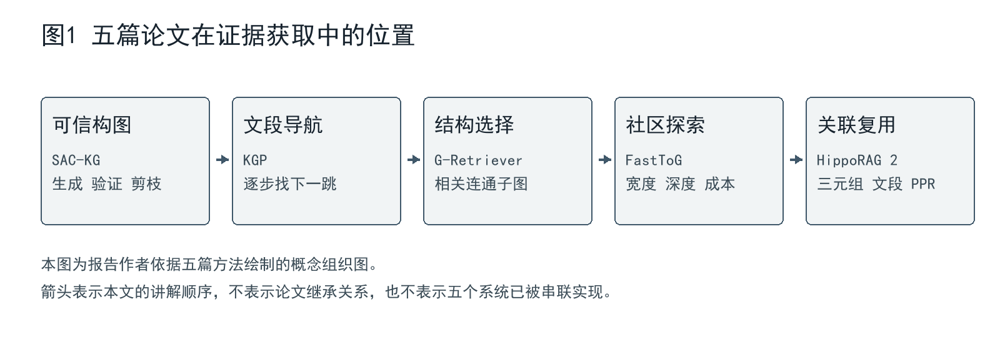
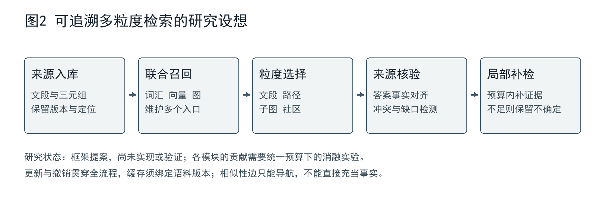

# 面向大语言模型的知识图谱构建、检索与推理技术研究

## 以 GraphRAG 与长期记忆为例

知识图谱课程报告　2026年11月

本文围绕 SAC-KG、KGP、G-Retriever、FastToG 与 HippoRAG 2 五篇论文展开。综述与研究设想为本报告的综合分析；各论文全文译稿另册列出。本文没有开展新的模型训练或对照实验，所引实验数字均为原论文结果，研究方案中的预期均作为待检验假设。

## 摘要

大语言模型能够理解和生成自然语言，但参数知识难以及时更新，独立检索文本片段又容易遗漏多跳问题中的桥接证据。知识图谱及其他带有语义关联的图结构，为组织、检索和复用外部知识提供了明确的关系载体。本文选取五篇研究，依次讨论领域知识图谱构建、跨文档证据遍历、连通子图检索、社区级推理和面向持续知识利用的关联检索。SAC-KG 通过生成、验证和剪枝控制构图质量；KGP 将文段和文档结构组织成图，并通过遍历代理逐步获取证据；G-Retriever 利用奖赏收集斯坦纳树选择紧凑的相关子图，并结合图编码与语言模型生成答案；FastToG 将探索单位从单个节点扩展到社区；HippoRAG 2 则把关系三元组与原始文段联合组织，以识别记忆和个性化 PageRank 支持关联检索。综合比较表明，图结构的价值取决于关系是否可靠、检索粒度是否适合问题以及证据能否被完整保留。基于这些观察，本文提出来源可追溯、粒度可调节的证据检索框架，并给出统一预算下的基线、消融和评价方案。该框架的有效性尚待实验验证。

关键词：知识图谱；检索增强生成；多跳问答；连通子图；社区检索；长期记忆

## 一 研究背景与问题定义

### 1.1 从参数知识到外部证据

语言模型的参数可以压缩大量训练知识，但难以单独保证答案所依据的事实仍然有效，也不能自然地给出每个事实的出处。检索增强生成将外部材料作为回答条件，使知识更新不必总是依赖参数训练。然而，相关文段与完整证据并不等价。例如，回答“某位作者出生城市所在的行政区是什么”，需要同时连接“人物—出生城市”和“城市—行政区”两条关系。第一条证据与查询文本高度相似，第二条却可能只提及城市名称，独立相似度排序可能遗漏它。

图结构能够将这类连接预先存储下来，或在检索阶段显式搜索连接路径。其代价是增加构图、实体对齐、关系维护以及图搜索的成本。因此，本文不预设“加入图一定优于向量检索”，而考察图在什么任务、表示和预算下能够带来收益。

### 1.2 三种图不能混为一谈

经典知识图谱以实体为节点，以具有明确语义的关系为边，可写为三元组集合 K={(h,r,t)}。SAC-KG 与 FastToG 直接围绕此类结构工作。边“出生于”是事实性关系，原则上需要外部依据。

文段关系图把文段、页面或表格作为节点，边表示词汇关联、语义邻近或结构归属。KGP 中两个文段相连，并不意味着二者之间存在一个已被证实的现实世界关系。此类图主要服务于候选证据导航。

文本属性图为节点和边附加文本描述。G-Retriever 面向这一更一般的对象，其场景图、解释图和知识图谱任务不应统一描述为三元组抽取。HippoRAG 2 则把短语关系图与文段节点结合，建立关系传播与原始上下文之间的联系。[1–5]

### 1.3 本文的三个研究问题

RQ1 是图谱如何构建并控制错误，尤其是生成错误是否会在迭代扩展中传播。RQ2 是检索应以节点、路径、子图还是社区为单位，以及不同粒度如何影响完整性和成本。RQ3 是如何在跨次查询和语料更新中复用图结构，同时保存可追溯的原始证据。五篇论文构成围绕这些问题的逻辑组织，不代表它们之间存在直接继承关系。

## 二 文献范围与分析方法

本文固定使用仓库提交 aa2d7a8fbc6827f62ff6d633e38e5fa37ab93b56 中的五份 PDF，共100页。KGP 和 FastToG 以仓库作者版为翻译底本，其附录、图号和页码不以会议精简版替换。其余三篇同样以仓库文件为准。SHA-256、文件大小和逐页抽取结果保存在配套核验文件中。

| 文献 | 正式发表 | 底本页数 | 分析对象 | 核心定位 |
|---|---|---:|---|---|
| SAC-KG | ACL 2024 | 16 | 领域实体关系图 | 生成时控制图谱质量 |
| KGP | AAAI 2024 | 22 | 跨文档文段及结构图 | 证据导航 |
| G-Retriever | NeurIPS 2024 | 32 | 文本属性图 | 查询相关连通子图 |
| FastToG | AAAI 2025 | 11 | 既有知识图谱及局部社区 | 社区级多跳推理 |
| HippoRAG 2 | ICML 2025 | 19 | 短语关系与文段联合图 | 非参数知识持续利用 |

本文从输入、节点与边、离线处理、在线检索、生成条件、实验口径和局限七个维度进行定向比较。这是围绕固定五篇论文的技术综述，不声称覆盖整个 GraphRAG 领域。对于原文实验，先列明数据集、模型和指标，再在同一设置内计算差值，不把构图精度、答案准确率与文段召回率合并排名。

## 三 领域知识图谱构建 SAC-KG

### 3.1 构建任务与基本流程

SAC-KG 关注由领域语料自动构建专业知识图谱。系统从给定实体出发构建单层关系，再选择值得继续扩展的尾实体，逐层形成领域图谱。关键风险在于：输入中的领域外噪声会影响抽取，而一次错误的实体扩展又可能引出更多错误关系。[1，第3节，Figure 2]

Generator 包含领域语料检索与开放图谱检索。前者为当前实体选择相关领域上下文，后者从 DBpedia 中提供相关三元组作为知识提示。模型据此生成实体诱导的单层图。这里开放图谱起辅助作用，领域语料仍然是专业知识的重要依据；通用图谱覆盖不足可能影响提示质量。

Verifier 对输出执行数量、格式和冲突检查，并依据发现的错误类型提示语言模型纠正。规则检查能约束部分结构性错误，但规则通过不等于事实完全正确。对于涉及专业知识、语境限定和未收录事实的三元组，仍需原始材料支持。

Pruner 是基于 T5 的实体二分类模块，判断尾实体属于继续生长还是剪枝。其训练标签利用 DBpedia 中实体作为头实体或仅作为尾实体的分布构造。剪枝控制的不只是图规模，也影响后续生成方向。因此，剪枝过强可能减少覆盖，过弱则可能增加成本和领域漂移。

### 3.2 实验结果的正确解释

原文 Table 1 在相同领域语料下比较多种抽取系统。采用 ChatGPT 的 SAC-KG 构图 precision 为89.32%，domain specificity 为81.25%；PIVE 对应为64.48%和51.58%。前者精度高24.84个百分点。该表中的 Number of recalls 是作者定义的产出数量指标，不能直接改称标准召回率，也不能由此推导问答准确率。[1，Table 1]

Table 2 对提示、领域文本、验证器和剪枝器进行消融。它的意义在于区分生成输入、输出纠错和扩展控制的贡献，而非证明“只要有规则就消除幻觉”。随着迭代层数增加，更需要观察精度和领域相关性是否下降。原论文中规模超过百万节点的结果体现了系统扩展能力，节点规模本身不能替代事实正确性评估。

### 3.3 对本报告的启示与限制

SAC-KG 提供的是上游知识组织方法，不是完整的问答检索器。其对后续 RAG 的启示是，在知识进入长期索引之前就保留质量控制，并记录被修正、拒绝或剪枝的原因。本报告进一步提出为每个三元组增加出处和版本记录；这属于研究设计，不能写成 SAC-KG 已具备的原始功能。

## 四 跨文档证据导航 KGP

### 4.1 为什么以文段为节点

多文档问题既可能问事实内容，也可能要求比较页面或定位表格。只抽取实体三元组会损失文档顺序、结构和较长上下文。KGP 因此将文段作为主要节点，并在需要时加入页面、表格等结构节点。边可以根据共同实体、词汇相似性、嵌入相似性或文档结构建立。[2，Figure 3]

在这种表示中，邻居是“下一步值得阅读的候选证据”。它并不是“当前事实必然蕴含的下一条事实”。区分这两点，才能正确理解图遍历的能力与局限。

### 4.2 检索与推理交替

系统先选取种子文段，然后由图遍历代理根据问题及已收集证据形成下一步检索方向，再从当前邻居中寻找匹配文段。随着证据增加，下一跳目标可以调整。最终阅读模型利用收集的文段回答问题。[2，Figure 4，Algorithm 2]

KGP 比较了不同遍历模型，包括指令微调的 T5、LLaMA、MDR 和带示例的 ChatGPT。代理规模大并不自动保证表现更好，训练数据、目标任务和邻居表示都可能影响下一跳选择。还应区分“用于构图的编码器”和“用于图上导航的模型”，同一模型名称出现在两处时含义不同。

### 4.3 实验与图密度权衡

原文 Table 1 在2WikiMQA上报告 KGP-T5 的F1为53.50，MDR为52.44；在MuSiQue上分别为41.19与37.03。差值为1.06和4.16个百分点，只能用于该表相同设置的比较。IIRC上，KGP-T5的F1为41.54，低于MDR的43.47，因此不能概括成“所有数据集均最优”。PDFTriage另用结构问题指标 Struct-EM，KGP-T5为67.00，不能与答案F1直接混算。[2，Table 1]

图越稠密，候选邻居越丰富，但检索延迟与噪声也可能增加。原文对图密度和不同建图方法作了专门分析，并指出在HotpotQA上训练的MDR表示迁移到MuSiQue时可能受到分布变化影响。这说明导航性能受候选图质量约束：关键桥接文段没有成为可达邻居时，代理即使推理正确也难以检索到它。[2，第5.4节及补充第8.6节]

### 4.4 适用边界

KGP 适合需要保持原始文段、处理文档结构并逐步扩展证据的任务。其瓶颈是图密度、搜索宽度、代理误选和多轮调用成本。可见的检索路径能说明“系统读了什么”，但不能单凭路径证明最终答案的逻辑成立。

## 五 连通子图检索 G-Retriever

### 5.1 从独立相关项到相关结构

G-Retriever 面向一般文本属性图。它先为节点与边的文本建立索引，根据查询获得相关候选，再用奖赏收集斯坦纳树（Prize-Collecting Steiner Tree，PCST）选择子图。相较于独立选择若干最相似三元组，这一机制允许加入本身相似度不高、但连接关键证据的桥接节点或边。[3，第4节，Figure 3]

用便于说明的目标式表示，系统希望找到连通结构 S，使 J(S)=Σ[v∈V(S)]p(v)+Σ[e∈E(S)]p(e)−Σ[e∈E(S)]c(e) 较大。其中p表示与查询有关的奖赏，c表示纳入边的成本。该式用于说明奖赏与成本的权衡，不替代原文中的边奖赏变换及求解步骤。原文将边奖赏转化后交给PCST求解器处理。奖赏不是事实置信度，连通也不是充分的逻辑证明。

### 5.2 图编码与语言生成

检索结果有两种互补表示：子图文本被写入提示，子图结构经GNN编码并映射为语言模型可接收的软提示。训练时可保持语言模型冻结，仅调整相关编码和提示模块，也可采用LoRA调整模型。因而，其效果来自检索、结构表示与训练配置共同作用，不能把主实验全部提升都归因于PCST。

### 5.3 数值证据及其条件

附录D.1的Table 10固定k=5并使用llama2-7b-chat，在WebQSP上比较检索机制：PCST的Hit@1为66.17，Top-k triples为52.64，Top-k nodes加邻居为49.82，最短路径为55.20。PCST相对Top-k triples高13.53个百分点。这是该设置下的机制对照，不是与FastToG或HippoRAG 2的跨论文排名。[3，Table 10]

主文Table 3中，冻结LLM并进行提示调优的G-Retriever在WebQSP上为70.49±1.21，采用LoRA的版本为73.79±0.70；它们与附录检索对比表的配置不同，不能把66.17和73.79写成同一配置下的重复实验。

Table 4报告WebQSP检索前后平均文本token由100627降至610，节点由1371降至18，每轮训练时间由18.7分钟降至6.2分钟。这是该实验中的文本量、图规模和训练效率数据，不等于端到端在线响应时间降低同样比例。[3，Table 4]

### 5.4 对多粒度检索的意义

PCST为“多选相关项”和“保持证据连接”提供了共同优化视角。实际使用仍需考虑候选召回率、奖赏标定和成本参数。当相关证据在图上天然断开时，强制连通也可能引入无关桥接结构。图是否完整、所选子图是否能支撑答案，都需要额外验证。

## 六 社区级推理 FastToG

### 6.1 为什么把社区作为探索单位

逐节点扩展的图推理可能在每一跳都调用语言模型，并被高连接度节点产生的大量候选拖慢。FastToG采用局部社区搜索，将相互联系紧密的一组实体作为一次探索单元，以获得更宽的局部信息并减少达到关键证据所需的轮数。[4，Figure 1和Figure 2]

系统在当前实体周围搜索局部图，执行社区检测，再通过模块度相关的粗剪枝减少候选社区，随后使用LLM进行与问题相关的细剪枝。粗剪枝主要利用图结构，细剪枝主要利用问题语义，二者解决的筛选问题不同。

### 6.2 社区内容如何进入推理

Triple2Text直接将社区三元组组织成文本，Graph2Text通过生成模型把图转换为更自然的说明。系统在获得社区信息后判断是否已有足够证据；若没有，则选择下一步探索实体，继续形成推理链。Graph2Text压缩了结构表达，也可能改变事实、遗漏限定或引入幻觉。因此，更流畅的社区摘要不一定带来更准确的答案。

### 6.3 实验中的收益和代价

原文使用CWQ、WebQSP、QALD、ZSRE、T-REx和Creak六个数据集。Table 1的gpt-4o-mini设置下，WebQSP中Graph2Text版本准确率为65.8%，Triple2Text版本为65.2%；QALD中两者分别为55.9%与56.1%。Graph2Text并非在所有数据集都更好。[4，Table 1]

Table 2另用llama-3-70b，不能把两个表的数值当作同一次实验。本文也不把Creak等事实判断任务的高准确率解释为跨数据集的推理难度优势。

作者改变社区最大规模并检查平均搜索深度和准确率。更大的社区可能降低轮数，同时带来更多噪声；原文观察到最大规模为8时准确率可能下降。这意味着“更宽”与“更准”之间需要预算和任务约束。平均深度只反映部分效率，完整评估还应包括社区检测、图到文本和语言模型输入长度。

### 6.4 结构偏好与查询需求的冲突

社区检测倾向于发现内部紧密的结构，而多跳问题可能恰好依赖跨社区的稀疏边。于是，模块度高的社区不一定是问题所需的社区。保留跨社区桥接边、允许回退到节点或路径搜索，是本报告研究设想中的补充措施；这些仍需消融检验。

## 七 图结构支持长期知识利用 HippoRAG 2

### 7.1 非参数持续学习的含义

HippoRAG 2通过外部知识索引吸收新增材料，强调在不更新模型参数的条件下持续使用知识。这里的长期记忆是对外部语料的持久组织与检索，不应直接等同于完整的个人记忆管理、偏好学习或无限长度的对话记忆。[5，第1至3节]

### 7.2 离线图与在线检索

离线阶段用OpenIE抽取三元组，建立短语节点之间的关系和同义连接，同时加入原始文段节点。文段连接使关系网络可以回到保留完整上下文的材料，缓解仅存储简短三元组导致的信息丢失。[5，Figure 2]

在线阶段把查询与三元组及文段匹配，用识别记忆筛选相关三元组。识别记忆在此是让LLM从候选中判断相关项，不是任意生成新的事实。随后依据三元组相似度和文段相似度确定种子与重启权重，通过PPR在联合图上传播，按文段节点得分返回材料。

对于列随机转移矩阵P，可用r=αs+(1−α)Pr说明PPR，其中s是归一化重启分布，α是重启概率。某些实现使用转置矩阵或把α定义为继续游走概率，比较实现前需核对约定。PPR得分表达图关联强弱，不等于事实真值或答案置信度。

原文附录G说明：短语种子最多保留5个，文段节点则广泛参与种子初始化，并通过权重调节与短语种子的影响。识别记忆返回空列表时回退到向量文段检索。因此，系统没有把纯图搜索视为所有问题的唯一入口。

### 7.3 实验与消融

原文Table 2使用Llama-3.3-70B-Instruct作为问答阅读器。HippoRAG 2在MuSiQue上的F1为48.6，NV-Embed-v2为45.7；2Wiki上分别为71.0和61.5。该表还包含简单问答与篇章理解任务。各数据集不同，不能只报告平均值而省略能力差异。[5，Table 2]

Table 4评价的是文段Recall@5。完整系统在MuSiQue、2Wiki、HotpotQA上的均值为87.1；去掉文段节点为81.0，去掉过滤为86.4。于是，在这一均值上文段节点带来6.1个百分点的差异，过滤带来0.7个百分点的差异。过滤在2Wiki上的完整系统值90.4还略低于不加过滤的90.7。消融说明组件效应存在任务差异，不能把识别记忆描述成任何设置下都显著改善。[5，Table 4]

### 7.4 仍然需要解决的更新问题

图索引可被重复利用，但更新不只是追加节点。旧事实失效、矛盾证据、同名短语合并和删除请求都会改变图传播。论文的持续语料实验支持其非参数知识利用思路，不能据此直接推断系统已解决所有动态一致性与遗忘问题。

## 八 五篇论文的横向比较

### 8.1 统一技术维度

| 维度 | SAC-KG | KGP | G-Retriever | FastToG | HippoRAG 2 |
|---|---|---|---|---|---|
| 主要输入 | 领域文本与开放KG | 多文档材料 | 文本属性图及查询 | KG及查询 | 文段语料及查询 |
| 节点 | 实体 | 文段 页面 表格 | 带文本属性节点 | 实体及局部社区 | 短语与文段 |
| 边含义 | 实体语义关系 | 相似性或结构联系 | 图任务已有关系 | KG语义关系 | 三元组 同义 文段关联 |
| 主要粒度 | 实体逐层构建 | 文段路径 | 连通子图 | 社区链 | 图传播后文段排序 |
| 在线语义选择 | 非主要任务 | 遍历代理 | 嵌入相关性与子图优化 | LLM社区细剪枝 | 三元组识别过滤 |
| 原始上下文 | 生成输入 | 节点文本 | 属性文本 | 取决于KG及转述 | 显式文段节点 |
| 主要失败风险 | 错误扩展 | 错连或漏连 | 候选缺失与成本失配 | 桥接损失与摘要幻觉 | 过滤误差与传播偏差 |

### 8.2 构建质量如何影响检索

生成图中的错误关系与文段图中的错误相似边，其后果不同。前者可能直接作为事实进入回答；后者通常首先影响导航，只有在阅读器误读文段时才形成错误结论。因此，评估图质量需要分别考察事实精度、边的导航效用和文段覆盖率。

构图高精度也不能保证检索高召回。一个非常保守的图可能删除关键桥接关系。反之，一个较稠密的文段图虽然包含噪声，却可能借助语义代理找到完整路径。合理目标是在可接受的错误与预算约束下提高支持证据覆盖，而不是单独追求某一个图指标。

### 8.3 四种检索机制的实际差别

路径遍历适合逐步形成下一跳目标，但较早的误选会影响后续候选。连通子图优化通过一次结构选择保留多个相关区域及其桥接信息，但需要合适的相关性奖赏和成本。社区搜索一次提供局部丰富上下文，但可能掩盖跨社区关系。PPR把多处种子信号通过图传播融合，能够提高关联召回，却需要控制泛化过度和高连接度节点偏置。

四者并不互斥，也不能简单理解为从低级到高级的序列。对于单事实问题，直接文段检索可能更经济；对于明确关系链，路径或子图可能更合适；对于主题聚合，社区信息更有价值。需要由问题、图结构和证据缺口共同决定粒度。

### 8.4 可解释性和可追溯性

图可以展示节点、边和访问路径，但解释仍可能是事后组织。较强的可追溯要求是：每个答案事实能定位到原始材料；每条使用的关系保留出处；变换、过滤和摘要的过程有记录；存在不足或冲突时能明确提示。本文因此将“可展示图”与“有充分来源支撑”分开评价。

### 8.5 不建立跨论文排行榜

SAC-KG的89.32%是构图precision；KGP含答案F1和结构EM；G-Retriever含图任务准确率与WebQSP的Hit@1；FastToG报告不同问答或判断数据集上的准确率；HippoRAG 2分别评价问答F1与文段召回。即使都使用WebQSP，不同底图、样本划分、基础模型和检索预算也会改变结果。本文只在原论文的同表配置中比较数值。

## 九 个人研究设想 可追溯的多粒度证据检索

### 9.1 场景与待检验假设

本文设想一个面向科研资料阅读与RAG代理的检索系统。用户问题可能只需定位一个结论，也可能需要跨论文比较实验设置，或者在多份资料中连接人物、方法和数据集。系统应返回可核对的证据及答案，同时控制检索开销。此处是拟开展的研究设计，不代表本人已经实现或获得实验增益。

H1：同时保留原文段与带出处三元组，在相同上下文预算下，有助于提高多跳支持证据召回。H2：依据查询需求与证据缺口选择粒度，比固定社区或固定路径策略具有更好的成本与质量权衡。H3：答案事实与来源之间的核验和局部补检，可以减少无来源断言，但可能增加调用成本。三项均允许实验否定。

### 9.2 证据图的数据结构

将事实关系与导航关系分别标明类型。实体或短语节点保留规范名和别名；文段节点保留文档标识、版本、页码或字符区间、原文及内容哈希；三元组边连接对应文段出处。相似性边只用于导航，不能直接作为事实引用。社区是可重新计算的检索组织层，其摘要必须能回到成员文段。

事实记录可以表示为(h,r,t,source,span,version,status)。status至少区分候选、核验、争议与失效。模型给出的置信分数保留为辅助字段，不直接解释为概率。对矛盾材料保存多个有来源的断言，并记录时间条件，避免用简单覆盖破坏历史依据。

### 9.3 查询自适应流程

第一步，使用词汇与向量检索同时召回文段和候选三元组，避免实体图覆盖不足时完全失去入口。第二步，依据问题类型、候选分散程度和实体数量，选择以文段、路径、连通子图或社区为主的检索方式。初期使用可解释规则，只有在数据充分时再训练路由器。

第三步，在选定粒度内扩展证据。需要桥接关系时允许跨社区边；若只需单个事实则优先使用最少的直接证据。第四步，生成带文段编号的答案，将每个可核验的事实与支持材料对齐。第五步，如果出现缺少来源、材料冲突或桥接不完整，则按缺口局部补检；达到预算仍不足时给出不确定结论。

建议将优化目标写为在token与调用预算内最大化支持证据覆盖，同时惩罚冗余、无来源关系与冲突。各项需要在开发集标定。不同路由都必须使用相同的总体预算上限，防止自适应方法仅因读取更多材料而获得优势。

### 9.4 可执行的实验设计

| 实验要素 | 设计 |
|---|---|
| 主要任务 | 先在MuSiQue与2Wiki多跳问答验证，再扩展到可公开的科研资料集 |
| 公平控制 | 同一语料 同一阅读模型 同一嵌入模型 同一上下文上限 |
| 文本基线 | BM25 向量RAG 词汇与向量混合检索 |
| 图检索基线 | 固定路径 固定PCST 固定社区 固定PPR |
| 上界与参照 | 支持证据可得时使用黄金证据输入，并报告其假设 |
| 主要指标 | 答案EM/F1 支持文段Recall@k 证据充分率 引用支持率 |
| 成本指标 | 索引token 索引时间 单查询token 调用次数 延迟P50/P95 |
| 诊断分组 | 单跳与多跳 跨社区与社区内 新增事实与冲突事实 |

证据充分率按“检索集合是否覆盖所有已标注支持文段”定义。引用支持率按“带引用的答案事实中，被对应来源支持的比例”定义，采用预先写好的标注准则，由人工抽样复核。召回率高不表示生成答案忠实，因此两者分开报告。对于标注不全的数据，额外可接受证据需独立判定，不能把所有未标注文段自动记为错误。

### 9.5 消融与统计分析

依次移除出处约束、文段节点、自适应路由、跨社区桥接与答案后补检；每次只改变一个因素。设置一个相同预算下随机路由的对照，以判断路由是否具有实际选择能力。再加入可控比例的错误关系、断裂桥接和失效事实，检查系统是否能回退及降低不可靠引用。

报告多次随机种子的均值与变化；若生成成本限制重复次数，应明确次数。主要成对比较可使用查询级配对bootstrap估计差值置信区间，并同时报告效应大小。人工来源审核报告抽样规模、标注分歧和裁定方式。调参仅使用开发集，测试集保持独立。

### 9.6 持续复用与拓展

新增文档只处理新增或变化的文段，并更新关联边；删除来源时同时撤销依赖该来源且无其他依据的事实。查询缓存必须绑定语料版本，避免在知识更新后返回旧答案。与HippoRAG 2的非参数持续利用思路相呼应，本设计将图作为外部可更新索引；其更新效率和一致性仍需测量。

未来可考虑通过Complementary RL研究检索经验与策略选择如何协同改善，但本报告不引入第六篇核心论文，也不将强化学习收益写作既成事实。

## 十 结论

五篇论文分别说明了图增强系统中的不同环节。SAC-KG强调知识进入图谱时的质量控制；KGP强调原始文段之间的导航；G-Retriever强调相关性与连接结构的共同选择；FastToG强调社区粒度与搜索成本；HippoRAG 2强调关系传播与原始上下文的联合组织。它们的共同启示是：图的作用需要落实到具体证据获取过程，图规模或结构复杂度本身不能证明系统更可靠。

本文提出将可靠构图、可调检索粒度和来源核验组合起来，在统一预算下评价支持证据、答案质量与成本。该研究设想的主要价值是形成可检验的问题，而非预先承诺优于所有基线。后续工作应首先验证图是否补齐了文本检索遗漏的桥接证据，再评价复杂检索机制的额外成本是否合理。

## 参考文献

[1] Chen H, Shen X, Lv Q, et al. SAC-KG: Exploiting Large Language Models as Skilled Automatic Constructors for Domain Knowledge Graphs. ACL 2024, pp. 4345–4360. https://aclanthology.org/2024.acl-long.238/

[2] Wang Y, Lipka N, Rossi R A, et al. Knowledge Graph Prompting for Multi-Document Question Answering. AAAI 2024. DOI: 10.1609/aaai.v38i17.29889. https://ojs.aaai.org/index.php/AAAI/article/view/29889 （翻译使用仓库22页作者版。）

[3] He X, Tian Y, Sun Y, et al. G-Retriever: Retrieval-Augmented Generation for Textual Graph Understanding and Question Answering. NeurIPS 2024. https://proceedings.neurips.cc/paper_files/paper/2024/hash/efaf1c9726648c8ba363a5c927440529-Abstract.html

[4] Liang X, Gu Z. Fast Think-on-Graph: Wider, Deeper and Faster Reasoning of Large Language Model on Knowledge Graph. AAAI 2025. DOI: 10.1609/aaai.v39i23.34635. https://ojs.aaai.org/index.php/AAAI/article/view/34635 （翻译使用仓库11页作者版。）

[5] Jiménez Gutiérrez B, Shu Y, Qi W, et al. From RAG to Memory: Non-Parametric Continual Learning for Large Language Models. ICML 2025, PMLR 267. https://proceedings.mlr.press/v267/gutierrez25a.html

## 附录A 统一术语

| 英文 | 统一中文 | 本报告中的含义 |
|---|---|---|
| knowledge graph | 知识图谱 | 实体与语义关系构成的知识组织 |
| passage | 文段 | 可作为完整检索和引用单位的原始文本 |
| textual graph | 文本属性图 | 节点或边带有文本属性的图 |
| graph traversal | 图遍历 | 沿候选边逐步访问证据节点 |
| subgraph | 子图 | 从原图选取的节点和边 |
| community | 社区 | 结构上联系较密集的一组节点 |
| pruning | 剪枝 | 排除不适合继续探索的候选 |
| PCST | 奖赏收集斯坦纳树 | 平衡相关性奖赏与连接成本的结构选择 |
| personalized PageRank | 个性化PageRank | 带查询相关重启分布的图传播排序 |
| recognition memory | 识别记忆 | 对候选三元组进行查询相关性识别 |
| provenance | 来源溯源 | 保存事实与原始材料及版本的对应 |
| precision | 精确率 | 预测或生成结果中正确项的比例 |
| recall | 召回率 | 目标相关项中被找回的比例 |

## 附录B 阅读与引用定位

SAC-KG：方法看Figure 2和第3节，构建评价看Table 1，模块消融看Table 2。KGP：图构建看Figure 3，代理看Figure 4，问答与代理对照看Table 1–2，作者版第8节包含补充实现、复杂度和提示。G-Retriever：整体框架看Figure 3，性能与效率看Table 3–4，PCST检索对照看附录D.1与Table 10。FastToG：整体流程看Figure 2，双模型六数据集对照看Table 1–2，社区大小与剪枝看Figure 3–5，算法见附录。HippoRAG 2：流程看Figure 2，答案与检索分别看Table 2–3，消融看Table 4，种子分布细节见附录G。
