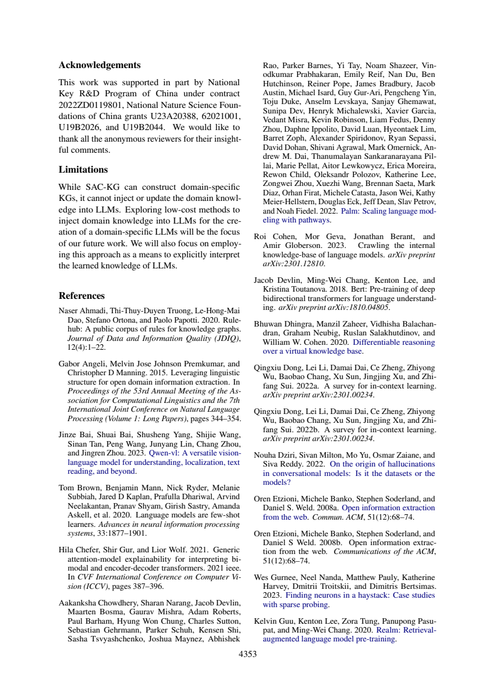
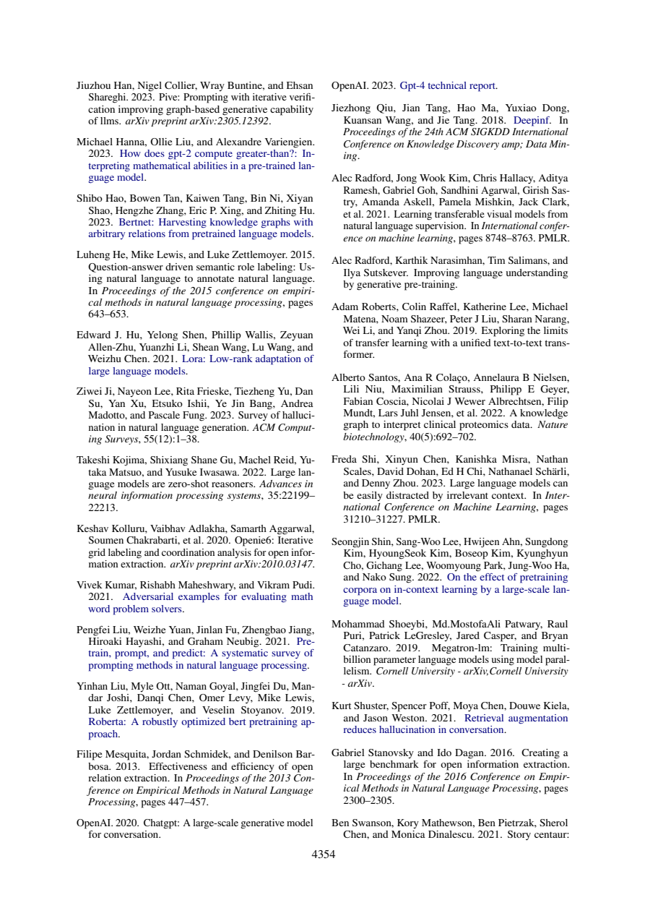
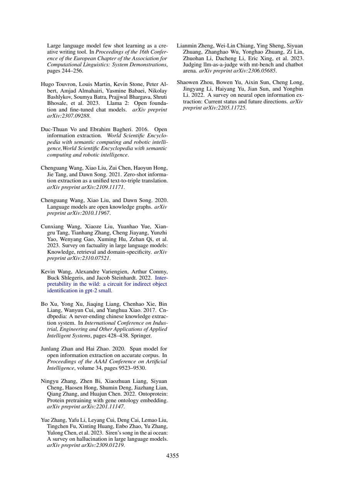
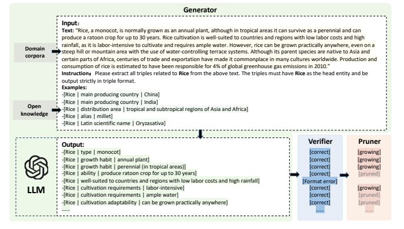
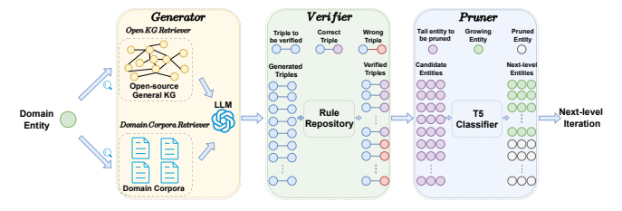
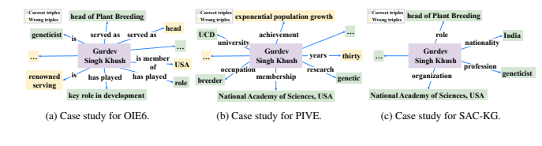
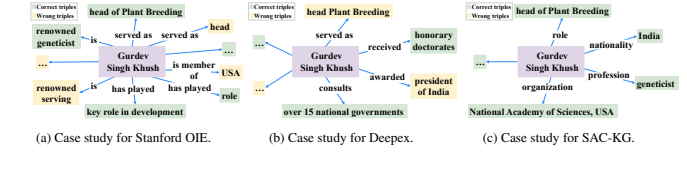
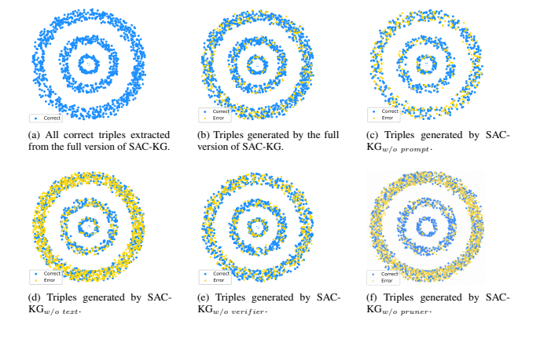
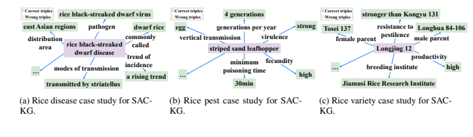

# SAC-KG 全文中文译稿

**原题** SAC-KG: Exploiting Large Language Models as Skilled Automatic Constructors for Domain Knowledge Graphs

**中文题名** SAC-KG：利用大语言模型作为领域知识图谱的熟练自动构建者

**作者** Hanzhu Chen、Xu Shen、Qitan Lv、Jie Wang、Xiaoqi Ni、Jieping Ye。中国科学技术大学 GIPAS 技术重点实验室与脑启发智能感知及认知教育部重点实验室；阿里云。通讯作者 Jie Wang。Hanzhu Chen 在阿里云实习期间完成本工作。

**底本** 仓库 `01_SAC-KG_ACL2024.pdf`，ACL 2024 长文，第 4345—4360 页。以下保留原节号、图表号；各页原版影像用于核对原图、数值和英文参考文献。图内英文保留原样，图注及读图术语另译。译文未对原文内部表述不一致之处擅自修正。

<!-- source-page: 1 -->

## 摘要

知识图谱在专业领域中需要大量知识的任务里发挥关键作用，这类任务对知识的准确性和可靠性要求很高。然而，现有图谱构建方法严重依赖人工干预才能得到合格的知识图谱，因而难以应用于真实场景。为解决这一挑战，我们提出通用知识图谱构建框架 SAC-KG，利用大语言模型充当领域知识图谱的熟练自动构建者。SAC-KG 有效地让大语言模型担任领域专家，生成专业、准确的多层知识图谱。它由生成器、验证器和剪枝器三个组件组成。对于给定实体，生成器从原始领域语料生成关系和尾实体，构成专业的单层图谱。随后，验证器和剪枝器通过纠正生成错误、判断新生成尾实体是否需要继续迭代生成下一层图谱，共同保证精度。实验表明，SAC-KG 能自动构建超过一百万个节点的领域图谱，精度达到 89.32%；相较现有最先进的图谱构建方法，其精度指标提升超过 20%。

## 1 引言

知识图谱是事实三元组的集合，以结构化形式表达人的知识，即（头实体，关系，尾实体）。近年来，知识图谱成功应用于医学（Santos et al., 2022）、生物学（Zhang et al., 2022）、社交网络（Qiu et al., 2018）等领域。然而，构建领域图谱需要大量专业知识和人工干预，严重限制了实际应用。

为应对这一挑战，研究者已广泛研究知识图谱构建任务（Angeli et al., 2015; Etzioni et al., 2008a）。传统方法主要根据语义模式学习逻辑规则；基于规则的方法利用词汇和语义角色标签提取主语—谓语—宾语三元组（Zhan and Zhao, 2020）。近期，基于大语言模型的方法成为新趋势，其表现超过基于规则的方法（Wang et al., 2021; Han et al., 2023）。这些方法利用模型内部储存的先验知识，从原始语料提取三元组。大量工作表明，这些方法更富创造性（Swanson et al., 2021），也更容易被人理解（Chefer et al., 2021）。

尽管具有诸多优点，基于大语言模型的方法仍面临两项严重妨碍性能与部署的挑战。第一，输入存在上下文噪声。现有方法直接从原始上下文提取三元组，而原始上下文中有大量无关领域信息，可能分散模型注意力，降低性能（Shi et al., 2023; Kumar et al., 2021）。第二，输出存在知识幻觉，即模型生成的内容不合常理，或不忠于给定来源（Zhang et al., 2023; Ji et al., 2023）。

在领域图谱构建中，上下文噪声与知识幻觉可能使模型生成无关或错误的三元组。这些错误还可能传播到下一轮迭代，严重影响最终图谱的可信度。

<!-- source-page: 2 -->

**图 1 SAC-KG 框架的输入输出示例。** 输入由文本、指令、示例三部分组成。文本部分从领域语料检索与给定实体最相关的内容；指令要求模型生成对应三元组；示例部分从开源百科知识图谱检索模板三元组。输出包含生成的正确三元组，以及剪枝器给出的“继续生长”或“剪除”标记。

图中输入文本译文：水稻是单子叶植物，通常作为一年生植物栽培，但在热带地区可作为多年生植物存活，并能够连续产生再生稻长达 30 年。水稻栽培劳动密集且需要充足水分，适合劳动力成本较低、降水量较高的国家和地区。不过，利用能够控制水分的梯田系统，即便陡峭山坡或山区也几乎都可种植。尽管其亲本物种原产亚洲及非洲部分地区，几个世纪的贸易与出口使其在世界各地文化中普遍存在。据估计，2010 年稻米生产和消费造成的温室气体排放占全球的 4%。

指令译文：请从上述文本提取所有与水稻相关的三元组。三元组必须以水稻为头实体，严格按三元组格式输出。示例包括（水稻，主要生产国，中国）、（水稻，主要生产国，印度）、（水稻，分布地区，亚洲和非洲热带及亚热带地区）、（水稻，别名，millet）、（水稻，拉丁学名，Oryza sativa）。图1输出逐项如下，所有条目的头实体均为水稻（Rice）；标签保留作者原判定。

|图1输出|验证器标签|剪枝器标签|
|---|---|---|
|[水稻，类型，单子叶植物]|正确|继续生长|
|[水稻，生长习性，一年生植物]|正确|继续生长|
|[水稻，生长习性，多年生植物（在热带地区）]|正确|继续生长|
|[水稻，能力，产生再生稻长达30年]|正确|剪除|
|[水稻，适合劳动力成本较低且降水量较高的国家和地区]|格式错误|无标签|
|[水稻，栽培要求，劳动密集]|正确|继续生长|
|[水稻，栽培要求，充足水分]|正确|剪除|
|[水稻，栽培适应性，几乎任何地方均可种植]|正确|剪除|
|……|……|……|

格式错误一行在原图中只有头实体与一个文本槽，未满足三元组格式，译文保持其缺槽状态。图内标签：Generator生成器，Verifier验证器，Pruner剪枝器，Domain corpora领域语料，Open knowledge开放知识，Input输入，Text文本，Instruction指令，Examples示例，Output输出，LLM大语言模型，correct正确，Format error格式错误，growing继续生长，pruned剪除。示例中的millet意为粟／小米；它作为原图给出的别名照录，不据此认定水稻与粟在生物学上相同。

因此，本文试图回答：能否提出自动、专业且准确的通用知识图谱构建框架？为此，我们明确研究上述两项挑战，提出 SAC-KG：让模型充当领域专家，利用实体诱导的树搜索算法，自动迭代构建领域图谱。框架包含三个组件。

生成器使用领域语料检索器，从原始领域语料中检索最相关的专业上下文；同时使用开放知识检索器，从开源百科知识图谱 DBpedia（Xu et al., 2017）中检索与实体最相关的三元组。两类信息合并后输入模型。生成器可以消除领域无关信息，生成专业的单层实体诱导图谱。

验证器使用错误检测过程，通过 RuleHub 中的规则标准识别并输出错误类型。RuleHub 包含从开放图谱挖掘的 7000 余条标准（Ahmadi et al., 2020）。随后，验证器根据错误类型重新提示模型以纠正错误。它可减轻错误三元组传播，提高当前层图谱的精度。

剪枝器以在 DBpedia（Xu et al., 2017）上微调的 T5 模型（Roberts et al., 2019）作为二分类器。它接收各生成三元组的尾实体，判断是否需要下一层生成。剪枝器决定生成方向，进一步提高下一层构建精度。

SAC-KG 是高度自动、专业和准确的通用图谱构建框架。实验表明，它能自动构建超过一百万节点的领域图谱，达到 89.32% 的精度，显著超过现有方法，精度指标提升超过 20%。

## 2 相关工作

**开放信息抽取。** 开放信息抽取（OIE）支持从大型语料发现不依赖领域的关系事实（Zhou et al., 2022）。

<!-- source-page: 3 -->

**图 2 SAC-KG 总体框架。** SAC-KG 将生成器、验证器和剪枝器有机整合为自动构建领域图谱的统一框架。给定实体，系统迭代生成单层实体诱导图谱。每轮中被标为“继续生长”的实体集合（剪枝器中绿色实体）成为下一轮生成器的输入。图内术语：待验证三元组、正确三元组、错误三元组、待剪枝尾实体、继续生长实体、剪除实体；生成三元组、验证后三元组、候选实体、下一层实体；开源通用图谱、领域语料、规则库、T5 分类器、下一层迭代。图中 Open KG Retriever 为“开放知识图谱检索器”，Domain Corpora Retriever 为“领域语料检索器”，Domain Entity 为“领域实体”，Q 为查询符号；Generator／Verifier／Pruner 分别为生成器／验证器／剪枝器。

TextRunner（Etzioni et al., 2008b）是首个 OIE 模型，它合并实体相同的元组，并依据预定义规则规范化关系。之后，Stanford OIE（Angeli et al., 2015）提出有效的新方法：利用分类器提取自包含子句，通过自然逻辑推理确定具体论元，成为从文本提取通用知识的常用方法。OIE6 提出迭代网格标注架构（Kolluru et al., 2020），进一步提升抽取质量。更近的研究直接用大语言模型从输入上下文生成三元组（Wang et al., 2020; Cohen et al., 2023）。DeepEx（Wang et al., 2021）利用微调后预训练语言模型的注意力矩阵提取三元组；PIVE（Han et al., 2023）对模型进行提示，并迭代补充额外三元组。然而，现有基于模型的方法受到上下文噪声和知识幻觉影响，难以生成高质量三元组。

**上下文学习。** 上下文学习（ICL）让模型仅根据包含少量示例的上下文进行预测，已成为自然语言处理的新范式（Liu et al., 2021）。随着模型和训练语料规模扩大（Brown et al., 2020），大语言模型展现出从含少量训练样例的提示中学习的能力（Dong et al., 2022a; Kojima et al., 2022）。有监督学习需要在训练阶段反向传播以更新参数；ICL 无需更新参数，而是直接预测。ICL 通过类比，使模型利用示例完成预测（Dong et al., 2022b）。把上下文与提示拼接后，模型学习示例中隐含模式，并在下游任务表现良好（Kojima et al., 2022）。

## 3 方法

我们提出通用框架 SAC-KG，将大语言模型作为领域图谱的熟练自动构建者（相关工作见附录 A）。给定领域语料，总体任务是自动、准确、可控地提取三元组。框架将生成器、验证器和剪枝器统一用于知识图谱构建，见图 2。

### 3.1 生成器

对于指定实体，通常是领域名称或该领域随机选择的一组名词，生成器利用领域语料检索器检索最相关的原始上下文，并利用开放知识检索器从 DBpedia（Xu et al., 2017）检索最相关三元组。生成器采用上下文学习，因此无需训练参数、无需监督、完全自动。检索器也帮助确保生成质量。

#### 3.1.1 领域语料检索器

大语言模型经常受到严重知识幻觉限制，生成内容可能偏离事实知识（Dziri et al., 2022; Shuster et al., 2021），影响领域图谱的可靠性及实际应用。为准确增强模型的知识，我们提出领域语料检索器。

<!-- source-page: 4 -->

给定实体，先将领域语料切分成句子，按实体出现频率对相关句子排序，再将句子拼为文本列表。最后按与实体的相关程度降序排列，拼接为固定长度文本，输入模型。

#### 3.1.2 开放知识图谱检索器

若输入只有领域语料和简单指令，模型输出通常难以控制，甚至三元组格式也会错误。为此，我们采用上下文学习（Shin et al., 2022），从 DBpedia（Xu et al., 2017）检索与实体最相关三元组作为示例，鼓励正确格式、增强可控性。策略如下：对于开放图谱已有实体，提供其作为头实体的相关三元组，最多 10 条；对于图谱没有的实体，先分词，再检索最相关三元组，例如 micropropagation 若未找到，则拆为 micro 和 propagation 后再次检索；分词后仍无法匹配的实体，随机选取 10 条图谱三元组作为提示。随后将相关上下文、三元组提示和指令拼接输入模型，得到生成器抽取的三元组。

### 3.2 验证器

尽管生成器改善了输出质量，三元组仍可能出错。验证器进一步识别和过滤错误，以提高最终图谱质量。它基于规则、无须训练参数，可高效完成错误检测和纠正，具体包含两个步骤。

使用 RuleHub（Ahmadi et al., 2020）中从开放图谱挖掘的既有标准识别错误、输出类型，流程如下。① 数量检查：三元组数量少于阈值（默认为 3）时，归为“数量不足”。② 格式检查：不符合示例格式时归为“格式错误”；头实体不匹配指定实体时归为“头实体错误”；头尾相同时归为“头尾冲突”。③ 冲突检查：对每条三元组利用 RuleHub（Ahmadi et al., 2020）全面检查冲突，例如人的出生时间必须早于死亡时间，年龄不得为负数。系统依次执行数量、格式、冲突检查，输出错误类型信息。

纠错时，先用检测步骤确定错误类型并给出相应提示，再重新提示模型生成修正输出。例如“格式错误”的提示为：“请严格按照格式要求重新生成，并注意示例三元组的格式。”错误类型与提示详见附录 B。

**表 1 相同领域语料上的领域图谱评价。** 原表的 Number of recalls 译为“召回数量”，不是标准召回率；精度和领域特异性以原表数值保留。

|骨干|模型|召回数量|精度|领域特异性|
|---|---|---:|---:|---:|
|规则|OpenIE6 (2020)|1.94|42.05|31.96|
|规则|Stanford OIE (2023)|2.12|45.94|31.24|
|BERT|DeepEx (2021)|1.64|48.28|34.76|
|ChatGPT|PIVE (2023)|5.08|64.48|51.58|
|Qwen 7B|SAC-KG|3.85|69.89|57.90|
|Llama 2 7B|SAC-KG|2.73|54.39|40.59|
|Llama 2 13B|SAC-KG|4.15|69.40|65.13|
|ChatGPT|SAC-KG|8.09|89.32|81.25|

<!-- source-page: 5 -->

### 3.3 剪枝器

经过验证器后，获得当前层正确三元组，再生成下一层。但并非所有三元组都需要继续。例如（水稻，最适生长温度，20—25 摄氏度）是正确的，但尾实体“20—25 摄氏度”不需要作为下一层头实体继续生成。

为增强图谱可控性，我们提出在 DBpedia 上微调的 T5 二分类剪枝器。输入是每条正确三元组的尾实体，输出“继续生长”或“剪除”，表示该实体应继续生成下一层，还是停止扩展。具体而言，将实体文本输入 T5，生成对应标签。训练数据从 DBpedia 收集：选头实体子集作为“继续生长”类别；再选等量尾实体，排除与头实体列表重合者，作为“剪除”类别。微调时，以实体文本为输入，对应标签为目标。

最终，利用领域语料为输入实体生成单层图谱，再加入新生成的一层。SAC-KG 据此生成多个三元组并持续迭代，以生成三元组中的头实体为根，建立图谱子树。该过程类似树逐层生长，也类似由浅入深检索和访问领域知识。此外，SAC-KG 无须监督，任何拥有大量非结构化文本的领域都可应用，无需标注数据。

译注：此处“无监督、无需标注数据”为作者对领域构建流程的表述；剪枝器仍利用DBpedia的头／尾实体角色自动形成二分类标签，并进行T5微调。不可将其理解为框架中所有组件均无需训练。

**表 2 SAC-KG 构建前三层图谱的消融实验。** 每次迭代新增一层；“—”表示第一轮前尚未应用剪枝器。各列依次为召回数量、精度、领域特异性。

|轮次|配置|召回数量|精度|领域特异性|
|---|---|---:|---:|---:|
|1|去掉示例提示|10.15|80.64|74.19|
|1|去掉领域文本|11.27|81.48|71.80|
|1|去掉验证器|13.05|76.47|69.88|
|1|去掉剪枝器|—|—|—|
|1|完整模型|13.50|88.81|80.50|
|2|去掉示例提示|4.13|77.35|71.16|
|2|去掉领域文本|7.52|63.24|52.23|
|2|去掉验证器|8.43|77.06|70.41|
|2|去掉剪枝器|2.30|73.33|70.42|
|2|完整模型|9.94|84.61|76.27|
|3|去掉示例提示|3.22|61.53|56.61|
|3|去掉领域文本|5.84|38.41|31.59|
|3|去掉验证器|4.83|58.53|52.29|
|3|去掉剪枝器|1.32|44.82|39.65|
|3|完整模型|6.63|76.74|68.60|

## 4 实验

我们设计实验评价 SAC-KG 的有效性，并深入分析所构建的领域图谱。实验包括五部分：与现有最先进方法比较领域图谱构建效果；评价 GPT-4 与人工判断的一致性；消融各组件；分析构建图谱的案例；在既有开放 OIE 基准上评价效果。

<!-- source-page: 6 -->

### 4.1 数据集与实验设置

首先，从专业书籍、网页和系谱数据收集水稻领域原始文本，共 70 本专业书、1522 个网页、24000 条系谱记录，详见附录 H。语料结构多样、文本质量不一，能够模拟其他领域原始语料的常见情况。

从开源图谱检索领域实体作为根节点，从领域语料获取相应文本；每个节点最多检索 500 token。在相同输入文本上比较各基线的三元组抽取效果，指标如下。

**精度。** 同时采用人工和自动评价，后者更易扩展。遵循 Vicuna（Zheng et al., 2023），用 GPT-4（OpenAI, 2023）担任自动评审；将抽取三元组和对应文本输入 GPT-4，评价每条三元组是否正确。

**召回。** 因无法得到每段领域文本对应的完整真实三元组，不能估计召回率。因此报告每段文本通过验证的三元组平均数量，即不提供分母的召回数，称为“召回数量”。与已有研究相同（Vo and Bagheri, 2016; Kolluru et al., 2020），这符合无法取得全部准确事实的真实场景；惯例因此只报告生成事实的数量。它反映领域语料被有效抽取和利用的程度。

**领域特异性。** 我们希望三元组正确、与领域相关，并且不同于开源百科图谱中的现有三元组。受已有综述（Wang et al., 2023）启发，目标是构建具有更高领域专业性的大规模图谱。因此定义同时满足正确、领域相关、不存在于开放百科图谱这三个条件的生成三元组比例：

$$
\mathrm{DomainSpecificity}=\frac{|T_{\mathrm{generated,domain,correct}}\setminus T_{\mathrm{openKG}}|}{|T_{\mathrm{generated}}|}.
$$

其中 T_generated 是生成三元组集合；T_generated,domain,correct 是其中领域相关且正确的三元组子集；T_openKG 是开放百科图谱中的三元组集合。集合差表示去除已有知识，竖线表示集合基数。该指标旨在鼓励模型从领域语料总结、凝练专业知识，而非仅依赖开放图谱。

生成器温度为 0.1，最大序列长度 2000 token。剪枝器采用 LoRA（Hu et al., 2021）高效微调 T5（Roberts et al., 2019），训练 2 个 epoch，批大小 64，学习率 0.001。更多细节见附录 E。

译注：正文4.1节分别报告“每节点检索最多500 token”与“最大序列长度2000 token”；附录E则报告“最大输入长度500 token”与“检索文本最大长度2000 token”。原文未进一步解释这些上限如何同时满足或对应哪些实际阶段。本译稿分别保留原值，不据此自行设定统一的输入预算。

**表 3 不同实体类别的案例结果。** 对类别内实体的单层图谱评价，报告平均结果。

|类别|模型|召回数量|精度|领域特异性|
|---|---|---:|---:|---:|
|水稻品种|OpenIE6|1.90|31.65|24.05|
|水稻品种|Stanford OIE|2.33|39.28|26.71|
|水稻品种|DeepEx|3.04|60.37|43.47|
|水稻品种|PIVE|2.57|54.48|43.58|
|水稻品种|SAC-KG ChatGPT|13.11|84.28|76.88|
|水稻专家|OpenIE6|7.75|50.40|38.30|
|水稻专家|Stanford OIE|4.25|43.03|29.26|
|水稻专家|DeepEx|1.50|47.36|34.01|
|水稻专家|PIVE|2.00|55.17|44.14|
|水稻专家|SAC-KG ChatGPT|3.88|93.33|84.43|

### 4.2 主要结果

本研究使用 OpenIE6（Kolluru et al., 2020）、Stanford OIE（Angeli et al., 2015）、DeepEx（Wang et al., 2021）、PIVE（Han et al., 2023）四个基线。

<!-- source-page: 7 -->

OpenIE6 与 Stanford OIE 代表基于规则的先进抽取方法，后者使用 2023 年 9 月更新版本。DeepEx 代表结合 BERT（Devlin et al., 2018）与规则的抽取方法；PIVE 直接利用 ChatGPT（OpenAI, 2020）构建图谱。

为全面评价，我们使用多种大语言模型骨干，主要使用表现优异、被广泛用于研究的 ChatGPT（OpenAI, 2020）；同时选择 Qwen 7B、Llama 2 7B、Llama 2 13B（Bai et al., 2023; Touvron et al., 2023），说明方法在较小参数模型上的有效性。

表 1 表明 SAC-KG 持续优于既有图谱构建方法。OIE6、Stanford OIE 通过词汇和语义角色标签抽取三元组，在精度和领域特异性上较弱；它们还倾向抽取信息量不足的三元组，造成召回虚高（详见 4.5 节）。DeepEx 与 PIVE 有所改善，但仍不理想。ChatGPT 骨干达到 89.32% 精度与 81.25% 领域特异性，进一步说明从开放领域语料直接构建图谱的有效性。

**图 3 OIE6、PIVE 与 SAC-KG 的水稻专家案例可视化。** 绿色实体表示正确三元组，黄色表示错误三元组。

**图3内文字逐项对照。** 三个子图的中心实体 Gurdev Singh Khush 保留姓名；省略号“…”仍表示原图省略内容。图例 Correct triples 为“正确三元组”，Wrong triples 为“错误三元组”。原图实体与关系的颜色、连接和正误判断按作者图保留，以下对照不纠正其错误三元组。

|子图|原图文字|中文对照|
|---|---|---|
|(a) OIE6|Case study for OIE6|OIE6案例研究|
|(a) OIE6|head of Plant Breeding|植物育种部门负责人|
|(a) OIE6|geneticist|遗传学家|
|(a) OIE6|head|负责人|
|(a) OIE6|USA|美国|
|(a) OIE6|renowned serving|著名的任职〔原图词组〕|
|(a) OIE6|key role in development|在发展中的关键作用|
|(a) OIE6|role|作用|
|(a) OIE6|is|是|
|(a) OIE6|served as|曾担任|
|(a) OIE6|is member of|是……的成员|
|(a) OIE6|has played|发挥过|
|(b) PIVE|Case study for PIVE|PIVE案例研究|
|(b) PIVE|UCD|UCD〔保留原图缩写〕|
|(b) PIVE|exponential population growth|人口指数增长|
|(b) PIVE|thirty|三十|
|(b) PIVE|genetic|遗传的〔原图词形〕|
|(b) PIVE|breeder|育种家|
|(b) PIVE|National Academy of Sciences, USA|美国国家科学院|
|(b) PIVE|university|大学|
|(b) PIVE|achievement|成就|
|(b) PIVE|years|年数|
|(b) PIVE|research|研究|
|(b) PIVE|occupation|职业|
|(b) PIVE|membership|成员身份|
|(c) SAC-KG|Case study for SAC-KG|SAC-KG案例研究|
|(c) SAC-KG|head of Plant Breeding|植物育种部门负责人|
|(c) SAC-KG|India|印度|
|(c) SAC-KG|geneticist|遗传学家|
|(c) SAC-KG|National Academy of Sciences, USA|美国国家科学院|
|(c) SAC-KG|role|职务|
|(c) SAC-KG|nationality|国籍|
|(c) SAC-KG|profession|职业|
|(c) SAC-KG|organization|组织|

### 4.3 一致性评价

为验证 GPT-4 自动评价的有效性，我们进行人工评价。20 名志愿者包括 5 名博士、7 名博士生、8 名硕士生，具有知识图谱与水稻背景。每份问卷含 100 对“文本—三元组列表”，即模型输入文本及对应输出。志愿者判断正确性，将三元组判错时还需说明原因，如与文本不一致、格式错误或其他。

为提高可信度，我们以人工评价为真实标签，报告精度、召回率、F1 与平均精度等统计。表 4 显示两者接近：精度 0.906 表明 GPT-4 可识别多数正例；召回率 0.951 表明可覆盖多数真实正例；F1 为 0.928，进一步表明评价稳健。Cohen κ 超过 0.6，说明中高程度一致。总体统计说明 GPT-4 评价有效可靠，更多细节见附录 C。

**表 4 GPT-4 与人工评价统计。** 精度 0.906；召回率 0.951；F1 0.928；Cohen κ 0.613。

译注：本节把人工判断作为标签，测量GPT-4对三元组正误的判断与人工是否一致。表4的precision、recall与F1因此属于评审分类的一致性评价，不是表1图谱构建任务的三项指标，也不是问答指标。正文提及“平均精度”，但表4没有单独列出该值；本译稿不补造数据。正文列20名志愿者，而附录C另称若干水稻研究博士生参与；两处按原文分别保留。

### 4.4 消融实验

为研究各组件贡献，对整个框架进行系列消融，每轮计算指标以获得细粒度结果。去掉开放图谱检索器、领域语料检索器、验证器、剪枝器的变体分别记为 w/o prompt、w/o text、w/o verifier、w/o pruner。

<!-- source-page: 8 -->

表 2 显示，缺少任何组件都会使性能下降。尤其剪枝器和开放图谱检索器影响更大，它们分别控制生成方向和提供示例，说明增强构建过程可控性的重要性。

### 4.5 案例研究

我们以水稻品种和水稻专家为例，分析 SAC-KG 与基线所构图谱的差异；更多案例见附录 F。表 3 显示每轮 SAC-KG 的精度与领域特异性均良好。水稻专家案例中，规则方法召回更高，但精度和领域特异性不佳，可能因为其对人名更敏感（Kolluru et al., 2020）。SAC-KG 的召回虽较低，但精度和专业性更高。

图 3 可视化三个单层图谱。规则方法 OIE6 仅依靠词汇句法分析，容易产生信息量有限的冗余三元组。PIVE 抽取更有信息量的三元组，但仍受无关文本噪声影响，例如错误地抽取（Gurdev Singh Khush，成就，人口指数增长）。SAC-KG 抽取数量更少，但可理解性与领域信息量更高。今后将研究特定案例下如何提高召回，以充分利用领域语料。

### 4.6 OIE 基准结果

为进一步验证有效性与通用性，遵循 DeepEx（Wang et al., 2021）的设置与评价方法，在 OIE2016（Stanovsky and Dagan, 2016）、NYT、WEB（Mesquita et al., 2013）、PENN（Radford et al., 2021）开放基准上实验，采用传统 AUC 与 F1，数据集详见附录 G。

表 5 显示 SAC-KG 同样超过既有先进方法，说明其有效性与泛化能力。它大幅优于 OpenIE6、Stanford OIE；相对 DeepEx 和 PIVE 也持续最优，说明有效性和稳健性，并验证在传统 OIE 任务中的作用。

**表 5 OIE 数据集的 F1 与 AUC。**

|模型|OIE2016 F1|AUC|WEB F1|AUC|NYT F1|AUC|PENN F1|AUC|
|---|---:|---:|---:|---:|---:|---:|---:|---:|
|OpenIE6|55.3|61.1|61.1|64.9|30.7|55.2|54.2|63.1|
|Stanford OIE|59.3|65.1|63.3|69.3|31.1|56.9|56.8|67.1|
|DeepEx|72.6|58.6|91.2|82.4|85.5|72.5|88.5|81.5|
|PIVE|70.4|71.1|89.8|86.0|83.5|77.9|86.0|81.2|
|SAC-KG ChatGPT|74.7|73.2|96.6|95.7|88.8|87.3|91.1|90.1|

## 5 结论

本文提出自动领域图谱构建框架 SAC-KG，直接从领域语料有效构建图谱。它让模型担任领域专家，以实体诱导树搜索迭代构建多层图谱。生成器、验证器和剪枝器共同形成自动、准确、可控的通用框架。SAC-KG 构建超过一百万节点的领域图谱，精度 89.32%，精度指标提升超过 20%。相对现有最先进方法的表现证明了框架有效。

<!-- source-page: 9 -->

## 致谢

本研究部分得到国家重点研发计划 2022ZD0119801，以及国家自然科学基金 U23A20388、62021001、U19B2026、U19B2044 支持。感谢匿名评审的有益意见。

## 局限性

SAC-KG 能构建领域图谱，但无法把领域知识注入或更新到大语言模型中。今后将探索低成本知识注入，以创建领域专用模型，并研究通过该方法显式解释模型学到的知识。

## 参考文献

按要求保留英文原文，见以下原页。第 9 页上方的致谢与局限性已在上文翻译。

<!-- source-page: 10 -->

<!-- source-page: 11 -->

<!-- source-page: 12 -->

## 附录 A 更多相关工作

**语言模型。** GPT（Radford et al.；原文此处未列年份）、BERT（Devlin et al., 2018）、RoBERTa（Liu et al., 2019）、Megatron-LM（Shoeybi et al., 2019）引发自然语言处理学习范式转变：模型先在大量无标注文本上，以语言建模目标预训练，再在下游任务微调。近期，ChatGPT（OpenAI, 2020）、PaLM（Chowdhery et al., 2022）等大语言模型在少样本乃至零样本场景表现优异（Brown et al., 2020）。为增强可解释性，一些工作进行归因分析（Wang et al., 2022; Hanna et al., 2023; Gurnee et al., 2023）；另一类工作显式检索模型中的知识作为解释基础，包括推理（Shi et al., 2023）和问答任务（Hao et al., 2023; Dhingra et al., 2020; Guu et al., 2020）。

## 附录 B 错误类型与提示细节

本方法根据检测模块输出的错误类型纠错。为提高推理效率，若某类错误三元组数量超过预设阈值（默认 3），验证器把表 6 中相应提示与原模型输入合并，要求重新生成；若数量低于阈值，则直接删除标记三元组，不再重新生成。

译注：附录此处只明确“大于”和“小于”阈值的处理，没有定义错误条目数量恰好等于3时的分支；它也不同于3.2节“三元组总数少于3”的数量不足检查。译稿保留二者，不能把两个阈值判断合并为同一规则。

## 附录 C 一致性评价更多细节

我们邀请具有水稻研究专长的博士生参加人工评价。通过人工检查维基百科等高可信网页来源，验证每条生成事实的精度，并提供初始正误示例。每条三元组最短评价时间设为 5 秒；10 条三元组的一组样本需花 50 秒，方可进入下一组。文本中出现的三元组实体和关系会被高亮。

遵循 Vicuna（Zheng et al., 2023），报告一致性以说明自动评价合理性。表 7 比较同一图谱的不同评价：GPT-4 指正文自动评价；Author 指作者评价；Human 指领域专家评价；Human-M 指人工多数票。表 8 报告不同评审类型间的一致性，即对三元组正误判断相同的概率。

选择具有图谱和水稻背景的志愿者，是因为其基础领域知识有助于更准确地评价专业图谱质量；志愿者来自多所大学和研究机构，以增强客观性。

## 附录 D 消融研究可视化

图 5 可视化每种消融变体生成的前三层图谱。完整框架总体最佳，各层错误三元组数量差异不大，表明迭代构建中错误传播不明显。相反，w/o text 和 w/o pruner 出现错误传播，第三层错误明显增多；w/o prompt 和 w/o verifier 抽取三元组更少，说明缺少示例与纠错时，模型难以总结领域语料知识。这进一步证明各组件的贡献。

## 附录 E 实验设置细节

所有大语言模型温度设为 0.1；温度越低，输出越稳定。最大输入长度设为 500 token，表示每次响应输入模型的最大 token 数为 500。检索文本最大长度为 2000，表示领域语料检索器返回文本最多 2000 token。剪枝器采用 LoRA（Hu et al., 2021）在开放图谱上高效微调 T5（Roberts et al., 2019），训练 2 轮、批大小 64、学习率 0.001；并从开放图谱随机抽取 120 个领域相关实体作为根节点输入生成器。

<!-- source-page: 13 -->

**表 6 错误类型与对应提示。**

|错误类型|提示译文|
|---|---|
|一般冲突|请严格按照要求重新生成。|
|数量不足|请严格按照要求重新生成，并注意生成足够数量的三元组。|
|头实体错误|请严格按照要求重新生成，并注意头实体必须为 xx。|
|格式错误|请严格按照格式要求重新生成，并注意示例三元组的格式。|
|头尾冲突|请严格按照格式和要求重新生成，并注意头实体与尾实体通常不应相同。|

**图 4 Stanford OIE、DeepEx 和 SAC-KG 的水稻专家案例。** 绿色实体表示正确三元组，黄色表示错误三元组。

**图4内文字逐项对照。** 各子图中心 Gurdev Singh Khush 保留姓名，“…”为原图省略号；Correct triples／Wrong triples 分别为正确三元组／错误三元组。原图用词按原样对应，不将图内错误三元组修正成事实。

|子图|原图文字|中文对照|
|---|---|---|
|(a) Stanford OIE|Case study for Stanford OIE|Stanford OIE案例研究|
|(a) Stanford OIE|head of Plant Breeding|植物育种部门负责人|
|(a) Stanford OIE|renowned geneticist|著名遗传学家|
|(a) Stanford OIE|head|负责人|
|(a) Stanford OIE|USA|美国|
|(a) Stanford OIE|renowned serving|著名的任职〔原图词组〕|
|(a) Stanford OIE|key role in development|在发展中的关键作用|
|(a) Stanford OIE|role|作用|
|(a) Stanford OIE|is|是|
|(a) Stanford OIE|served as|曾担任|
|(a) Stanford OIE|is member of|是……的成员|
|(a) Stanford OIE|has played|发挥过|
|(b) DeepEx|Case study for Deepex|DeepEx案例研究|
|(b) DeepEx|head Plant Breeding|负责人／植物育种〔保留原图省略介词的词组〕|
|(b) DeepEx|honorary doctorates|荣誉博士学位|
|(b) DeepEx|president of India|印度总统|
|(b) DeepEx|over 15 national governments|超过15个国家的政府|
|(b) DeepEx|served as|曾担任|
|(b) DeepEx|received|获得|
|(b) DeepEx|awarded|授予|
|(b) DeepEx|consults|提供咨询|
|(c) SAC-KG|Case study for SAC-KG|SAC-KG案例研究|
|(c) SAC-KG|head of Plant Breeding|植物育种部门负责人|
|(c) SAC-KG|India|印度|
|(c) SAC-KG|geneticist|遗传学家|
|(c) SAC-KG|National Academy of Sciences, USA|美国国家科学院|
|(c) SAC-KG|role|职务|
|(c) SAC-KG|nationality|国籍|
|(c) SAC-KG|profession|职业|
|(c) SAC-KG|organization|组织|

**表 7 不同评审对同一图谱的结果。**

|评审|召回数量|精度|领域特异性|
|---|---:|---:|---:|
|GPT-4|8.09|89.32|88.31|
|作者|7.88|87.09|86.85|
|人工|7.80|86.15|85.96|
|人工多数票|7.93|87.55|87.35|

**译注：原文数据差异。** 表1中 ChatGPT 骨干 SAC-KG 的领域特异性为81.25，表7中 GPT-4 评审行的领域特异性为88.31。原文将表7说明为对同一生成图谱采用不同评审方式的结果，但未解释这一差异。本译稿分别保留各表原值，不将其擅自统一。

**表 8 不同评审间的一致性。**

|评审对|一致性|
|---|---:|
|GPT-4 与作者|86.65|
|GPT-4 与人工|84.78|
|GPT-4 与人工多数票|87.11|
|作者与人工|82.67|
|作者与人工多数票|89.69|
|人工与人工多数票|92.97|

## 附录 F 更多案例结果

图 4 展示 4.5 节水稻专家案例中 Stanford OIE 与 DeepEx 的可视化。SAC-KG 表现更好，生成更准确且体现领域信息的三元组。

表 10 提供更多案例；在水稻病害、害虫和品种中，SAC-KG 在三项指标上也明显优于所有提及的基线，说明有效性。图 6 进一步可视化三个案例，生成的单层图谱准确且易于理解。

**表 9 OIE 基准统计。**

|数据集|领域|句数|训练三元组|开发三元组|测试三元组|
|---|---|---:|---:|---:|---:|
|OIE2016|新闻、维基|3200|5078|1673|1730|
|WEB|新闻、网页|500|—|—|461|
|NYT|新闻、维基|222|—|—|150|
|PENN|混合|100|—|—|52|

<!-- source-page: 14 -->

**图 5 完整 SAC-KG 与消融变体生成前三层图谱的可视化。** 同心圆半径表示生成层级；蓝色节点表示正确三元组，黄色节点表示错误三元组。各子图依次为：(a) 完整模型抽取的全部正确三元组；(b) 完整模型全部三元组；(c) 去掉示例；(d) 去掉文本；(e) 去掉验证器；(f) 去掉剪枝器。图中Correct=正确，Error=错误，w/o prompt=去掉示例提示，w/o text=去掉领域文本，w/o verifier=去掉验证器，w/o pruner=去掉剪枝器。

## 附录 G OIE 基准细节

OIE2016（Stanovsky and Dagan, 2016）来自新闻与维基百科，由 QA-SRL（He et al., 2015）自动转换得到。另纳入 NYT、WEB（Mesquita et al., 2013）与 PENN（Radford et al., 2021）。基准统计见表 9。

## 附录 H 科研材料

所收集领域数据均公开、可在线查看。数据所有者注明允许科研使用，或未注明禁止科研使用；收集过程也遵守规定。数据不含个人唯一身份标识或冒犯内容。

具体收集过程为：用关键词 rice 在 Google 搜索领域书籍并下载 70 本；以相同关键词搜索网页，采集 1522 页文本；从水稻系谱数据库收集 24000 条系谱数据，包含各类水稻及其亲本信息。随后简单清理，去除 HTML 标签、图片、表格和无意义特殊字符。

## 附录 I 关于 SAC-KG 的更多讨论

### I.1 未检索到相关三元组时随机返回一组三元组，会否损害性能或准确率

答：不会。实验发现三元组提示越相关，提示效果越强。无法检索到相关三元组时，随机返回或返回固定集合（两者效果相同）仍优于完全不返回三元组。

### I.2 经过验证器后仍有错误三元组，是否说明未检测出来

答：为提高推理效率，当前验证器使用规则检查格式和冲突，仅在发现错误时重新提示模型。

<!-- source-page: 15 -->

大量实验证明，领域文本与三元组提示降低了事实错误出现的概率，例如（美国，首都，纽约），大多数错误集中于格式或冲突。未来可以探索让模型自主验证，但这会显著增加推理计算成本。

### I.3 输入剪枝器的三元组是否全部正确

答：未必。前置验证器在维持效率的同时尽力确保正确性，但三元组是否正确不会显著影响后续生成；尾实体质量才主要决定后续生成质量，与该三元组本身正误无关。因此剪枝器的目标是消除低质量尾实体。

### I.4 为什么用 DBpedia 训练的剪枝器能在水稻领域取得好效果

答：判断实体能否作为头实体，无需广泛的领域专门知识，主要学习头尾实体的模式差异。DBpedia 也包含水稻基础名词。例如“糯稻”“稻瘟病”“33 英亩”“集中灌溉 3—4 天”“缺氮肥”等尾实体中，很容易判断前两个能够作为头实体，因为它们对应有意义的独立对象。

### I.5 开放图谱是否包含领域实体

答：DBpedia 等开放图谱包含水稻领域基础名词，如基本品种、病虫害和种植方法，但可能不含更专门术语。因此可先识别开放图谱中的常见领域实体，作为构建基础，再由 SAC-KG 引导从语料逐层增量抽取专业知识。

**图 6 SAC-KG 的水稻病害、害虫和品种案例可视化。** 绿色实体表示正确三元组。以下逐项翻译原图自然语言标签；不以外部知识擅改原图命名或作者判断。

|子图|原图文字|中文对照|
|---|---|---|
|共用图例|Correct triples|正确三元组|
|共用图例|Wrong triples|错误三元组|
|(a) 水稻病害|Rice disease case study for SAC-KG|SAC-KG水稻病害案例研究|
|(a) 水稻病害|rice black-streaked dwarf disease|水稻黑条矮缩病|
|(a) 水稻病害|rice black-streaked dwarf virus|水稻黑条矮缩病毒|
|(a) 水稻病害|east Asian regions|东亚地区|
|(a) 水稻病害|dwarf rice|矮稻〔按原图用词〕|
|(a) 水稻病害|a rising trend|上升趋势|
|(a) 水稻病害|transmitted by striatellus|由striatellus传播〔保留原图物种名部分〕|
|(a) 水稻病害|distribution area|分布地区|
|(a) 水稻病害|pathogen|病原体|
|(a) 水稻病害|commonly called|通常称为|
|(a) 水稻病害|trend of incidence|发病趋势|
|(a) 水稻病害|modes of transmission|传播方式|
|(b) 水稻害虫|Rice pest case study for SAC-KG|SAC-KG水稻害虫案例研究|
|(b) 水稻害虫|striped sand leafhopper|条纹沙叶蝉〔原图用名，按字面翻译〕|
|(b) 水稻害虫|egg|卵|
|(b) 水稻害虫|4 generations|4代|
|(b) 水稻害虫|strong|强|
|(b) 水稻害虫|high|高|
|(b) 水稻害虫|30min|30分钟|
|(b) 水稻害虫|vertical transmission|垂直传播|
|(b) 水稻害虫|generations per year|每年代数|
|(b) 水稻害虫|virulence|毒力|
|(b) 水稻害虫|fecundity|繁殖力|
|(b) 水稻害虫|minimum poisoning time|最短“中毒”时间〔按原图字面，原图未进一步界定〕|
|(c) 水稻品种|Rice variety case study for SAC-KG|SAC-KG水稻品种案例研究|
|(c) 水稻品种|Longjing 12|龙粳12|
|(c) 水稻品种|Tosei 137|Tosei 137〔保留品种标识〕|
|(c) 水稻品种|Longhua 84-106|Longhua 84-106〔保留品种标识〕|
|(c) 水稻品种|stronger than Kongyu 131|强于Kongyu 131〔保留比较品种标识〕|
|(c) 水稻品种|Jiamusi Rice Research Institute|佳木斯水稻研究所|
|(c) 水稻品种|high|高|
|(c) 水稻品种|female parent|母本|
|(c) 水稻品种|male parent|父本|
|(c) 水稻品种|resistance to pestilence|抗病性|
|(c) 水稻品种|productivity|产量|
|(c) 水稻品种|breeding institute|育种机构|

译注：原图(b)的英文名称及“minimum poisoning time”表述均按底本保留对应，不据此完成昆虫分类或传播机制的外部校订；各子图中的省略号仍代表原图省略内容。

<!-- source-page: 16 -->

**表 10 不同类别的更多案例结果。** 对类别内实体的单层图谱评估并报告平均值。列依次为召回数量、精度、领域特异性。

|类别|模型|召回数量|精度|领域特异性|
|---|---|---:|---:|---:|
|水稻品种|OpenIE6|1.90|31.65|24.05|
|水稻品种|Stanford OIE|2.33|39.28|26.71|
|水稻品种|DeepEx|3.04|60.37|43.47|
|水稻品种|PIVE|2.57|54.48|43.58|
|水稻品种|SAC-KG Qwen|4.15|69.89|61.05|
|水稻品种|SAC-KG Llama 2 7B|2.27|49.34|35.26|
|水稻品种|SAC-KG Llama 2 13B|3.60|59.79|55.96|
|水稻品种|SAC-KG ChatGPT|13.11|84.28|76.88|
|水稻病害|OpenIE6|2.77|41.66|31.67|
|水稻病害|Stanford OIE|3.44|57.40|39.03|
|水稻病害|DeepEx|1.66|45.45|35.45|
|水稻病害|PIVE|1.07|81.51|62.21|
|水稻病害|SAC-KG Qwen|3.55|94.11|82.82|
|水稻病害|SAC-KG Llama 7B|1.56|63.64|47.27|
|水稻病害|SAC-KG Llama 13B|5.44|80.32|75.53|
|水稻病害|SAC-KG ChatGPT|4.11|93.67|85.01|
|水稻害虫|OpenIE6|1.26|62.26|47.32|
|水稻害虫|Stanford OIE|2.11|64.70|44.00|
|水稻害虫|DeepEx|2.91|68.62|49.41|
|水稻害虫|PIVE|8.65|64.84|51.87|
|水稻害虫|SAC-KG Qwen|3.50|64.53|45.56|
|水稻害虫|SAC-KG Llama 2 7B|2.77|45.86|35.16|
|水稻害虫|SAC-KG Llama 2 13B|5.34|76.79|71.60|
|水稻害虫|SAC-KG ChatGPT|14.44|89.96|80.54|
|水稻农药|OpenIE6|1.90|48.83|37.11|
|水稻农药|Stanford OIE|2.09|60.52|41.15|
|水稻农药|DeepEx|2.5|45.45|32.72|
|水稻农药|PIVE|3.18|61.40|49.12|
|水稻农药|SAC-KG Qwen|3.0|80.48|70.82|
|水稻农药|SAC-KG Llama 7B|2.64|54.72|42.26|
|水稻农药|SAC-KG Llama 13B|2.54|62.22|55.46|
|水稻农药|SAC-KG ChatGPT|3.72|90.54|83.30|
|水稻专家|OpenIE6|7.75|50.40|38.30|
|水稻专家|Stanford OIE|4.25|43.03|29.26|
|水稻专家|DeepEx|1.50|47.36|34.01|
|水稻专家|PIVE|2.00|55.17|44.14|
|水稻专家|SAC-KG Qwen|2.50|66.66|55.25|
|水稻专家|SAC-KG Llama 2 7B|3.75|55.56|40.00|
|水稻专家|SAC-KG Llama 2 13B|2.62|75.00|70.32|
|水稻专家|SAC-KG ChatGPT|3.88|93.33|84.43|

## 原图

