# KGP 全文中文译稿

**原题** Knowledge Graph Prompting for Multi-Document Question Answering

**中文题名** 面向多文档问答的知识图谱提示

**作者** Yu Wang、Nedim Lipka、Ryan A. Rossi、Alexa Siu、Ruiyi Zhang、Tyler Derr。美国纳什维尔 Vanderbilt University；美国圣何塞 Adobe Research。

**作者联系信息（按原文保留）** Yu Wang与Tyler Derr隶属Vanderbilt University，其余作者隶属Adobe Research。电子邮件：yu.wang.1@vanderbilt.edu；lipka@adobe.com、ryrossi@adobe.com、asiu@adobe.com、ruizhang@adobe.com；tyler.derr@vanderbilt.edu。

**版权（原文）** Copyright © 2024, Association for the Advancement of Artificial Intelligence (www.aaai.org). All rights reserved.

**底本** 仓库 `02_KGP_AAAI2024.pdf`，22 页作者版，arXiv:2308.11730v3（2023 年 12 月 25 日）。遵循该版节号、图表号，正文和补充材料均译；英文参考文献及原图保留。原图内英文界面、节点文字保留，中文图注随文提供。各图保留原页影像以确保全部标注可核对。原文中数据集别名、预算及符号的不一致不擅自修正。

<!-- source-page: 1 -->

## 摘要

大语言模型的“预训练、提示、预测”范式在开放域问答取得显著成功，但很少有工作在多文档问答（MD-QA）中探索这一范式。多文档问答要求全面理解文档内容与结构之间的逻辑关联。为填补这一缺口，我们提出知识图谱提示（KGP），为提示模型进行多文档问答构造合适上下文。它包含图构建与图遍历模块。构建时，以文段或文档结构（页面、表格等）为节点，以文段语义/词汇相似性或文档结构关系为边；遍历时，设计基于大语言模型的图遍历智能体，在节点间导航，收集支持文段，辅助最终问答。图谱作为全局约束，规定文段间的转移空间、降低检索延迟；智能体则作为局部导航者，收集相关上下文，逐步接近问题并保证检索质量。大量实验表明 KGP 对多文档问答有效，揭示了利用图增强提示设计和检索增强生成的潜力。代码：https://github.com/YuWVandy/KG-LLM-MDQA。

## 1 引言

大语言模型推动“预训练、提示、预测”范式革新自然语言处理，在开放域问答、事实核查和算术推理等真实任务得到应用（Chen et al., 2017；Thorne et al., 2018；Asai et al., 2019；Karpukhin et al., 2020；Aly et al., 2021；Qin et al., 2023；Zou and Caragea, 2023；Liu, Dong, and Zhang, 2023）。然而，多文档问答中的这一范式尚缺少充分研究，尽管学术研究、客户支持、金融与法律咨询等场景往往需要从多个文档推导深入分析（Tessuto, 2011；Bolino, Long, and Turnley, 2016）。

为研究模型的能力，我们从 2WikiMQA（Ho et al., 2020）与 MuSiQue（Trivedi et al., 2022b）开发集随机抽取多文档问题，采用四种提示策略求解，设置见第 5 节。回答需要多个维基文档知识。图 1 显示，不提供上下文（None）时，2WikiMQA/MuSiQue 的 F1 仅为 25.07%/10.58%，EM 仅为 18.60%/4.60%；提供支持事实（Golden）后，F1 达 59.69%/47.75%，EM 达 40.20%/30.60%。支持事实指假定包含回答所需信息的文段。这说明单靠模型参数知识难以完成多文档问答。

传统开放域或单文档问答（Xu et al., 2020；Mathew, Karatzas, and Jawahar, 2021）通常检索依据上下文并据此回答，即“检索—阅读”（Zhu et al., 2021；Ju et al., 2022）。多文档问答的主要挑战却是跨文档交替检索和推理（Pereira et al., 2023；Caciularu et al., 2023）。例如，图 2(a)(b) 需要对两个文档（这里是维基页面）的不同文段推理。此外，文档本身由页面、章节、段落、表格、图片等多模态结构数据构成。

**图 1 使用不同策略检索上下文并提示 ChatGPT 的多文档问答表现。**

<!-- source-page: 2 -->

某些问题专门询问特定结构内容，因此必须理解复杂文档结构。例如图 2(c) 询问第 1 页与表 2 的差异，单靠 BM25 或 DPR（Karpukhin et al., 2020）等方法无法回答。大语言模型的出现又引入新复杂性。

对于跨文档交替推理与检索，既有多跳检索器（Xiong et al., 2020；Yavuz et al., 2022）通过根据已有文段顺序检索下一文段来模拟，但尚未充分利用大语言模型。较新研究（Trivedi et al., 2022a；Wei et al., 2022；Yao et al., 2023；Yao, Li, and Zhao, 2023）设计思维链、思维树、思维图等提示，逐步引导回答；然而反复调用非开源模型会带来高延迟和难以负担的成本。如何把不同文档结构融入提示，使模型理解，也仍是开放问题。

我们因此提出 KGP：以文段和文档结构为节点，以词汇/语义相似性和内部结构关系为边，构建文档图谱。基于大语言模型的遍历智能体交替生成下一证据（推理），再按证据从图中选择最有希望的邻居（检索）。通过指令微调提升智能体推理能力，减少反复调用非开源模型生成证据。针对多模态挑战，加入不同结构节点，以支持检索特定结构内容。

贡献如下。① 通用图构建：提出三种文档图谱构建方法，节点为文段/结构，边为词汇、语义或结构关系；通过邻域和支持事实的重叠评价图质量（图 5），补充表 5 比较既有与本文方法。② 利用图构造提示：设计 KGP，用智能体遍历图检索问题相关上下文，并微调智能体，使其根据已访问节点自适应访问最有希望的邻居。③ 案例验证：比较不同智能体（表 2）和不同文档数（图 7(c)），补充 8.7 节可视化多文档问答。

**图 2 三类需要在多文档文段、页面或表格间推理检索的常见问题。** (a) 桥接问题依赖顺序推理；(b) 比较问题依赖对不同文段并行推理；(c) 结构问题依赖提取对应文档结构的内容。

图内 (a)：问题“《辛普森一家》主题曲现行编曲者出生于哪一年？”S1：“主题曲在第二季重新编曲，由 Alf Clausen 制作的现行版本从第三季开始使用。”S2：“Alf Heiberg Clausen（1941 年 3 月 28 日出生）是美国影视作曲家。”答案：“1941 年 3 月 28 日”。路径为 Q→S1→S2→A。

图内 (b)：问题“Scott Derrickson 和 Ed Wood 国籍是否相同？”S1：“Scott Derrickson（1966 年 7 月 16 日出生）是美国导演、编剧、制片人。”S2：“Edward Davis Wood Jr.（1924 年 10 月 10 日—1978 年 12 月 10 日）是美国电影人、演员、作家、制片人、导演。”答案“是”。路径为两个文段并行汇合。

图内 (c)：问题“结合第 1 页和表 2 内容，可得何结论？”文段：“Harry Potter 虽有 Voldemort 的印记，但最终去了不同学院。”表格“人物—学院”：Tom Riddle（Voldemort）—Slytherin；Cho Chang—Ravenclaw。答案：“Harry Potter 没有去 Slytherin 学院。”结构路径从页节点 P1 到文段 S1，与表节点 T2 汇合。

## 2 符号

遵循 Tian et al.（2023a），令图谱 $G=(V,E)$ 从文档集合 $D$ 构建。节点集合 $V=\{v_i\}_{i=1}^{n}$ 表示文段、页面、表格等文档结构，边集 $E\subset V\times V$ 表示语义/词汇相似性及结构归属等连接。令 $X=\{X_i\}_{i=1}^{n}$ 为节点特征；$X_i$ 对应节点 $v_i$，形式可以是文段文本、表格 Markdown、页面页码。

<!-- source-page: 3 -->

## 3 知识图谱构建

既有成熟图谱（Hoffart et al., 2013；Tian et al., 2023b）通常将节点/边视为实体/关系，需要复杂关系抽取，限制了通用领域应用（Huang et al., 2021）；且主要面向维基百科，难以回答法律、金融等非维基问题。我们提出更通用的构建方法。

图 2(a)(b) 的两类问题都需推导不同文段逻辑关联。关联可由词汇相似性编码，如 Alf Clausen 连接图 2(a) 的 S1、S2；也可由语义相似性编码，如图 2(b) 的“国籍”和“美国导演”。因此以文段为节点、词汇/语义相似性为边。将文档切为文段，对每个 $S_i$ 加节点 $v_i$，特征 $X_i$ 为其文本，再按两两相似性加边。

**TF-IDF 图构建。** 对每份文档用 TF-IDF（Ramos et al., 2003）提取关键词，滤掉助动词和冠词等无意义词，同时降低词袋（BOW）维数、稀疏化图、提高遍历效率。因部分问题关注标题实体，也将文档标题加进关键词集合。收集全部文档关键词形成空间 $W$，两个文段只要共享 $W$ 中关键词就连边。

**KNN-ST/MDR 图构建。** 用句子 Transformer 等现成模型生成节点文段嵌入，计算两两相似度，构建 K 近邻图。现成模型通常训练任务与多文档问答关系不大，嵌入相似度未必捕获问题需要的逻辑关联。为解决此问题，遵循 MDR（Xiong et al., 2020），以根据已有支持事实预测下一支持事实的方式训练句子编码器，赋予其推理能力，使嵌入相似度和 KNN 图能够编码文段逻辑联系。

**TAGME。** 采用 TAGME（Min et al., 2019）从各文段抽取维基实体；两个文段共享维基实体时连边。

此外，通过Adobe Extract-PDF API抽取文档结构节点。原文脚注3为[Adobe PDF Extract API文档](https://developer.adobe.com/document-services/docs/overview/pdf-extract-api/)。本文仅加入页面和表格，但可扩展更多类型。表格特征为 Markdown（补充图 8 说明模型能理解），页面特征为页码，并向该页句子/表格节点加有向边。本文无意提出适合所有情况的统一构建法，而通过补充表 5 比较优缺点，为不同场景提供选择依据。

**图 3 图内术语。** Documents 文档，Golden 真实支持文档，Negative Samples 负样本文档，Split 切分，Passage 文段，Embedding 嵌入，KNN K 近邻，Keywords 关键词，Extraction 抽取，Bag-of-word 词袋，Extract API 抽取接口，Table (Markdown) 表格，Page (Pointer) 页面指针，Graph Construction 图构建，Passage Node 文段节点，Page Node 页面节点，Table Node 表节点，Structural Relation 结构关系，Common keyword or Passage Similarity 共同关键词或文段相似性。

**图 3 图构建。** 将文档切为文段，通过预训练编码器获取嵌入或提取关键词形成词袋，再按嵌入相似性或共享关键词连接。通过 Extract-PDF 抽取页面、表格作为结构节点；页面指向其中的文段和表格，表示归属。表格节点包含 Markdown 内容。

<!-- source-page: 4 -->

为检验图谱是否编码多文档问答所需信息，我们从 HotpotQA 随机抽题，对每题文档集建图，变化超参数控制稀疏度，测量 TF-IDF 初始种子文段邻居覆盖支持事实的程度。四种构建法与超参数详见 8.5 节。图 5 显示图越稠密，邻居命中支持事实概率越高（SF-EM 上升），冗余也越多（精度下降）。单个文段与其他文段共享的关键词远少于所有文档文段总数，因此 TF-IDF 图密度有上界，SF-EM 低于 0.7。TAGME 在一个文段识别的实体较多，图较稠密，起始 SF-EM 已约 0.95。KNN-MDR 在 HotpotQA 上预训练以预测下一支持事实（Xiong et al., 2020），因而比未经数据集专门预训练的 KNN-ST 有更好权衡。

高 SF-EM 表明多数问题支持事实被种子邻居完整覆盖，低精度却表示大多邻居与问题无关。盲目遍历会带来冗余上下文，损害问答能力（表 2 中 KGP-Random 表现较低也验证此点）。下一节提出智能体，自适应选择最有助于回答的邻居。

**图 4 图内文字对照。** 左侧结构问题：“第 1 页讲什么？”结构抽取→结构节点搜索；S1：“Alf Clausen 的现行编曲从第三季开始使用”；S2：“Clausen 于 1967 年搬到加州洛杉矶寻求电视配乐工作”；回答：“Alf Clausen 创作了现行编曲，并搬到洛杉矶”。右侧内容问题：“《辛普森一家》主题曲现行编曲者出生于哪一年？”种子搜索后 S1 为编曲事实，S4 为“Alf Heiberg Clausen（1941 年 3 月 28 日出生）是美国作曲家”，S2 为搬迁事实；模型推理生成“Alf Clausen（1941 年 4 月 16 日出生）是美国影视配乐作曲家，因《辛普森一家》配乐闻名”，再以 Match S4（匹配 S4）取原证据，答案“1941 年 3 月 28 日”。右上指令微调例为清单 1 第一例：给定现有证据，为回答问题还需什么证据；输入两本杂志创刊先后问题及 Arthur’s Magazine 事实，输出 First for Women 1989 年创刊事实。Reason 为推理，Generate 为生成，Fine-tune 为微调，Sentence Node 为句子节点，Common Keyword or Sentence Similarity 为共同关键词或句子相似性。

**图 4 基于模型的图遍历智能体。** 结构问题先抽取结构并检索内容：页面内容是其文段，表格内容为 Markdown。内容问题与已有上下文拼接，生成下一证据，再比较候选邻居与生成文段相似性，确定下一访问节点，并更新候选集合。

译注：此段原文提及“表2中的KGP-Random”，但底本表2列出的行名为TF-IDF、MDR、ChatGPT、LLaMA、T5，没有单列KGP-Random。这里保留作者表述，不把TF-IDF擅自视为随机遍历。

**图 5 HotpotQA 图质量。** 平均邻居数增加、图变稠密时，SF-EM 上升而精度下降。KNN-MDR 权衡优于 TF-IDF 和 KNN-ST；TAGME 图比其他图更稠密。

## 4 基于大语言模型的图遍历智能体

自适应遍历的一种自然办法是对候选节点（已访问节点的邻居）排序，决定下一访问对象。启发式模糊匹配或嵌入相似度不能捕获已有路径与下一节点间内在逻辑关系。因此微调大语言模型，根据已访问文段引导遍历，选择最有希望的下一文段，称为基于模型的图遍历智能体。

<!-- source-page: 5 -->

给定询问内容的问题 $q$，智能体在已访问节点/已检索文段 $\{s_k\}_{k=0}^{j}$ 上推理，按下式选择下一文段：

$$
s_{j+1}=\operatorname*{argmax}_{v\in\mathcal N_j}\phi\left(g(X_v),f\left(\Vert_{k=0}^{j}X_k\right)\right). \tag{1}
$$

其中连接符拼接此前检索文本。$f$ 可用 RoBERTa-base 等仅编码器模型（Asai et al., 2019；Xiong et al., 2020；Yavuz et al., 2022），此时 $g$ 为另一个编码器，$\phi$ 为嵌入内积；也可采用 T5 等编码器—解码器模型（Brown et al., 2020；Touvron et al., 2023），此时 $g$ 为恒等映射，$\phi$ 衡量文本相似性。为减少幻觉、增强推理（Wei et al., 2022；Ji et al., 2023），我们通过根据已有支持事实预测下一支持事实，对 $f$ 指令微调（Chung et al., 2022），结合预训练常识和微调推理能力。访问候选队列中式 (1) 最高分节点后，加入新节点邻居，更新候选队列，迭代到预算上限。

图 4 示例询问“《辛普森一家》主题曲现行编曲者出生于哪一年？”TF-IDF 初始化种子节点 1，文段为“Alf Heiberg Clausen（1941 年 3 月 28 日出生）是美国电影作曲家”。将问题置于已有上下文前，要求生成下一证据。经指令微调，模型预期能够理解逻辑关系，预测连贯但可能含事实错误的文段，例如“Alf Clausen（1941 年 4 月 16 日出生）是美国影视配乐作曲家”。为修正潜在错误，在邻居中选择与生成内容最匹配的节点 4，其中日期为 1941 年 3 月 28 日。由于该文段直接来自文档，作者认为它从来源上保证了信息的有效性。译注：这是原作者关于来源有效性的论述，并不意味着文档内容或最终答案必然正确。再以节点 1、4 作为上下文提示最终模型回答。

对于结构问题，抽取结构名称并定位对应结构节点。表格取 Markdown；页面遍历一跳邻居，取其所属文段。

**算法 1 基于模型的图遍历，为内容问题检索相关上下文。**

输入：文档集 $D$ 上问题 $q$，图 $G=\{V,E,X\}$，微调遍历器 $f_{GT}$，预算 $K$，TF-IDF 检索函数 $g$。

1. 初始化种子文段 $V_s=g(V,X,q)$。
2. 初始化路径队列 $P=[\{v_i\}\mid v_i\in V_s]$。
3. 初始化候选邻居队列 $C=[\mathcal N_i\mid v_i\in V_s]$。
4. 初始化计数 $k=\sum_{P_i\in P}|P_i|$。
5. 当 $P$ 与 $C$ 均非空时执行：
6. $P_i\leftarrow P.\mathrm{dequeue}()$，$C_i\leftarrow C.\mathrm{dequeue}()$。
7. 按式 (1) 计算 $V'_i=\mathrm{GraphTraversal}(\{q\}\cup P_i,C_i,k)$。
8. 对各 $v\in V'_i$：
9. 将 $P_i\cup\{v\}$ 入队 $P$，将 $\mathcal N_v$ 入队 $C$。
10. $k\leftarrow k+1$。
11. 若 $k>K$，则
12. 终止。
13. 返回检索路径队列 $P$。

整体先用模型分类问题属于结构还是内容。结构问题抽取 Page、Table 等关键词，直接检索相应节点；内容问题执行算法 1：TF-IDF 初始化种子、路径和候选邻居队列（1—4 行）；依次出队最早路径/邻域，并用式 (1) 排序（5—7 行）；选前 k 个文段访问，更新队列（8—13 行）；候选为空或达到预算即结束。时空复杂度见补充 8.3。

## 5 实验

研究问题为：Q1（5.1）KGP 相对既有方法效果如何？Q2（5.2—5.3）图质量和遍历智能体如何影响效果？因篇幅限制，数据、基线及指标详见补充 8.1—8.2。

<!-- source-page: 6 -->

### 5.1 多文档问答性能比较

表 1 比较 KGP-T5 与基线。None/Golden 最差/最好，因为分别不提供上下文和提供真实支持上下文；其余方法只覆盖部分支持事实，性能居中。KGP-T5 除 Golden 外总体排名第一。第二名 MDR 通过根据问题和已有上下文预测下一支持事实（Xiong et al., 2020），微调 RoBERTa-base，赋予跨文段推理能力，提高上下文质量。DPR 仅最大化问题和支持事实相似度，忽视顺序，显著弱于 MDR，说明理解知识逻辑顺序的重要性（Xiong et al., 2020）。

所有基线在 HotpotQA 都优于 IIRC，因为前者问题较简单，部分可用捷径回答（Jiang and Bansal, 2019）；IIRC 有时需要算术，例如“Wingfield 失去财富时，该事件持续了多少年”，而模型算术能力不足（Yuan et al., 2023）。

普通基线未针对结构设计，无法处理 PDFTriage 中“第 1 页与第 2 页有什么差别”“表 3 哪个站平均流量最高”等问题。结构节点和结构上下文检索使 KGP 达到 67% Struct-EM。

**表 1 不同方法问答表现（%）。** None 只给问题；Golden 给问题及支持事实。各数据集按 Acc/EM/F1 顺序。

|方法|HotpotQA|IIRC|2WikiMQA|MuSiQue|PDFTriage Struct-EM|含PDFTriage排名|不含排名|
|---|---|---|---|---|---:|---:|
|None|41.80/19.00/30.50|19.50/8.60/13.17|44.40/18.60/25.07|30.40/4.60/10.58|0.00|8.53|9.00|
|KNN|71.57/40.73/57.97|43.82/25.15/37.24|52.40/31.20/42.13|44.70/18.86/30.04|—|7.00|7.33|
|TF-IDF|76.64/45.97/64.64|47.47/27.22/40.80|58.40/34.60/44.50|44.40/21.59/32.50|—|4.85|5.00|
|BM25|71.95/41.46/59.73|41.93/23.48/35.55|55.80/30.80/40.55|44.47/21.11/31.15|—|6.92|7.25|
|DPR|73.43/43.61/62.11|48.11/26.89/41.85|62.40/35.60/51.10|44.27/20.32/31.64|—|5.31|5.50|
|MDR|75.30/45.55/65.16|50.84/27.52/43.47|63.00/36.00/52.44|48.39/23.49/37.03|—|3.07|3.08|
|IRCoT|74.36/45.29/64.12|49.78/27.73/41.65|61.81/37.75/50.17|45.14/22.46/34.21|—|4.00|4.08|
|KGP-T5|76.53/46.51/66.77|48.28/26.94/41.54|63.50/39.80/53.50|50.92/27.90/41.19|67.00|2.69|2.75|
|Golden|82.19/50.20/71.06|62.68/35.64/54.76|72.60/40.20/59.69|57.00/30.60/47.75|100.00|1.00|1.00|

### 5.2 构建图的影响

变化 TF-IDF、KNN-ST、KNN-MDR、TAGME 超参数控制密度，研究 KGP-T5 的问答表现与邻居匹配时间。邻居越多，命中支持事实概率越高，但式 (1) 候选集合越大，匹配效率越低。图 6 显示密度增大时 F1/EM 上升后趋稳，选择下一邻居的延迟也增大。相同密度下，MDR 优于 ST，因为前者在 HotpotQA 上用下一支持事实预测预训练，邻居关系更反映逻辑关联，与图 5 结论一致。TAGME 图更稠密，表现更强但延迟更高。

**图 6 图密度增加时性能与延迟均增大。** 结果为 HotpotQA 随机 100 题平均。

**表 2 TAGME 图上不同遍历智能体比较。** ChatGPT 使用现成模型与少样本示例，LLaMA/T5/MDR 经微调。各单元仍按 Acc/EM/F1。

|智能体|HotpotQA|IIRC|2WikiMQA|MuSiQue|
|---|---|---|---|---|
|TF-IDF|73.52/43.79/63.14|46.30/27.70/41.43|58.12/35.07/45.95|44.67/21.93/32.90|
|MDR|75.72/46.09/65.77|49.58/29.32/43.21|60.94/37.22/51.29|51.22/27.76/41.11|
|ChatGPT|77.80/46.03/66.57|46.27/26.01/39.35|61.62/36.16/49.39|50.61/26.92/38.66|
|LLaMA|75.66/46.22/66.31|49.57/28.09/42.56|62.45/37.55/52.45|50.81/26.72/40.01|
|T5|76.53/46.51/66.77|48.28/26.94/41.54|63.50/39.80/53.50|50.92/27.90/41.19|

<!-- source-page: 7 -->

### 5.3 遍历智能体的影响

比较随机选择和 ChatGPT、LLaMA、T5、MDR 引导下的 TAGME 图遍历。随机智能体盲目遍历，不可避免地收集无关文段，效果最差，呼应图 5 低精度，也说明需要模型引导。有趣的是，T5-0.7B 优于参数更多的 LLaMA-7B，可能因为后者需要更多微调数据。

### 5.4 敏感性分析

分析分支因子，即从候选邻居选择多少下一节点。图 7(a)(b) 显示起初分支增加，推理路径更多，效果上升；但固定上下文预算以保证公平后，分支过大会减少初始种子数量、降低图覆盖，导致效果下降。图 7(c) 比较不同文档数：KGP 始终优于其他基线，效率高于 DPR；纯启发式 TF-IDF 略快于 KGP。

**图 7。** (a)(b) 随分支因子增加，效果先升后降；结果为 2WikiMQA、MuSiQue 各 100 题平均。(c) MuSiQue 文档数增加时性能/效率增加/下降，KGP-T5 性能和效率均高于 DPR。

## 6 相关工作

**问答。** 问答用自然语言回答用户问题（Zhu et al., 2021；Pandya and Bhatt, 2021），多数系统包含信息检索和答案抽取（Mao et al., 2021；Ju et al., 2022；Liu and Qin, 2022）。前者用 BM25（Robertson, Zaragoza et al., 2009）或 DPR（Karpukhin et al., 2020）等检索相关事实文段，后者通常从中提取文本片段作为答案。该框架广泛用于开放域问答（Mao et al., 2021）和单文档问答（Xu et al., 2020; Mathew, Karatzas, and Jawahar, 2021），但先前工作少有聚焦需要跨文档交替推理检索的多文档问答。本文用图编码逻辑联系，让智能体交替生成推理内容和访问最匹配文段。

**大语言模型的预训练、提示、预测。** 该范式已广泛应用（Gururangan et al., 2020；Liu et al., 2023；Yu et al., 2023），先通过预训练任务将世界知识编码到大量参数（Wu et al., 2023），再借提示函数提取下游相关知识（Yang et al., 2023）。近期通过不同提示增强推理（Wei et al., 2022；Jin et al., 2023）；本文则从新角度将提示构造转为图遍历。

## 7 结论

回答多文档问题需跨文档和多模态推理检索，给大语言模型范式带来挑战。KGP 利用文段逻辑联系与文档结构关系，以句子或文档结构为节点，以词汇/语义相似性/结构关系为边构图。因图中可能包含无关邻居，另设计模型遍历智能体选择最有希望的节点。未来将研究模型理解图拓扑的能力，以及通过微调/提示编码复杂拓扑信号的潜力。

<!-- source-page: 8 -->

## 伦理声明

由于篇幅限制，补充材料与复现细节公开于项目 GitHub 中的 `AAAI24_KGPrompting_Supplementary.pdf`。

## 致谢

研究得到 Adobe Research 和美国国家科学基金 NSF IIS2239881 支持。

## 参考文献

保留原文：

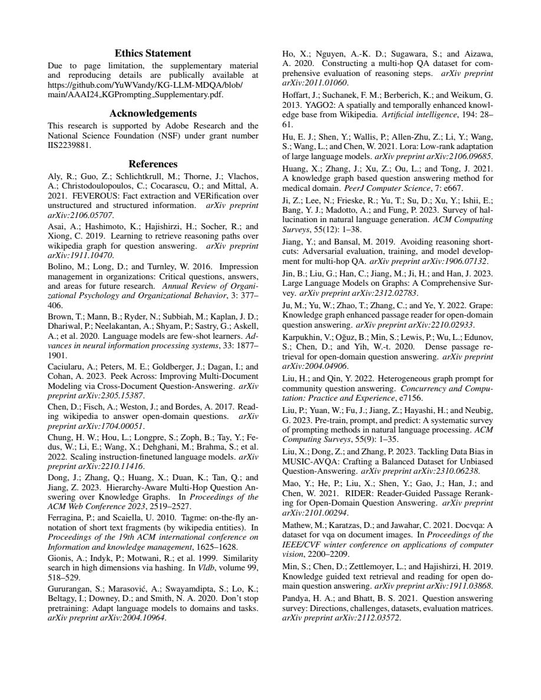

<!-- source-page: 9 -->

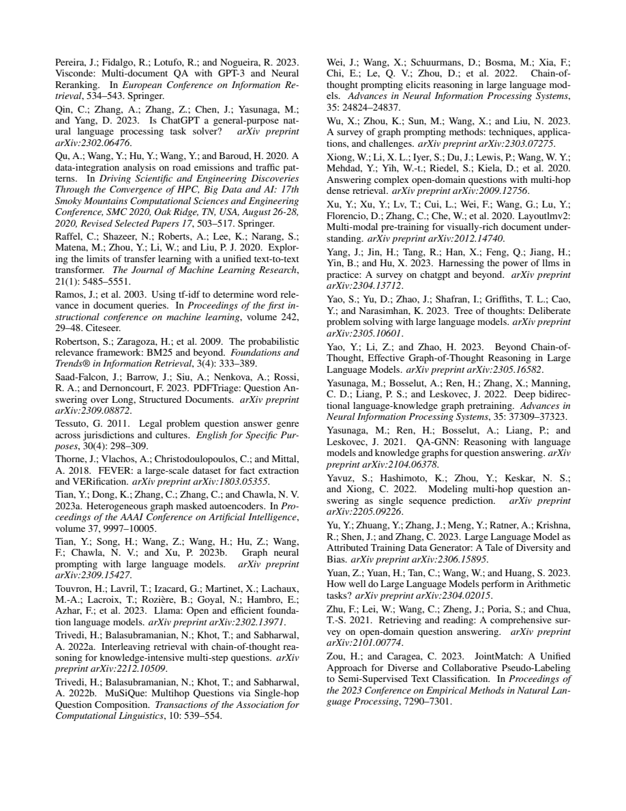

<!-- source-page: 10 -->

## 8 补充材料

### 8.1 数据集收集

**文档集收集与处理。** 为模拟用户保存多文档文件夹、问题答案来自其中部分内容的真实情境，从 HotpotQA、IIRC、2WikiMQA、MuSiQue 开发集随机抽题；对各题从维基获取包含支持事实的文档，称为真实支持文档；再随机抽负文档与之合并。将文档切为文段，默认文段长度 250，实验效果较好。上述数据只关注内容，另加入公司内部真实结构问题集合 PDFTriage，详见 Saad-Falcon et al.（2023）。

**图构建。** 每题及对应文档集建一个图。HotpotQA、IIRC、WikiMHop、MuSiQue 的问题无需结构信息，因此只设文段节点；PDFTriage 另用 Extract API 得页面、表格，加入相应节点。边按第 3 节构建。表 3 汇总跨题平均统计。收集和预处理代码见项目 GitHub。各数据集已有每题支持事实。

**表 3 文档集与图平均统计。**

|数据集|文档数|问题数|文段数|边数|平均文段长度|图密度|
|---|---:|---:|---:|---:|---:|---:|
|HotpotQA|12|500|715.22|70420.68|37.55|0.23|
|IIRC|12|477|1120.55|143136.17|37.24|0.20|
|WikiMHop|12|500|294.19|19235.15|37.24|0.27|
|MuSiQue|12|500|748.04|97931.28|38.56|0.29|

PDFTriage更多细节见Saad-Falcon et al.（2023）。

**顺序数据收集。** MDR（Xiong et al., 2020）需要将支持事实排列为逐渐接近答案的逻辑顺序。因此直接使用 MDR 仓库预处理 HotpotQA 训练编码器，再用于不提供支持事实顺序的其他数据集。LLaMA 指令微调也用这些数据，转为 instruction-input-output 格式，指令为“给定当前证据，为回答问题还需要什么证据？”示例见清单 1。T5-large使用相同输入输出，但按T5格式把推理指令作为输入前缀（Raffel et al., 2020）。原文脚注5为[MDR预处理数据与代码](https://github.com/facebookresearch/multihop_dense_retrieval/tree/main)。

### 8.2 实验细节

**训练 DPR（Karpukhin et al., 2020）与 MDR（Xiong et al., 2020）。** DPR 将问题与其支持事实组成正样本，随机文段作负样本。HotpotQA 每题仅需两条支持事实，故 MDR 以第一条作原问题正样本，再拼接问题和第一条形成新问题，以第二条作正样本；两者均随机采负例。遵循 Xiong et al.（2020）和 Karpukhin et al.（2020），默认采用 RoBERTa-base，超参数搜索见表4。

**表 4 DPR/MDR 超参数。** 多数值直接来自原仓库。

|超参数|搜索空间/设置|
|---|---|
|编码器|RoBERTa-base|
|隐藏维数|768|
|最大上下文长度|128、256、350|
|批大小|128、256、512|
|训练轮数|50|
|预热步数|300|
|学习率|2e-5|
|梯度裁剪范围|2|

**LLaMA 与 T5-Large 指令微调。** 以清单 1 数据微调 LLaMA，受计算限制选 7B 并用 LoRA（Hu et al., 2021）。T5-Large 使用同样数据，但移除独立指令字段，将推理指令置于输入前缀。T5的格式处理遵循 Raffel et al.（2020）。两者均采用各自原GitHub仓库的默认超参数。原文脚注6为[LLaMA微调仓库](https://github.com/Lightning-AI/lit-llama)，脚注7为[T5微调说明](https://shivanandroy.com/fine-tune-t5-transformer-with-pytorch/)。

<!-- source-page: 11 -->

**表 1、2 中问答提示。** 遵循 Trivedi et al.（2022a），随机从开发集抽题，所有基线检索文段数设为 30，用 ChatGPT 阅读并生成答案，以公平比较。实现如下。

KNN：用在多来源 2.15 亿问答对上训练的 `multi-qa-MiniLM-L6-cos-v1` 生成嵌入；按嵌入相似度和模糊匹配各选前 15 文段。模糊匹配使用 Levenshtein 距离。

MDR：以内积评分进行束搜索；因 HotpotQA 最多两跳，深度设为 2。首跳 15 文段，每个再取 3 个，共 45 文段对；按两跳分数乘积排序，取前 30 作为上下文。

IRCoT（Trivedi et al., 2022a）：不直接用原代码，因为其预处理维基语料不含全文，不符合多文档设定；原阅读器需 A100-80G，本文无法负担。因此替换为 ChatGPT，使用 8.1 节文档集。推理提示从 `gold_with_2_distractors_context` 选 2 示例；反复依据模型生成的推理及文档标题取前 5 文段加入上下文，直至预算。阅读提示与其他基线相同，实验发现优于原 IRCoT 提示。

KGP-T5/LLaMA/MDR/ChatGPT：分别使用 T5-large、LLaMA-7B、MDR、ChatGPT 引导遍历。内容问题同样两跳，但每跳仅在候选邻居搜索；首跳 10 文段，第二跳每条取 3，共 30 路径，两跳文段允许重复。结构问题先由 ChatGPT 抽页/表结构，再取内容；未来可预训练结构抽取模型。

KGP-TF-IDF：去掉模型引导，仅按文段与问题 TF-IDF 相似度选节点。全部提示模板见 8.9 节。

### 8.3 KGP 复杂度分析

**算法 2 基于大语言模型的知识图谱遍历算法，为内容问题检索相关上下文。**

输入：文档集 D 上的问题 q，D 上构建图 G={V,E,X}，微调图遍历器 f_GT，预设上下文预算 K，TF-IDF 检索函数 g。

1. 初始化种子文段 V_s=g(V,X,q)。
2. 初始化检索路径队列 P=[{v_i} | v_i∈V_s]。
3. 初始化候选邻居队列 C=[N_i | v_i∈V_s]。
4. 初始化计数 k=Σ_(P_i∈P)|P_i|。
5. 当队列 P 与 C 均不为空：
6. P_i←P.dequeue()，C_i←C.dequeue()。
7. 依据式 (1) 求 V′_i=GraphTraversal({q}∪P_i,C_i,k)。
8. 对每个 v∈V′_i 执行：
9. P.enqueue(P_i∪{v})，C.enqueue(N_v)。
10. k←k+1。
11. 如果 k>K：
12. 终止。
13. 返回检索路径队列 P。

算法主要结合式 (1) 邻居排序与广度优先搜索，时间复杂度为 BFS 的 $O(|V|+|E|)$ 乘邻居排序 $O(|\mathcal N|\gamma)=O(\hat d\gamma)$，其中 $\gamma$ 为某邻居与已检索路径计算嵌入相似度的时间，$\hat d$ 为平均度。因此总计

$$
O((|V|+|E|)\hat d\gamma),
$$

介于图规模的线性和二次之间。用户通常维护 10—100 文档，对应约 1000—10000 节点；表 3 中 12 文档约 200—1000 文段，即使二次复杂度仍可负担。可进一步采用 LSH（Gionis et al., 1999）或 KD-tree（Qu et al., 2020）降低邻居排序成本。

文档集变化时，可添加/删除其全部句子节点。为保证删除文档句子为线性复杂度，需维护文档到句子节点的指针。

<!-- source-page: 12 -->

添加时，先按构建方法计算新句子与现有节点的词汇/语义相似度，再加入连接边；这也相对当前图大小呈线性。

空间复杂度为 $O(|V|(\alpha+\beta))$，$\alpha$ 为存储文段嵌入的平均空间，$\beta$ 为文段文本平均空间。文段节点在极大图上扩展性不理想，但用户文件夹通常 10—100 文档，仍可承受。

### 8.4 Markdown 格式表格

图 8 显示，以 Markdown 输入表格，ChatGPT 能理解内容并按问题检索；但长表受输入 token 限制，未来可尝试以 SQL 作为提示内容，或把表格建模为网格图。

**图 8 ChatGPT 理解 Markdown 表格的示例。**

**图 8 对话与表格中文对照。** 用户：这里有一张表，我会据此提问，第一行说的是什么？表格列为“商品、是否有货、价格”；各行为 Python 帽子/是/23.99，SQL 帽子/是/23.99，Codecademy T 恤/否/19.99，Codecademy 连帽衫/否/42.99。模型：第一行说的是 Python 帽子，目前有货，价格 23.99 美元。用户：Codecademy T 恤多少钱？模型：19.99 美元，见表。用户：Python 帽子和 Codecademy 连帽衫哪个更贵？模型：帽子 23.99，连帽衫 42.99 美元，因此连帽衫更贵。

### 8.5 图构建方法比较

表 5 比较优缺点。TAGME（Ferragina and Scaiella, 2010）虽低效，但维基实体抽取有效；仅 12 个维基文档就常需超过 8 小时，并行仍超过 2 小时；仅可处理维基现有实体，难泛化到其他领域。

TF-IDF 和 KNN-ST 无领域限制，但关键词或嵌入相似度难保证精确编码问题需要的文段关系。即使删助动词和冠词，TF-IDF 仍可能抽取无意义关键词。

KNN-MDR 通过预测下一支持文段预训练，更可能编码必要逻辑关系；瓶颈是取得逐步接近答案的有序支持事实，这通常需大量精细人工标注。

使用现有知识库或任务子图是常见方案（Yasunaga et al., 2022；Dong et al., 2023；Yasunaga et al., 2021）。两实体与关系的三元组有力编码事实/常识，并因多文段可共享实体而缓解扩展性问题；但构建需要精心设计关系抽取器，仍是难题。最近利用模型抽关系，但随文档增多，非开源模型费用高昂；可微调开源模型专门抽关系，详细讨论超出本文范围。

没有普适构图法。一般事实领域适用 TAGME 或知识库；更小众或敏感领域可用 TF-IDF/KNN-ST；某些场景收集领域数据、预训练编码器最有效。

<!-- source-page: 13 -->

**表 5 现有和本文图构建方法系统比较。**

|图|节点|边|领域|构建器|可扩展性|超参数|优势|不足|
|---|---|---|---|---|---|---|---|---|
|TAGME|文段|共同维基实体|维基|—|否|先验阈值|有效识别维基实体|实体识别低效，领域窄|
|TF-IDF|文段|共同关键词|通用|—|否|关键词数|无领域限制|共享词可能无关问题|
|KNN-ST|文段|语义相似|通用|句子Transformer|否|邻居数|无领域限制|语义相似可能无关问题|
|KNN-MDR|文段|语义相似|通用|MDR|否|邻居数|编码问答逻辑关联|预训练需逻辑有序支持事实|
|知识库|实体|关系|特定|人工|是|—|有力编码事实|关系抽取难，领域受限|

### 8.6 更多结果与讨论

**MuSiQue 图质量。** 与图 5 相同，变化超参数控制稀疏度，测 TF-IDF 初始种子邻居覆盖支持事实比例。图越密，精度降、SF-EM 升；但 KNN-MDR 的权衡反而弱于 ST 和 TF-IDF，因为它在 HotpotQA 预训练，迁移到 MuSiQue 有分布偏移。ST 图更好不表示表 1 KNN 检索器应优于 MDR，前者图中名称指构图方法，后者表中名称指检索方法。

**图 9 MuSiQue 上四种图质量。** TF-IDF 用共享关键词；KNN-ST 用句子 Transformer 嵌入；KNN-MDR 用 MDR 嵌入；TAGME 用共享维基实体。

**MuSiQue 图影响。** 按图 6 设置比较不同密度下 KGP-T5。图越稠密，效果越高，下一节点搜索越慢。多数情况下 ST 的 F1/EM 优于 MDR，与图 9 的精度/SF-EM 权衡一致。

**图 10 密度增大时性能与延迟均增大。** MuSiQue 随机 100 题平均。

### 8.7 结构和内容问题案例

通过自行设计界面与后端方法，展示六个案例：两项表格问答（图 11—12）、一项页面问答（图 13）、一项单文档内容问答（图 14）、两项多文档内容问答（图 15—18）。可上传文档，后端切文段；左侧输入问题，点击 SUBMIT，后端检索上下文、组织提示并调用 ChatGPT。系统可以理解表/页问题，也能跨文档回答。

<!-- source-page: 14 -->

**图 11 表格问答：会员等级 Fellow 的人数。** 模型理解 Markdown 表格并成功取出人数。

**图11界面内容中文对照。** 问题：根据第4页的表格，有多少人属于“Fellow”会员等级？回答：共有24人属于“Fellow”会员等级。证据标题：第4页／表1。表格如下；右侧原文页也显示同一表。

|会员等级 Membership Grade|人数 Number of People|分会年费 Section Annual Dues|
|---|---:|---:|
|Fellow 高级会员|24|25美元|
|Member 会员|153|25美元|
|Institute Affiliate 学会附属会员|8|25美元|
|Student Member 学生会员|47|0美元*|
|Esteemed Colleague 尊敬的同行|6|0美元|
|总计 TOTAL|238|原表空白|

右侧页面标题：《俄勒冈分会2007／2008年报》；第2节“会员”。“下表概述俄勒冈分会会员情况，包括会员等级及分会会费。”星号注释：“学生还可享受会议注册费的大幅优惠。”

“会员委员会：过去一年，会员委员会继续开展组织联络员会员计划。该计划旨在识别公共和私营机构内可能有兴趣加入ITE或参加ITE活动的具体人员。联络员也协助宣传会议、招募新会员和推广ITE。”

页脚：交通工程师学会（Institute of Transportation Engineers），第4页／共13页。界面 Documental Question、SUBMIT、UPLOAD PDF、Answer、Evidence 分别为文档问题、提交、上传PDF、回答、证据；文档标识DR--182866691保留不变。

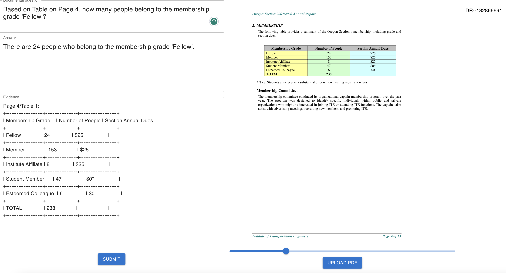

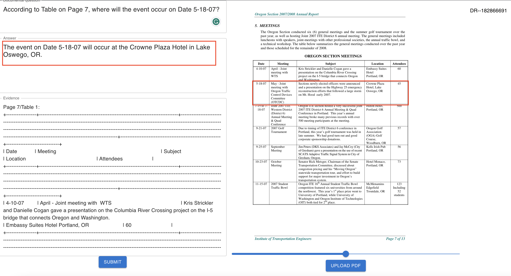

**图 12 表格问答：日期 5-18-07 的活动在哪里举行。**

**图 12 界面内容中文对照。** 问题：根据第 7 页表格，5-18-07 的活动在哪里举行？回答：在俄勒冈州 Lake Oswego 的 Crowne Plaza Hotel。证据框显示第 7 页/表 1，列为日期、会议、主题、地点、人数；可见首行日期 4-10-07、四月与 WTS 联席会议，Kris Strickler 与 Danielle Cogan 介绍连接俄勒冈和华盛顿的 I-5 大桥 Columbia River Crossing 项目，地点 Embassy Suites Hotel Portland, OR，60 人。右侧原表被框选的是 5-18-07 行：五月与 Oregon Traffic Control Devices Committee（OTCDC）联席会议，地点 Crowne Plaza Hotel, Lake Oswego, OR，45人。原界面证据框与右侧高亮行并非同一行，译文照录，不把它改为一致。

**图12右侧原页其余可读内容。** 标题：《俄勒冈分会2007／2008年报》；第5节“会议”。过去一年，俄勒冈分会召开六次常规会议及夏季高尔夫球赛，并主办2007年ITE第6区联合年会。常规会议包括有演讲嘉宾的午餐会、与其他专业学会的联席会议、年度交通知识竞赛和技术研讨会。下表概述过去一年举办的常规会议，以及2008年余下时间的安排。

|日期|会议|主题|地点|参会人数|
|---|---|---|---|---:|
|4-10-07|四月，与WTS联席会议|Kris Strickler和Danielle Cogan介绍Columbia River Crossing项目，即连接俄勒冈与华盛顿的I-5大桥项目。|Embassy Suites Hotel，Portland，OR|60|
|5-18-07|五月，与俄勒冈交通控制设施委员会OTCDC联席会议|宣布分会新当选官员；介绍2007年初Mt. Hood大风暴后Highway 25的紧急重建工作。|Crowne Plaza Hotel，Lake Oswego，OR|45|
|7-15至7-18-07|2007 ITE西部区（第6区）联合年会及Quad Conference|俄勒冈ITE分会在Portland成功举办联合年会和Quad Conference，超过500名与会者，打破多项既往纪录。|Hilton Hotel，Portland，OR|500|
|9-21-07|2007年高尔夫球赛|因ITE第6区会议在Portland举办，本年度球赛推迟至夏末举行，参与情况和企业赞助捐赠均良好。|俄勒冈高尔夫协会OGA球场，Woodburn，OR|57|
|9-25-07|九月会议|Jim Peters（DKS Associates）和Jay McCoy（Gresham市）介绍俄勒冈Gresham市近期使用的SCATS自适应交通信号系统。|Kells Irish Pub，Portland，OR|56|
|10-23-07|十月会议|参议院交通委员会主席Rick Metsger参议员讨论拥堵收费及其“Moving Oregon”全州交通巡回活动，争取对俄勒冈交通系统重大投资的支持。|Hotel Monaco，Portland，OR|73|
|11-15-07|2007年学生交通知识竞赛|俄勒冈ITE第16届年度学生交通知识竞赛有西北地区六所大学参加；University of Portland获第一，University of Washington和Oregon Institute of Technologies（OIT，原图用名）并列第二。|McMenamins Edgefield，Troutdale，OR|123，包括52名学生|

页脚：交通工程师学会，第7页／共13页。

<!-- source-page: 15 -->

**图 13 页面问答：第 2 页主要内容。** 回答给出概述，涵盖各节标题。

**图 13 界面内容中文对照。** 问题：第 2 页主要内容是什么？回答：主要介绍研究参与者与方法，包括所用椅子和设备、遵循的实验方案，以及能量消耗和心率测量。

证据（第 2 页）：参与者与方法——参与者。所有参与者签署知情同意，Mayo Clinic 机构审查委员会批准方案。共 16 名参与者（9 女、7 男），平均年龄 23±5 岁，BMI 26±5.5 kg/m²（表 1）。椅子描述：标准办公椅（对照椅）来自 Steelcase，Grand Rapids，Michigan，美国。FootFidget（footfidget.com，Lake Zurich，Illinois，美国；图 1）是桌下弹性脚踏，鼓励坐着时活动；其底座为钢制 17×10×10 英寸框架，中央弹性脚垫为 7 英寸泡棉圆柱硬管，两条 17 英寸弹性阻力绳穿过管并连接支架四根立柱；使用者反复在圆柱管上弹脚，受到阻力。CoreChair（corechair.com，Aurora，Ontario，加拿大；图 1）鼓励坐姿活动，为改装五轮办公椅，有 9 英寸低靠背、可调深度和无扶手；雕塑式座垫覆 2 英寸泡棉，机械核心允许坐姿侧向活动，倾斜程度可调，所有方向活动范围可达 14°（原截图字符显示为 14°）；研究设为最大活动范围。左侧检索证据在“Interchangeable”一词处截断；右侧原文仍有后续，可读内容补译如下。

**图13右侧原页补充译文。** 可更换的不同长度（长、短）中央支柱使椅子高度能够调节。

“实验方案”：参与者在热舒适条件下接受测试，时间为进食后2小时，并先休息30分钟。测试前向他们展示设备并解释方案。参与者穿轻便衣物（运动短裤和T恤），用校准的Seca 769体重秤称重，脱鞋使用Seca 219身高计测量身高（Seca，Chino，California，USA）。参与者坐在标准办公椅（Steelcase Criterion）上工作、查邮件或上网20分钟，同时监测能量消耗与心率。随后继续类似工作活动，同时提供FootFidget，测量20分钟能量消耗和心率。之后坐CoreChair并再次测量20分钟。参与者仍坐CoreChair，停止工作活动，跟随7分钟椅上运动视频，然后休息5分钟，再次跟随该7分钟视频，取得第二次样本。最后，在校准跑步机（PaceMaster Bronze；Aerobics，West Caldwell，New Jersey，USA）上以每小时2英里行走20分钟。

“方法——能量消耗”：采用间接测热法[14]测量（Metamax 3B；Cortex，Leipzig，Germany）。根据制造商说明，用5.0%二氧化碳、15.0%氧气、余量氮气的混合气体（Praxair，Danbury，Connecticut，USA）和环境空气校准。每名参与者测试前，另用3升注射器进行容积校准。仪器逐呼吸采集二氧化碳产生量和氧气消耗量，按标准公式[19]计算能量消耗。

“心率监测”：参与者佩戴Polar Heart Rate Monitor H7（Polar，Lake Success，New York，USA），记录心率样本并与每次呼吸同步。

“结果”：四种坐姿条件和慢走（每小时2英里）的能量消耗见图2。在标准办公椅上，静息能量消耗按预期与体重正相关（r=0.55，p=0.03）。关系式为：静息能量消耗（千卡／小时）=0.976×体重（千克）±0.917〔按截图原式保留〕。相较标准办公椅，使用FootFidget时能量消耗显著增加约30%，所有参与者的平均数由76±31升至98±42千卡／小时（p<0.001）。心率未显著增加，分别为75±10与78±14次／分钟。类似地，使用……时能量消耗显著增加〔原页在此处换页，截图未显示后续〕。

右下表1：“参与研究的16名志愿者的人口学信息”。9女、7男；年龄23±4.7岁，身高170±10厘米，体重77±17千克，收缩压116±18毫米汞柱，舒张压78±19毫米汞柱；数据表示为均值±标准差。正文年龄概述为23±5岁，两处按原图分别保留。Open Access为开放获取。页脚：Koepp GA等，BMJ Open Sport Exerc Med 2016;2:e000152，DOI 10.1136/bmjsem-2016-000152，第2页。侧边说明该文2016年9月1日首次发表，2019年10月31日由访客从期刊网站下载，受版权保护。

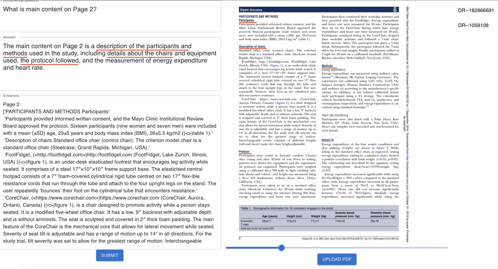

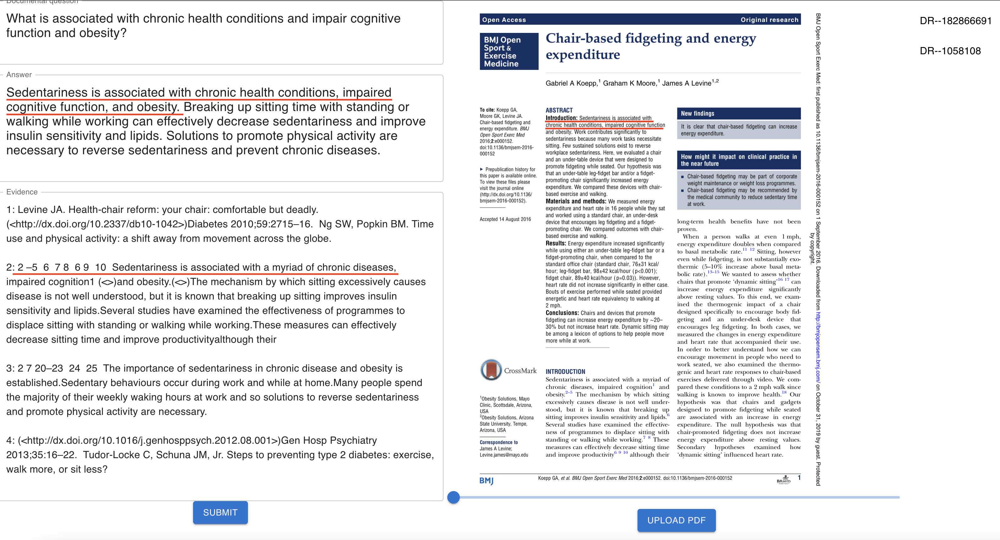

**图 14 单文档内容问答：久坐。** 第二条检索句含答案，对应论文摘要第一句。

**图 14 界面内容中文对照。** 问题：什么与慢性健康问题、认知受损和肥胖有关？回答：久坐与慢性健康问题、认知受损和肥胖有关。工作时用站立或步行打断久坐，可有效减少久坐并改善胰岛素敏感性与血脂；需要促进体力活动的方案来逆转久坐、预防慢性病。

检索证据 1：Levine JA，《健康座椅改革：你的椅子舒适却致命》，Diabetes 2010;59:2715–16，DOI 10.2337/db10-1042；Ng SW、Popkin BM，《时间使用和体力活动：全球从运动转向静坐》。证据 2：久坐与多种慢性疾病、认知受损及肥胖有关；过量坐姿导致疾病的机制未完全理解，但已知打断久坐改善胰岛素敏感性和血脂。多项研究检查工作时以站立/步行替代静坐，能够减少坐姿时间，提高生产力（截图在句中截断）。证据 3：久坐在慢性病与肥胖中的重要性已确立，发生于工作和家庭；很多人清醒时间大部分在工作，需要逆转久坐、促进活动。证据 4：Tudor-Locke C、Schuna JM Jr，《预防 2 型糖尿病的步骤：运动、多走路，还是少坐？》，Gen Hosp Psychiatry 2013;35:16–22，DOI 10.1016/j.genhosppsych.2012.08.001。

<!-- source-page: 16 -->

**图14右侧原页可读内容译文。** Open Access为开放获取，Original research为原创研究。题目：“基于座椅的小动作与能量消耗”。作者Gabriel A. Koepp、Graham K. Moore、James A. Levine。机构：美国亚利桑那州Scottsdale的Mayo Clinic肥胖解决方案部门，以及Arizona State University（Tempe）的肥胖解决方案部门。通讯作者James A. Levine，Levine.james@mayo.edu。2016年8月14日接收；预发表历史可在期刊网站在线查阅。引文信息：BMJ Open Sport Exerc Med 2016;2:e000152；DOI 10.1136/bmjsem-2016-000152。以下是截图中论文内容的翻译，不作为本报告的新实验结果或健康建议。

摘要“引言”：久坐与慢性健康问题、认知功能受损和肥胖有关。许多任务必须坐着完成，因此工作显著促成久坐。目前缺少能够持续逆转工作场所久坐的方案。本文评估一款椅子和一种桌下设备，它们被设计用于促进坐姿时的小动作。研究假设是：桌下腿部活动杆和／或促进小动作的椅子可显著提高能量消耗，并将它们与椅上运动、步行比较。

“材料与方法”：测量16人坐着工作时的能量消耗和心率，比较标准椅、鼓励腿部小动作的桌下设备、促进小动作的椅子，并与椅上运动和步行比较。

“结果”：相较标准办公椅，两种设备均显著增加能量消耗。标准椅76±31千卡／小时，腿部活动杆98±42千卡／小时（p<0.001），活动椅89±40千卡／小时（p=0.03）。两者心率均未显著升高。坐着进行的阶段性运动，在能量和心率方面等同于每小时2英里步行。

“结论”：促进小动作的椅子和设备可使能量消耗增加约20%—30%，但不增加心率。动态坐姿可能是帮助人们在工作时增加活动的多种方案之一。

“新发现”：基于椅子的小动作能够增加能量消耗。“在不久将来可能如何影响临床实践”：可纳入企业体重维持或减重计划；医疗界可能推荐它来减少工作时的久坐时间。

正文“引言”：久坐与许多慢性病、认知受损[1]、肥胖[2—5]有关。过量坐姿导致疾病的机制尚未充分理解，但已知打断坐姿可改善胰岛素敏感性及血脂[6]。若干研究检查工作时用站立或行走替代坐姿的方案[7,8]，能有效减少坐姿时间并提高生产力[6,9,10]，但长期健康益处尚未证实。即便以每小时1英里行走，能量消耗也会达到基础代谢率的两倍[11,12]。然而，即使伴有小动作，坐姿也没有显著产热效应，仅比基础代谢率高5%—10%[13—15]。研究者希望评估促进“动态坐姿”的椅子[16,17]能否使能量消耗显著高于静息值，因此检查一种鼓励身体小动作的椅子和一种鼓励腿部小动作的桌下设备，测量使用它们所伴随的能量消耗及心率变化。为理解如何鼓励必须坐着工作的人员活动，还检查视频指导的椅上运动的产热和心率反应。因为步行已知可改善健康[18]，故与每小时2英里步行比较。研究假设是促进坐姿小动作的椅子和设备与能量消耗增加有关；零假设是椅子促进的小动作不会使能量消耗高于静息值。次要假设检查“动态坐姿”如何影响心率。

右侧原文的引文编号在此按截图保留，不对应KGP文末参考文献。侧边版权和下载说明与图13相同。

**图 15 多文档桥接问题：LeBron James 与 Ohio。** 先检索他成长期间打篮球的州。

**图 15—16 界面内容中文对照。** 两图的问题相同：LeBron James 成长期间打篮球的州，是否是美国面积第 34 大州？回答相同：是，该州为 Ohio，是美国面积第 34 大州。两图检索到同一组证据：

1. James 五年级开始有组织篮球，后来为 Northeast Ohio Shooting Stars 打 AAU 业余篮球。
2. Ohio 是美国中西部州，50 州中面积第 34；近 1180 万人，为人口第 7、人口密度第 10。
3. James 在家乡 Akron, Ohio 的 St. Vincent–St. Mary High School 打球，因全能得分、传球、运动能力和组织能力被全国媒体视为未来 NBA 巨星。
4. 身高 6 英尺 2 英寸（1.88 米）的高中新生 James，校队场均 21 分、6 篮板。
5. St. Vincent–St. Mary 赛季 23 胜 4 负，最后在分区冠军赛失利。
6. Ohio 三大城市为 Columbus、Cleveland、Cincinnati，都是大都市区中心；Columbus 为州首府，靠近地理中心，以 Ohio State University 闻名。

图15在LeBron James原文中高亮第3项，建立人物—州的桥接；图16在Ohio原文高亮第2项，验证面积排名。

**右侧LeBron James原文页的可读内容。** 截图标题为“维基百科，自由的百科全书——LeBron James”，时间2023年7月28日11:51 AM；以下保留该历史截图中的履历和数字。

LeBron Raymone James Sr.（1984年12月30日出生），又称LBJ，是美国职业篮球运动员，效力于美国国家篮球协会NBA的Los Angeles Lakers。绰号“King James”，普遍被视为篮球史上最伟大的球员之一，在讨论史上最佳球员时常与Michael Jordan比较[a]。James是NBA历史得分王，生涯助攻排名第四。他赢得四次NBA冠军，其中Miami Heat两次、Lakers和Cleveland Cavaliers各一次，参加过十次NBA总决赛[1]；获得四次常规赛MVP、四次总决赛MVP、两枚奥运金牌，19次入选全明星，19次入选NBA最佳阵容，其中13次第一阵容[2,3]，六次最佳防守阵容，并两次在年度最佳防守球员评选中排名第二[4,5]。

James在家乡俄亥俄州Akron的St. Vincent–St. Mary High School成长并打篮球。全国媒体因他全面的得分、传球、运动能力及组织能力，极力将其宣传为未来NBA巨星[6]。高中毕业后直接进入职业篮球，2003年被Cleveland Cavaliers以选秀状元选中，获2004年NBA年度最佳新秀[7]，迅速成为联盟顶尖球员，2007年率Cavaliers首次进入总决赛，并在2009、2010年获得常规赛MVP[4]。未能在Cleveland夺冠后，他于2010年以自由球员身份加盟Miami Heat[8]，在全国电视特别节目《The Decision》中宣布这一决定，成为体育史上最具争议的自由球员转会之一[9]。

他在2012、2013年效力Heat时赢得前两次NBA冠军，两年均获常规赛MVP及总决赛MVP。2014年在Heat的第四个赛季后，他选择跳出合同、重返Cavaliers。2016年，他率Cavaliers在总决赛1比3落后情况下逆转Golden State Warriors，赢得球队首冠，并终结“Cleveland体育诅咒”[10]。2018年，他行使合同选项离开Cavaliers，签约Lakers，获得2020年NBA冠军及第四次总决赛MVP[11]。James是NBA历史上首位累计获得10亿美元的球员……〔截图在“in”处跨页，收入类型的后续文字未显示，不补写。〕

信息框照片说明：“2022年，James效力Los Angeles Lakers”。23号，Los Angeles Lakers；位置：小前锋／大前锋；联盟：NBA。个人信息：1984年12月30日生于美国俄亥俄州Akron；登记身高6英尺9英寸（2.06米）；登记体重250磅（113千克）。生涯信息：高中St. Vincent–St. Mary（Akron，Ohio）；2003年NBA选秀第一轮总第1顺位，被Cleveland Cavaliers选中；职业生涯2003年至今〔截至截图版本〕；“生涯经历”标题下的内容不在截图中。页脚为该维基百科条目链接与第1页／共68页。

**图16右侧Ohio原文页的可读内容。** 截图时间2023年8月8日5:10 PM；标题“维基百科，自由的百科全书——Ohio（俄亥俄州）”，坐标北纬40°、西经83°。

Ohio是美国中西部的一个州，在美国50州中面积排名第34。人口接近1180万，人口第7、人口密度第10。首府和最大城市是Columbus，其他主要人口中心包括Cleveland、Cincinnati、Dayton、Akron、Toledo。北临Erie湖，东接Pennsylvania，东南接West Virginia，西南接Kentucky，西接Indiana，西北接Michigan。因当地的俄亥俄七叶树而被称为“Buckeye State”，州民也称“Buckeyes”[10]。州旗是美国所有州中唯一非矩形的州旗。

州名来自Ohio River，而河名来自Seneca语“ohiːyo’”，意为“好河”“大河”或“大溪流”[13,14]。该州起源于Appalachian Mountains以西的土地，从殖民时代到18世纪末的西北印第安战争期间，这些土地一直存在争夺。它从此后形成的Northwest Territory分出，这里是新生美国的第一个边疆；1803年3月1日成为第17个加入联邦的州，也是依据《西北法令》加入的第一个州[3,15]。Ohio是殖民时代后首个加入联邦的自由州，并在20世纪成为最早且最有影响力的工业重镇之一。虽然21世纪已转向更多依靠信息和服务的经济，仍保持工业州地位；截至2019年GDP第7[16]，制造业第3，汽车产量第2[17]。

州政府由州长领导的行政部门、两院制Ohio General Assembly立法部门、州最高法院领导的司法部门组成。Ohio在美国众议院有16席[18]。该州作为全国……中的摇摆州和风向标而知名〔截图在national处跨页，未显示后续〕。

信息框：“Ohio，州，State of Ohio”。Flag为州旗，Seal为州徽；别称“Buckeye State”“航空诞生地”“万物之心”。格言：“与上帝同在，万事皆有可能”[1]；州歌《Beautiful Ohio》[2]，时长3:01。地图说明：“突出标示Ohio的美国地图”。国家：美国。加入联邦：1803年3月1日，第17州；该日期于1953年8月7日追认[3,4]。首府和最大城市：Columbus[5,6]。最大都会及城市区域：Greater Cleveland（联合统计区域和城市区域），Cincinnati（都会区），Columbus（都会区），见注[a]。末尾Government为“政府”标题。页脚条目链接与第1页／共50页。

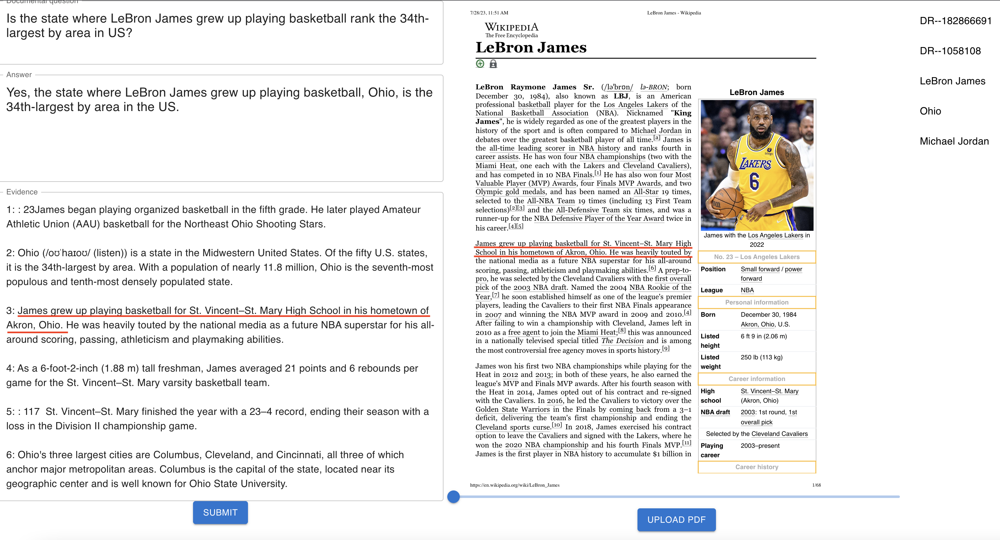

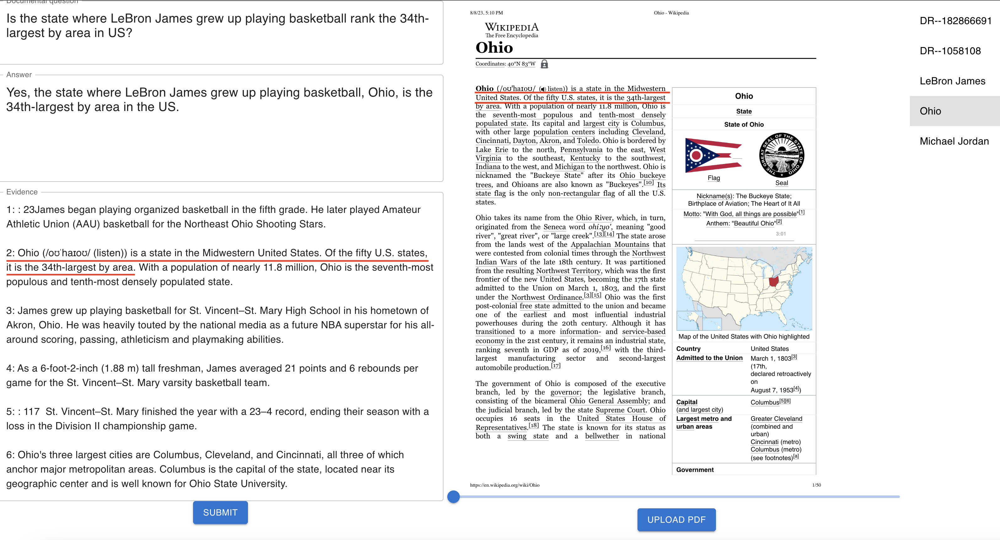

**图 16 同一桥接问题的后续。** 再判断 Ohio 面积是否排美国第 34。

<!-- source-page: 17 -->

**图 17、18 多文档比较问题：比较 LeBron James 和 Michael Jordan。** 需要检索两人的生日信息。

**图 17—18 界面内容中文对照。** 问题相同：Michael Jordan 和 LeBron James 谁出生更晚？回答：LeBron James 出生更晚，生于 1984 年 12 月 30 日，Jordan 生于 1963 年 2 月 17 日。两图检索证据相同：

1. 包括 Michael Jordan、Magic Johnson 在内的前 NBA 球员批评 James 加入 Miami 与 Bosh、Wade 联手，没有以“球队核心”夺冠。
2. James 经常在“史上最佳篮球员”语境被讨论，因此常与 Michael Jordan 比较。[a]
3. Michael Jeffrey Jordan（1963 年 2 月 17 日出生），常简称 MJ，是美国前职业篮球员和商人。
4. 2016 年 Sports Illustrated 采访中，James 承认超越 Jordan、成为最佳的动机。
5. 他和 Michael Jordan 是仅有的在同年获得 NBA MVP、NBA 冠军、总决赛 MVP 和奥运金牌的球员。
6. LeBron Raymone James Sr.（1984 年 12 月 30 日出生），又称 LBJ，是 NBA Los Angeles Lakers 美国职业篮球员。

图17高亮Michael Jordan生辰，图18高亮LeBron James生辰。

**图17右侧Michael Jordan原文页的可读内容。** 截图时间2023年7月28日11:51 AM，标题“维基百科，自由的百科全书——Michael Jordan”。以下保留原截图历史版本。

Michael Jeffrey Jordan（1963年2月17日出生），也以姓名缩写MJ为人所知[9]，是美国前职业篮球运动员和商人。NBA官方网站说：“公认地，Michael Jordan是史上最伟大的篮球运动员”[10]。他在NBA打了15个赛季，与Chicago Bulls赢得六次冠军；在1980、1990年代向世界推广篮球和NBA方面发挥重要作用[11]，成为全球文化符号[12]。

Jordan在教练Dean Smith带领的North Carolina Tar Heels打了三个大学赛季；大一时是1982年全国冠军队成员[5]。1984年以总第3顺位加入Bulls[5,13]，迅速成为联盟明星，以高产得分吸引观众，也获得顶尖防守球员的声誉[14]。他在扣篮大赛中展示从罚球线起跳扣篮的能力，因而获“Air Jordan”和“His Airness”绰号[5,13]。1991年随Bulls首次夺冠，接着在1992、1993年夺冠，实现三连冠。他在1993—1994赛季前突然从篮球退役、转打美国小联盟棒球，1995年3月回归Bulls，率队在1996、1997、1998年再获三冠，并在1995—1996常规赛取得当时纪录的72胜[5]。1999年1月第二次退役，2001—2003年又为Washington Wizards打两个NBA赛季[5,13]。职业生涯中入选美国国家队，在1983年泛美运动会、1984年夏季奥运会、1992年美洲锦标赛、1992年夏季奥运会获得四枚金牌，保持不败[15]。

个人荣誉包括六次总决赛MVP、十次NBA得分王，两项均为历史纪录；五次常规赛MVP，十次NBA第一阵容，九次最佳防守第一阵容，十四次全明星，三次全明星MVP，三次抢断王，以及1988年最佳防守球员[13]。他保持常规赛生涯场均30.1分和季后赛生涯场均33.4分的NBA纪录[16]。1999年被ESPN评为20世纪最伟大北美运动员；在美联社世纪运动员榜单上，仅次于Babe Ruth[5]。两度入选Naismith Memorial Basketball Hall of Fame：2009年以个人身份[17]，2010年再次作为1992年……的一员入选〔截图到此跨页，未显示队名〕。

信息框照片说明：“2014年4月的Jordan”。个人信息：1963年2月17日生于美国纽约州纽约市；登记身高6英尺6英寸（1.98米）；登记体重216磅（98千克）[a]。生涯信息：高中Emsley A. Laney（Wilmington，North Carolina）；大学North Carolina（1981—1984）；1984年NBA选秀第一轮第3顺位，被Chicago Bulls选中；职业生涯1984—1993、1995—1998、2001—2003；位置得分后卫／小前锋。页脚条目链接与第1页／共46页。

**图18右侧原文页。** 与图15右侧展示同一历史版本LeBron James条目，完整中文如下。

**右侧LeBron James原文页的可读内容。** 截图标题为“维基百科，自由的百科全书——LeBron James”，时间2023年7月28日11:51 AM；以下保留该历史截图中的履历和数字。

LeBron Raymone James Sr.（1984年12月30日出生），又称LBJ，是美国职业篮球运动员，效力于美国国家篮球协会NBA的Los Angeles Lakers。绰号“King James”，普遍被视为篮球史上最伟大的球员之一，在讨论史上最佳球员时常与Michael Jordan比较[a]。James是NBA历史得分王，生涯助攻排名第四。他赢得四次NBA冠军，其中Miami Heat两次、Lakers和Cleveland Cavaliers各一次，参加过十次NBA总决赛[1]；获得四次常规赛MVP、四次总决赛MVP、两枚奥运金牌，19次入选全明星，19次入选NBA最佳阵容，其中13次第一阵容[2,3]，六次最佳防守阵容，并两次在年度最佳防守球员评选中排名第二[4,5]。

James在家乡俄亥俄州Akron的St. Vincent–St. Mary High School成长并打篮球。全国媒体因他全面的得分、传球、运动能力及组织能力，极力将其宣传为未来NBA巨星[6]。高中毕业后直接进入职业篮球，2003年被Cleveland Cavaliers以选秀状元选中，获2004年NBA年度最佳新秀[7]，迅速成为联盟顶尖球员，2007年率Cavaliers首次进入总决赛，并在2009、2010年获得常规赛MVP[4]。未能在Cleveland夺冠后，他于2010年以自由球员身份加盟Miami Heat[8]，在全国电视特别节目《The Decision》中宣布这一决定，成为体育史上最具争议的自由球员转会之一[9]。

他在2012、2013年效力Heat时赢得前两次NBA冠军，两年均获常规赛MVP及总决赛MVP。2014年在Heat的第四个赛季后，他选择跳出合同、重返Cavaliers。2016年，他率Cavaliers在总决赛1比3落后情况下逆转Golden State Warriors，赢得球队首冠，并终结“Cleveland体育诅咒”[10]。2018年，他行使合同选项离开Cavaliers，签约Lakers，获得2020年NBA冠军及第四次总决赛MVP[11]。James是NBA历史上首位累计获得10亿美元的球员……〔截图在“in”处跨页，收入类型的后续文字未显示，不补写。〕

信息框照片说明：“2022年，James效力Los Angeles Lakers”。23号，Los Angeles Lakers；位置：小前锋／大前锋；联盟：NBA。个人信息：1984年12月30日生于美国俄亥俄州Akron；登记身高6英尺9英寸（2.06米）；登记体重250磅（113千克）。生涯信息：高中St. Vincent–St. Mary（Akron，Ohio）；2003年NBA选秀第一轮总第1顺位，被Cleveland Cavaliers选中；职业生涯2003年至今〔截至截图版本〕；“生涯经历”标题下的内容不在截图中。页脚为该维基百科条目链接与第1页／共68页。

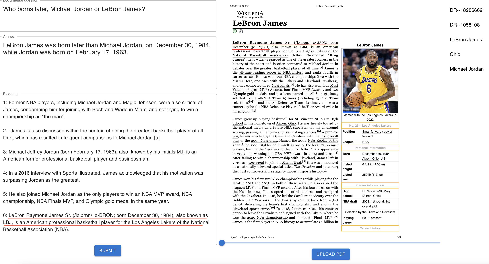

<!-- source-page: 18 -->

### 8.8 模型引导遍历器的推理检索过程可视化

**图 19 多文档问答示例 1 的图遍历。图 20 多文档问答示例 2 的图遍历。** 原图完整保留如下。

**图 19 节点文字中文对照。** 问题 Q：Oxford 哪所组成学院为化学、纯数学等理科提供四个教授研究员职位？

图中Q表示问题，S表示来自文档的检索文段，R表示模型生成的推理内容；边旁数字为原图匹配分数，红框和红色路径保留原图选择标记。

首跳候选：S1（0.394）：Magdalen College 是 Oxford 组成学院之一。S2（0.373）：Waynflete 教席是 Oxford 的四个教授研究职位，由 Magdalen 学院资助，以热衷科学的创办人 William of Waynflete 命名。S3（0.254）：这些教席为 Waynflete 化学教授、生理学教授、纯数学教授。

从 S1 生成 R1：学院提供十个自然和人文学科教授研究职位，包括化学、计算机科学、地球科学、经济学、英语、历史、法律、数学、哲学，另有六个教授研究职位，以及十八个导师职位、十个研究员职位及许多其他学术奖项。后继 S11（0.292）：Waynflete 教席是由 Magdalen 资助的四个 Oxford 教授职位，以热爱科学的 William of Waynflete 命名。S12（0.134）：Daubeny同时担任Aldrichian化学教授。他认为旧Ashmolean博物馆（如今的科学史博物馆）地下室里的化学实验室“出了名地配不上这样一所伟大的大学”，希望能有更好的科学设施。

从 S2 生成 R2：Oxford（非正式称 Oxford University 或简称 Oxford）是英国 Oxford 的一所学院制研究型大学。后继 S21（0.406）：Magdalen College 是 Oxford 组成学院之一。S22（0.245）：除了 Oxford University Student Union 旗下俱乐部、社团，Magdalen 学生也可参加一些学院社团。

从S3生成R3：Waynflete是位于英国的牛津大学的一所组成学院。〔这是模型生成内容，原样翻译，不作为事实性校正。〕后继 S31（0.545）：Waynflete 教席是由 Magdalen 资助的四个 Oxford 教授职位，以热爱科学的 William of Waynflete 命名。S32（0.347）：此 Waynflete 教席是 Oxford 五个法定哲学教席之一，另四个为 Wykeham 逻辑教授、White 道德哲学教授、Wilde 心灵哲学教授和未冠名古代哲学教席。原图生成节点可能不正确，不能当作事实结论。

**图 20 节点文字中文对照。** 问题 Q：Joseph D. Stewart 被任命为 Superintendent 的学院位于哪里？

首跳 S1（0.314）：Joseph D. Stewart，又称“Joey D.”（1942年7月9日—2019年4月30日），曾任美国海军陆战队少将。他从海军陆战队退休后，于1998年8月1日被任命为美国商船学院（USMMA）学院长。S2（0.223）：他是学院第三任学院长；右侧信件来自学院早期历史资料，并附有照片。S3（0.194）：Stewart在海军学院就读时打长曲棍球，曾连续三年效力全国冠军队。海军学院毕业后，他以少尉军衔加入海军陆战队。

从 S1 生成 R1：United States Merchant Marine Academy（USMMA 或 USMMA, Academy）是美国五所军种学院之一，位于 Long Island 的 Kings Point, New York。后继 S11（0.856）：该学院亦称 USMMA 或 Kings Point，是五所军种学院之一，位于 Kings Point, New York。S12（0.463）：学院由美国运输部 Maritime Administration 管理，位于 Kings Point, New York。

从 S2 生成 R2：United States Naval Academy 是 Maryland 州 Annapolis 四年制男女同校联邦军种学院，1845 年在海军部长 George Bancroft 任内建立，是五所军种学院中第二古老者，为海军、海军陆战队培养军官。后继S21（0.525）：根据《美国法典》第46编第51312节，美国商船学院访客委员会就与该学院相关的事项，向美国总统和美国国会提供独立意见和建议。S22（0.483）：USMMA（或 Kings Point）是位于 Kings Point, New York 的五所军种学院之一。

从 S3 生成 R3：United States Naval Academy（USNA、Annapolis 或 Navy）是 Maryland 州 Annapolis 四年制男女同校联邦学院，1845年在海军部长George Bancroft任内建立，是第二古老军种学院，培养海军和海军陆战队军官。后继 S31（0.341）：他在 2008 年 9 月 30 日以中将军衔从美国海运勤务队（U.S. Maritime Service）退休；生于 Baltimore，1960 毕业于 Severn School，1964 毕业于 Naval Academy。S32（0.337）：该学院是全国主要持证商船军官来源之一，以海洋教育训练闻名。Stewart中将于2008年9月30日从美国商船学院退休。此处S32原文已完整显示。

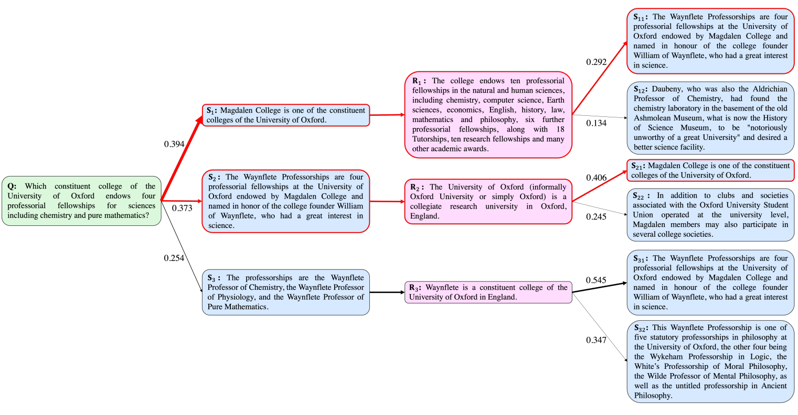

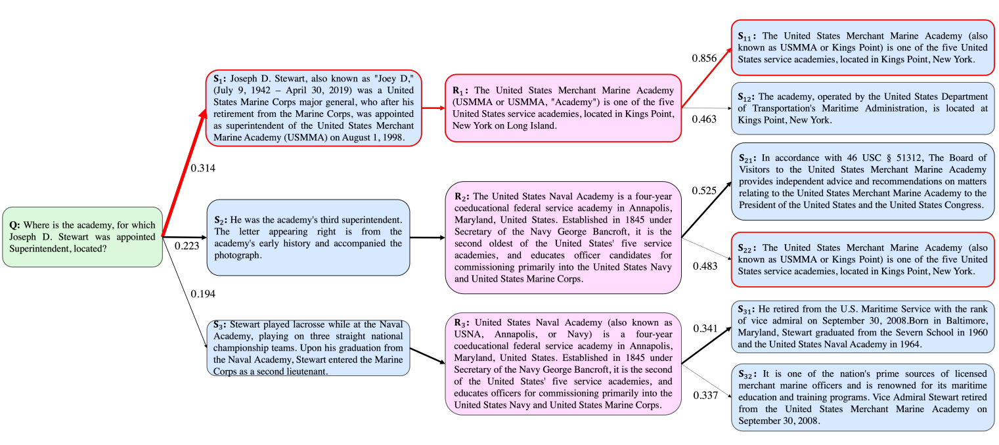

<!-- source-page: 19 -->

### 8.9 全文使用的提示模板

**清单 1 LLaMA 指令微调数据示例。**

问题：Arthur’s Magazine 与 First for Women 哪本杂志创刊更早？

答案：Arthur’s Magazine。

支持事实：(1) Arthur’s Magazine（1844—1846）是 19 世纪在费城出版的美国文学期刊。(2) First for Women 是 Bauer Media Group 在美国出版的女性杂志，创刊于 1989 年。

指令：给定当前证据，为回答问题还需要什么证据？

输入：Arthur’s Magazine 与 First for Women 哪本创刊更早？Arthur’s Magazine（1844—1846）是 19 世纪在费城出版的美国文学期刊。

输出：First for Women 是 Bauer Media Group 在美国出版的女性杂志，创刊于 1989 年。

第二例问题：《辛普森一家》主题曲现行编曲者出生于哪一年？

答案：1941 年 3 月 28 日。

支持事实：(1) 主题曲在第二季重新编曲，目前由 Alf Clausen 编曲的版本从第三季开始采用。(2) Alf Heiberg Clausen（1941 年 3 月 28 日出生）是美国影视作曲家。

指令：给定当前证据，为回答问题还需要什么证据？

输入：《辛普森一家》主题曲现行编曲者出生于哪一年？主题曲在第二季重新编曲，目前由 Alf Clausen 编曲的版本从第三季开始采用。

输出：Alf Heiberg Clausen（1941 年 3 月 28 日出生）是美国影视作曲家。

**清单 2 无检索上下文的问答提示。**

给定下面的问题，请给出最终答案。

问题：这位英爱女演员、交际花及情妇，是 William IV 国王私生女的母亲，她的生日是什么时候？

答案：请用少于 6 个词回答。

**清单3 有检索上下文的问答提示示例。**

给定下面的问题和上下文，为该问题生成最终答案。

问题：Earth乐队《Pentastar: In the Style of Demons》封面上出现的汽车型号，是在哪些年份制造的？

上下文：

1. 《Pentastar: In the Style of Demons》是持续音厄运金属乐队Earth的第三张完整录音室专辑。
2. 他于1957年出版《The Interpersonal Diagnosis of Personality》（人格的人际诊断），《Annual Review of Psychology》（心理学年鉴）称它是“当年最重要的心理治疗著作”。
3. 在转瞬即逝的cyberdelic反文化鼎盛时期，他担任Billy Idol制作1993年专辑《Cyberpunk》的顾问。
4. 在Barracuda开发期间，最不保密的秘密之一，是Ford计划在廉价Falcon的底盘和行走系统基础上推出一款新型运动紧凑车；该车最终作为Mustang在1964车型年中期发布。其他改动的程度尚不清楚。
5. 《Peace in Mississippi》是对Jimi Hendrix同名歌曲的翻唱。专辑最初发行的黑胶版本收录了这首歌的另一演奏版本。
6. 在1970—1974车型周期结束前，已经计划推出1975款Barracuda。
7. 2021年春，第三波冠状病毒疫情到来时，Varadi把他们的航空公司称为投资者“少有的希望曙光”之一。
8. 在此期间，美国首批联邦汽车安全标准逐步实施。Chrysler针对侧标志灯要求作出的应对，使第二代Barracuda各车型年可以区分。随着小马车级别逐渐确立、竞争加剧，Plymouth开始调整Barracuda的发动机选项。
9. Barracuda的基本售价为2512美元（以今天币值约为24000美元）。1964车型年既是Barracuda的第一个车型年，也是可选Torqueflite自动变速箱最后使用按钮控制的一年。
10. 用象征主义诗人Stéphane Mallarmé的话说：“语言是不完美的，因为语言有许多种；至高的语言缺席了……没有人能够说出带有‘真理本身化身’这一神奇印记的话语……语言是多么不可能表达事物……在诗人的手中……凭借一种依靠虚构而生的艺术所具有的恒常美德与必然性，它才发挥全部效力。”
11. 在法国，颓废运动的核心时期是1880年代与1890年代，即世纪末（fin de siècle），或所谓世纪结束时的阴郁时期。
12. 《Pentastar: In the Style of Demons》是持续音厄运金属乐队Earth的第三张完整录音室专辑，于1996年发行。它比乐队早期的持续音厄运作品更偏向摇滚，但仍保持极简风格。

<!-- source-page: 20 -->

13. 本场比赛是上一年Russell Athletic Bowl的重赛，Clemson曾以40比6获胜。本场比赛的两个参赛队是两支半决赛队伍Clemson Tigers与Oklahoma Sooners。
14. 战争对Ernst的影响具有毁灭性。他在自传中这样描述自己的军队生活：“1914年8月1日，M[ax].E[rnst].死去了。他于1918年11月11日复活。”
15. Plymouth高管原本想把新车型命名为Panda，但设计师不喜欢这个想法。最终，John Samsen建议的Barracuda获得采用。该车基于Chrysler的A-body平台，于1964年4月1日以快背造型首次亮相。
16. Scapigliati，字面意思是“不修边幅”或“蓬头散发”，是一群作家和诗人；他们共同不能容忍意大利复兴运动晚期（1860年代）至统一意大利初期（1870年代）之间令人窒息的知识氛围。
17. 他的文学作品反复出现以下主题：个人至上、对美的崇拜、夸张的精致、对机器的颂扬、人与自然的融合，以及与死亡胜利共存的高昂生命力。
18. 1965车型年开始后，提供盘式制动器和原厂安装的空调。1966车型年的Barracuda配备新尾灯、新的车头钣金件和新仪表板。
19. Eysenck写道：“本书最糟糕的缺陷，也许是完全没有提供任何关于诊断系统效度与信度的证据。”
20. 它以采用后轮驱动的Alfa Romeo Giulia加长底盘为基础，据传将搭载涡轮增压V6发动机，并在2019车型年内推出。
21. 他们投资于机队发展和机场建设，其中第一个机场将在Brașov启用。
22. 他打破爬坡赛纪录，这项创新在随后数年被广泛仿效。[需要引文] Mays在1935年德国大奖赛等赛事中崭露头角，与Ernst von Delius共用他的ERA赛车；该场比赛也是Tazio Nuvolari著名胜利发生的地方。
23. 这次披露的真实性仍有疑问。在1968年《Dragnet》的《The Big Prophet》一集中，Liam Sullivan饰演“扩展心灵圣殿”的领袖Brother William Bentley，这是对Leary稍加虚构的人物版本。
24. 比利时人Félicien Rops对颓废运动早期阶段的发展起到重要作用。他是Baudelaire的朋友，经作者本人请求，经常为Baudelaire的作品配插图。
25. 在承认对受控物质负责之后，Leary于1966年3月11日依据1937年《大麻税法》被判持有罪，获刑30年，罚款30000美元，并被要求接受精神治疗。
26. Sullivan County在州议会（General Court）的代表团，由该县所有新罕布什尔州众议院议员组成，共13名，来自11个不同选区。
27. 随后两队分别射门得分，使Clemson以16比10领先。比赛剩余2分17秒时，Oklahoma从本方一路推进穿越球场完成达阵，使Sooners取得1分领先。
28. 平均每户人口为2.41人，平均家庭人口为2.88人。人口中，18岁以下占23.90%，18—24岁占6.40%，25—44岁占28.00%，45—64岁占25.90%，65岁及以上占15.80%。
29. 乐队宣布发行《How It Feels To Be Lost》豪华版，该版本于2020年8月21日推出。2021年6月2日，乐队发布即将推出的专辑中的单曲《Bloody Knuckles》。
30. 第82届Orange Bowl是大学橄榄球季后赛半决赛；比赛胜者将与2015年Cotton Bowl的胜者Alabama Crimson Tide橄榄球队，在2016年大学橄榄球季后赛全国冠军赛中交锋。全国冠军赛在亚利桑那州Glendale的University of Phoenix Stadium举行。

问题：Earth乐队《Pentastar: In the Style of Demons》封面上出现的汽车型号，是在哪些年份制造的？

答案：请用少于6个词回答。

<!-- source-page: 21 -->

**清单4 MDR、KGP-T5、KGP-LLaMA和KGP-MDR使用检索上下文的问答提示示例。**

给定下面的问题和上下文，为该问题生成最终答案。

问题：Anthony Avent打篮球的那所高中，所在城市位于哪里以西约8英里？

上下文（各项内部的段落分隔对应底本中的换行标记“\n”；保留全部重复文段与干扰事实）：

1. Newark是纽约都会区的第二大城市，位于曼哈顿下城以西约8英里。

   在进入Seton Hall之前，Avent曾在新泽西州Newark的Malcolm X Shabazz High School打球。

2. Newark是纽约都会区的第二大城市，位于曼哈顿下城以西约8英里。

   美国新泽西联邦地区法院也位于该市。

3. Newark是纽约都会区的第二大城市，位于曼哈顿下城以西约8英里。

   靠近Market Street，并设有寄宿生宿舍；Saint Vincent Academy是一所罗马天主教女子高中，由Saint Elizabeth慈善修女会创立和资助，自1869年以来持续办学。Link Community School是一所无宗派、男女合校的走读学校，约有128名七年级和八年级学生。

4. 在进入Seton Hall之前，Avent曾在新泽西州Newark的Malcolm X Shabazz High School打球。

   Newark是纽约都会区的第二大城市，位于曼哈顿下城以西约8英里。

5. 在进入Seton Hall之前，Avent曾在新泽西州Newark的Malcolm X Shabazz High School打球。

   美国新泽西联邦地区法院也位于该市。

6. 在进入Seton Hall之前，Avent曾在新泽西州Newark的Malcolm X Shabazz High School打球。

   它位于Newark Bay，由纽约与新泽西港务局经营，是货物进出纽约都会区和北美东北部的主要集装箱船设施。

7. 他曾在Seton Hall University打大学篮球，并参加1989年NCAA冠军赛。在进入Seton Hall之前，Avent曾在新泽西州Newark的Malcolm X Shabazz High School打球。

   在进入Seton Hall之前，Avent曾在新泽西州Newark的Malcolm X Shabazz High School打球。

8. 他曾在Seton Hall University打大学篮球，并参加1989年NCAA冠军赛。在进入Seton Hall之前，Avent曾在新泽西州Newark的Malcolm X Shabazz High School打球。

   美国新泽西联邦地区法院也位于该市。

9. 他曾在Seton Hall University打大学篮球，并参加1989年NCAA冠军赛。在进入Seton Hall之前，Avent曾在新泽西州Newark的Malcolm X Shabazz High School打球。

   截至2020—2021学年，该学区共有65所学校、40423名在校生和2886.5名任课教师（按全职等值计算），生师比为14.0∶1。Science Park High School在《New Jersey Monthly》2010年9月关于全州“最佳公立高中”的封面专题中，在新泽西州322所学校中排名第69；2008年该校曾在316所学校中排名第50。

10. Anthony Avent（1969年10月18日出生）是美国前职业篮球运动员，在1991年NBA选秀第一轮第15顺位被Atlanta Hawks选中。

    Newark是纽约都会区的第二大城市，位于曼哈顿下城以西约8英里。

11. Anthony Avent（1969年10月18日出生）是美国前职业篮球运动员，在1991年NBA选秀第一轮第15顺位被Atlanta Hawks选中。

    美国新泽西联邦地区法院也位于该市。

12. Anthony Avent（1969年10月18日出生）是美国前职业篮球运动员，在1991年NBA选秀第一轮第15顺位被Atlanta Hawks选中。

    Atlanta United 1，New York Red Bulls 2。Atlanta United队史的第一场比赛在满场55297名观众面前举行。

13. Anthony Avent（1969年10月18日出生）是已退役的美国职业篮球运动员，在1991年NBA选秀第一轮第15顺位被Atlanta Hawks选中。

    2013—2017年美国社区调查（ACS）显示，Newark在校学生总数为77097人，其中托儿所和学前教育7432人，小学至高中（K—12）49532人，大学及研究生教育20133人。Newark Public Schools是由州政府管理的学区，也是新泽西州最大的学校系统。

14. Anthony Avent（1969年10月18日出生）是已退役的美国职业篮球运动员，在1991年NBA选秀第一轮第15顺位被Atlanta Hawks选中。

    截至2020—2021学年，该学区共有65所学校、40423名在校生和2886.5名任课教师（按全职等值计算），生师比为14.0∶1。Science Park High School在《New Jersey Monthly》2010年9月关于全州“最佳公立高中”的封面专题中，在新泽西州322所学校中排名第69；2008年该校曾在316所学校中排名第50。

<!-- source-page: 22 -->

15. Anthony Avent（1969年10月18日出生）是已退役的美国职业篮球运动员，在1991年NBA选秀第一轮第15顺位被Atlanta Hawks选中。

    2013—2017年美国社区调查显示，在Newark25岁及以上居民中，13.6%从未上过高中，12.5%没有高中毕业，74.1%高中毕业，其中14.4%获得学士或更高学位。

问题：Anthony Avent打篮球的那所高中，所在城市位于哪里以西约8英里？

答案：请用少于6个词回答。

**清单 5 问答评分提示示例。**

你是专门评分的专家教授，请根据真实答案判断问题预测是否正确。

例如：

问题：哪个公司拥有 Marvel Comics 的产权？答案：The Walt Disney Company。预测：The Walt Disney Company。返回：1。

问题：Oxford University 哪所组成学院为化学、纯数学等理科提供四个教授研究员职位？答案：Magdalen College。预测：Magdalen College.。返回：1。

问题：Marvel 成立于哪一年？答案：1939。预测：1200。返回：0。

现在评分：问题：Anthony Avent 打篮球的高中所在城市，位于哪里以西约 8 英里？答案：lower Manhattan。预测：Newark。

若预测按答案是正确的，返回 1；否则返回 0。你的回复只能是数字 0 或 1。

**图表坐标与图例中文对照。** 图1：None为无上下文，Golden为真实支持上下文，KGP-T5（Ours）为本文方法，Scores（%）为得分百分比，Metrics为指标，Acc为准确率，EM为精确匹配，F1为F1分数。图5、图9：横轴Supporting Fact Exact Match（SF-EM）为支持事实精确匹配；左轴Precision（Solid）为精度（实线），右轴#Neighbors/#Nodes（Dashed）为邻居数与节点数之比（虚线）。图6、图10：KG Density为图密度，Time（s）为时间（秒），F1和EM曲线分别带有对应构图方法后缀。图7：Performance为性能，Branching Factor为分支因子，Number of Documents为文档数，Log of Time（s）为时间（秒）的对数，KGP-Search为KGP搜索耗时，KGP-LMReason为KGP语言模型推理耗时。所有图的数字、线型和颜色均按原图保留。

## 原图与原算法核对

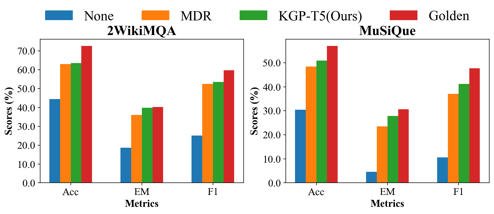

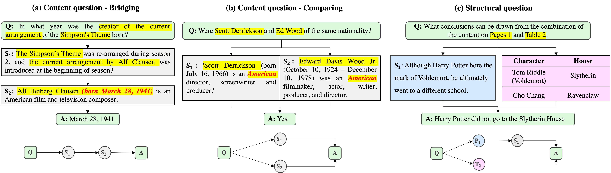

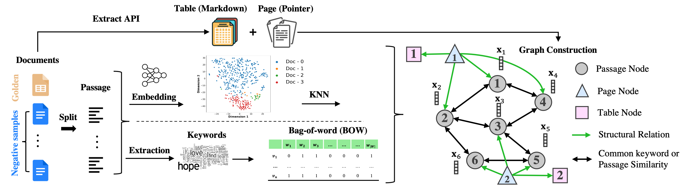

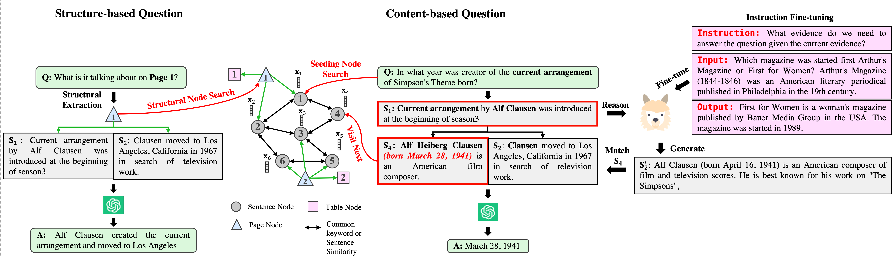

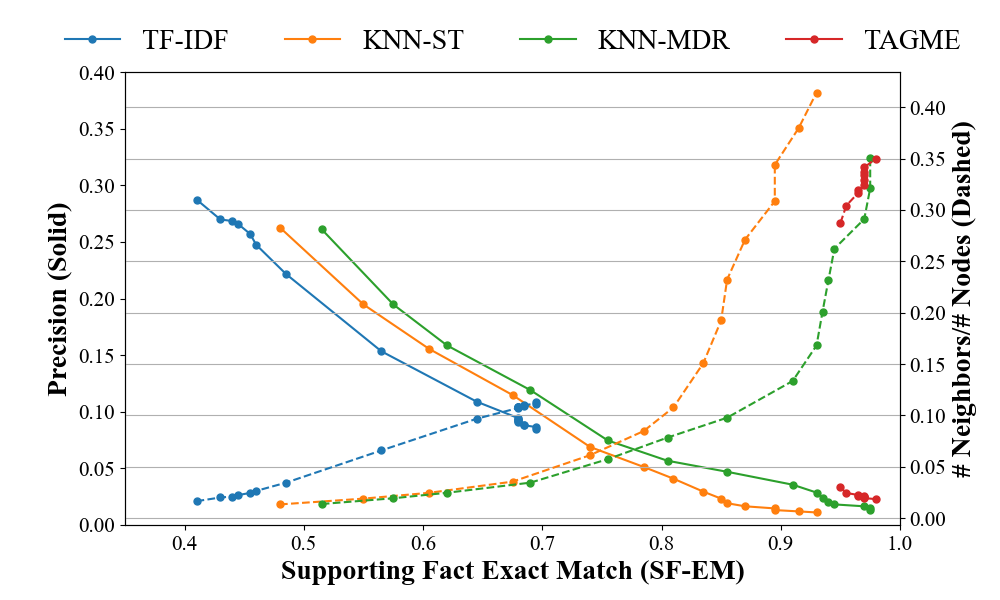

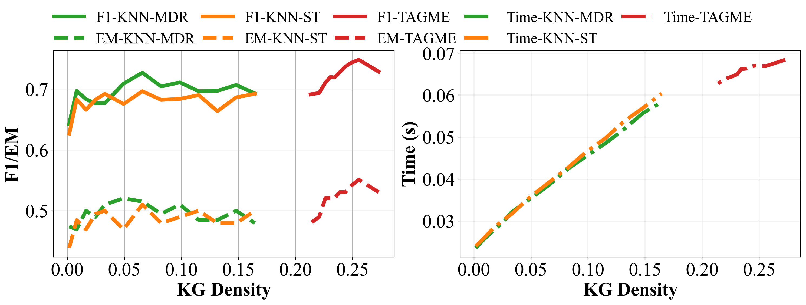

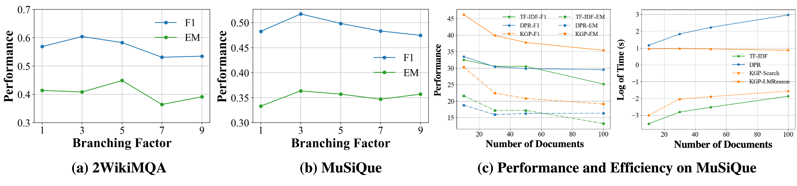

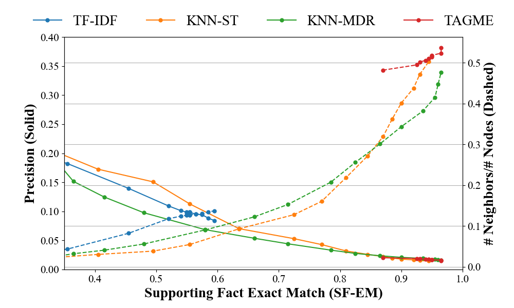

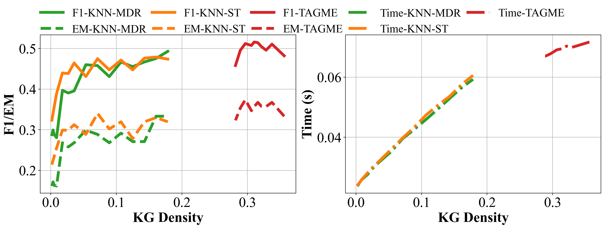

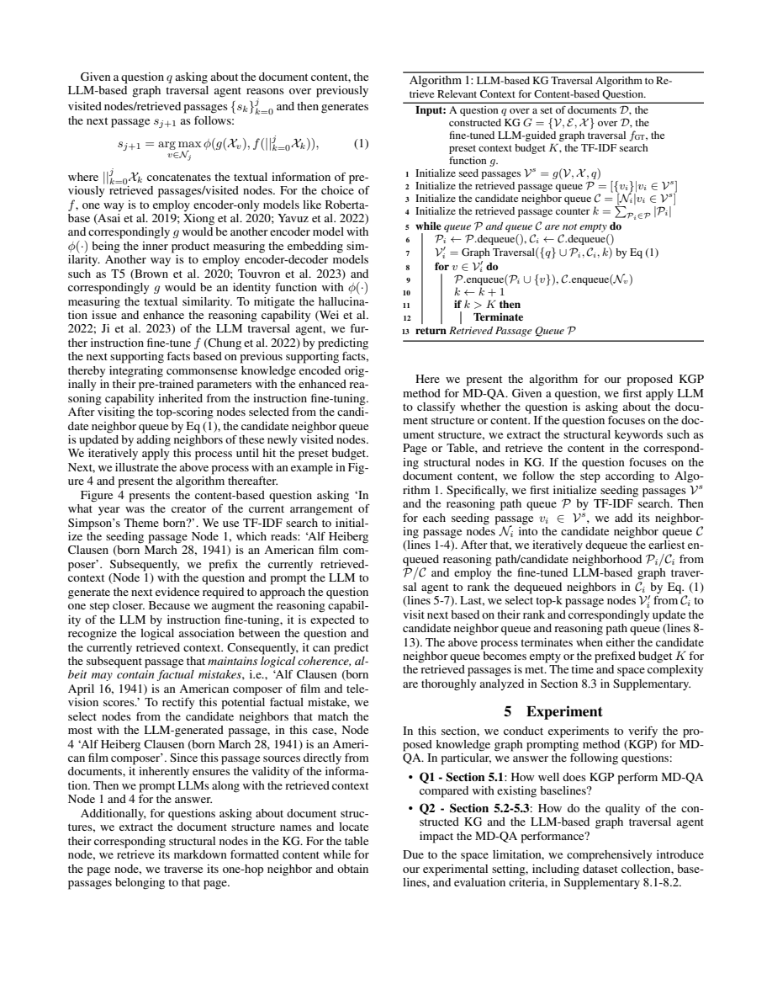

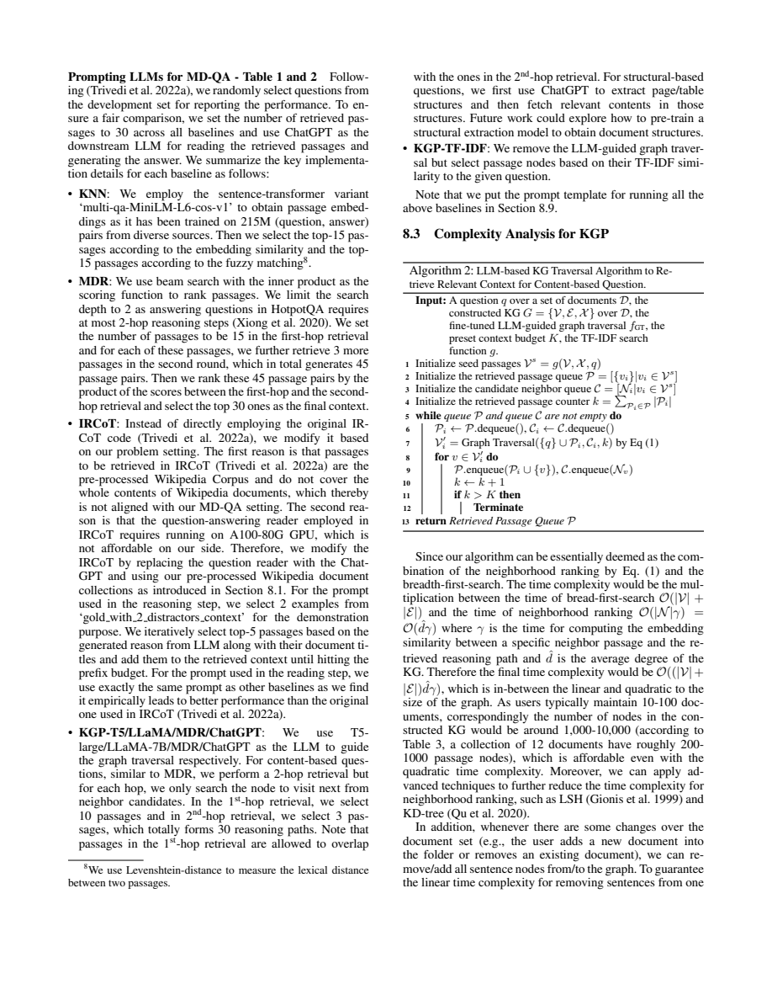
