# G-Retriever 面向文本属性图理解与问答的检索增强生成

**英文原题：G-Retriever: Retrieval-Augmented Generation for Textual Graph Understanding and Question Answering**

作者：Xiaoxin He、Yijun Tian、Yifei Sun、Nitesh V. Chawla、Thomas Laurent、Yann LeCun、Xavier Bresson、Bryan Hooi。机构：新加坡国立大学、圣母大学、洛约拉马利蒙特大学、纽约大学、Meta AI。发表于第38届神经信息处理系统大会 NeurIPS 2024。

作者联系邮箱（按原文保留）：{xiaoxin, yifeisun, xaviercs, bhooi}@comp.nus.edu.sg；{yijun.tian, nchawla}@nd.edu；tlaurent@lmu.edu；yann@cs.nyu.edu。

译本底本：仓库 `03_G-Retriever_NeurIPS2024.pdf`，共32页。按底本页序编排；参考文献保留英文原页。每节所附原页保留公式、图表内部标记和数据，便于逐项校核。译者说明以“译注”标出，不属于作者原文。

<!-- source-page: 1 -->
## 原文第1页

### 摘要

给定节点和边具有文本属性的图，我们使用户能够“与自己的图对话”，即通过对话界面提出有关图的问题。针对用户的问题，本方法提供文字回答，并突出显示图中相关部分。现有研究虽以多种方式整合大语言模型（LLM）与图神经网络（GNN），但主要关注传统图任务，如节点、边和图分类，或在小型、合成图上回答简单图查询。相比之下，我们开发了面向真实世界文本属性图的灵活问答框架，可用于场景图理解、常识推理和知识图谱推理等应用。

为此，我们首先构建图问答（GraphQA）基准，汇集不同任务的数据。随后提出 G-Retriever：首个面向一般文本属性图的检索增强生成（RAG）方法，可通过软提示微调增强图理解。为抵御幻觉并处理远超 LLM 上下文窗口大小的文本属性图，G-Retriever 将图上 RAG 表述为奖赏收集斯坦纳树（Prize-Collecting Steiner Tree，PCST）优化问题。实证评估表明，本方法在多个领域的文本属性图任务上优于基线，能够良好扩展到更大的图，并缓解幻觉。代码与数据集见 https://github.com/XiaoxinHe/G-Retriever。

### 1 引言

**图与大语言模型。** LLM 的出现显著改变了人工智能的发展格局。随着模型用于越来越多样的任务，处理复杂结构化数据的能力将愈发重要。在相互连接的世界中，相当一部分真实数据本身就具有图结构，例如万维网、电子商务、推荐系统、知识图谱等。其中许多图具有文本属性，即文本属性图，因此适合以 LLM 为中心的方法。这推动了将图技术，特别是 GNN，与 LLM 相结合以增强图推理能力的研究[44,15,24]。

**本研究：实现“与你的图对话”。** 现有工作以多种方式整合 LLM 与 GNN，但主要聚焦节点、边和图分类等传统图任务[8]，或在小型和合成图上回答简单问题[44,31]。

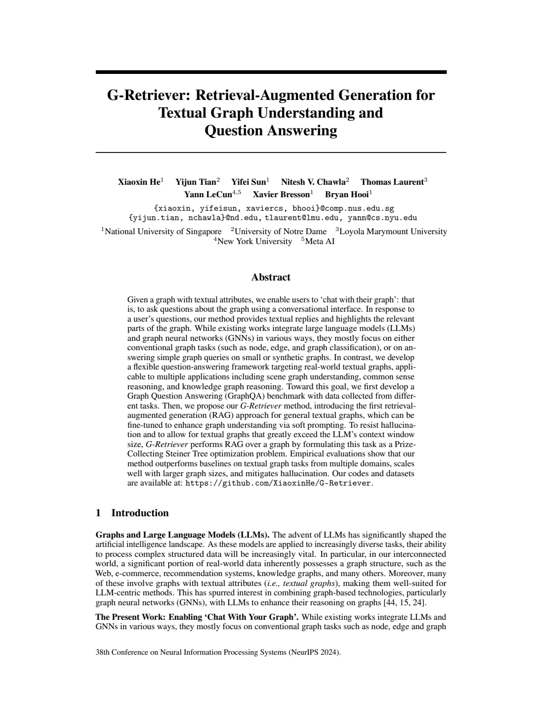

<!-- source-page: 2 -->
## 原文第2页

我们开发面向复杂真实图的灵活问答框架，通过统一对话界面让用户“与图对话”，向直观的图数据交互迈进一步，如图1所示。

**图1。** 我们通过统一对话界面，为真实文本属性图应用构建灵活的问答框架。这里的例子依次展示模型在常识推理、场景理解和知识图谱推理等实际图任务中处理生成式和创造性查询的能力。图中统一对话界面分别处理解释图、场景图、知识图谱；新基准为 GraphQA，新架构为 G-Retriever，技术包括检索增强生成和图提示微调。三个示例的用户问题及完整回答在附录H表13—15译出。

**需要综合的 GraphQA 基准。** 问答是自然语言处理的基础任务，也是评估 LLM 的重要基准，并为各种能力提供统一接口。虽然问答研究广泛，专门针对图模态的综合基准仍然缺乏。现有基准关注节点度、边是否存在、最短路径等基础图推理任务[6,44]，我们的基准则涵盖常识推理、场景理解、知识图谱推理等复杂真实图应用（见图2）。这对衡量模型回答不同应用中广泛图问题的进展至关重要。

**GraphQA 的新架构。** 为在大图上实现有效且高效的图问答，我们提出结合 GNN、LLM 和 RAG 优势的新框架 G-Retriever（图3），下面讨论动机、优势和细节。

**解决图 LLM 中的幻觉。** LLM 容易生成事实错误或无意义的内容，即幻觉[12]。我们验证这一问题在图场景下也存在。具体而言，将 MiniGPT-4[57] 改用于图：冻结 LLM，使其与可训练 GNN 交互，由后者把图编码为软提示，与 GraphToken[31] 类似。表1显示，文本 LLM 中的重要问题——幻觉，在图 LLM 中也普遍存在。这可能是因为基线无法从单一图嵌入回忆完整图结构，因而在问答中生成错误节点或边。相比之下，G-Retriever 使用 RAG 直接从实际图中检索信息，缓解了这一问题，见表1。

**提升图 LLM 的可扩展性与效率。** 近期研究将图转为自然语言，例如把节点和边展开为文本序列，供 LLM 处理图任务[56,6]。然而，这面临严重的可扩展性问题：含数千节点和边的图会产生过多 token，超过许多 LLM 的输入容量。若截断文本以适应 token 限制，则会损失信息和回答质量。G-Retriever 的 RAG 组件只选择相关图部分，从而克服这些问题，扩展到更大图。

**使 RAG 适用于图。** 现有 RAG 主要为较简单的数据类型或知识图谱设计，检索时通常与图结构相分离[7,1,36,16]。因此，我们引入面向一般文本属性图的新检索方法，将子图检索表述为 PCST 优化问题。

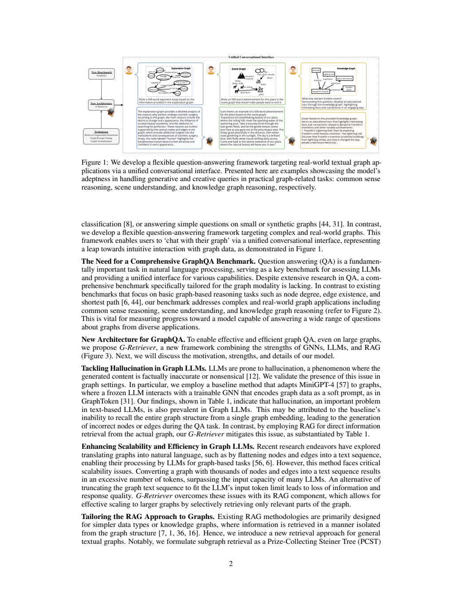

<!-- source-page: 3 -->
## 原文第3页

**表1 图 LLM 幻觉的观察与缓解。** 用户给出图，其中大象位于灌木丛中、在河边站立、吃草，问：“灌木丛中是什么动物？回答问题并列出图中支持答案的节点或边。”图提示微调 LLM 的错误回答是：“动物是一只鹿。节点：鹿（节点1）、灌木丛（节点2）。边：鹿→灌木丛（边1）、鹿→草（边2）、灌木丛→草（边3）。”这些节点和边存在幻觉。G-Retriever 的正确回答是：“根据图中信息，灌木丛中的动物是一头大象。支持节点：节点1，图的第一行提到大象。支持边：连接大象与灌木丛的边，表示大象位于灌木丛中。因此答案是大象。”

PCST 在检索时考虑邻域信息，也使系统能返回与查询最相关的子图，从而增强可解释性。

本文贡献如下：

- **开创图 RAG 的整合。** 提出首个面向一般文本属性图任务的检索方法，显著增强可扩展性和效率。
- **实现“与你的图对话”。** 开发灵活问答框架，通过统一对话接口处理复杂真实文本属性图。
- **引入新的 GraphQA 基准。** 引入面向真实图问答的多样化基准，填补研究空白。
- **实证发现。** 在多个领域证明 G-Retriever 的效率和有效性，并提出图 LLM 存在幻觉的重要发现。

### 2 相关工作

**图与大语言模型。** 图技术与 LLM 的交叉研究已经形成丰富成果[30,24,15,44,54]，涵盖通用图模型设计[47,25,51,19,40,31]、多模态架构[23,49]和实际应用，包括基础图推理[52,3,56]、节点分类[8,11,39,5,50,4,33]、图分类或回归[32,55]，以及 LLM 在知识图谱任务中的应用[41,14,29]。

**检索增强生成。** Lewis 等[21]最初提出 RAG；它因能缓解 LLM 幻觉、提高可信度和可解释性而日益受到关注[7]。虽然其在语言任务上成功，但检索方法在一般图任务上的应用仍基本未被探索，现有工作主要集中于知识图谱[38,1,36,16]。本研究首次将检索方法用于一般图任务，展示了 RAG 超越语言处理的适用性。

**参数高效微调。** 各种参数高效微调技术推动了 LLM 的进展，以较少参数训练提升性能。代表包括 Lester 等[20]的提示微调、Li 和 Liang[22]的前缀微调，以及 LoRA[10]和 LLaMA-adapter[53]。

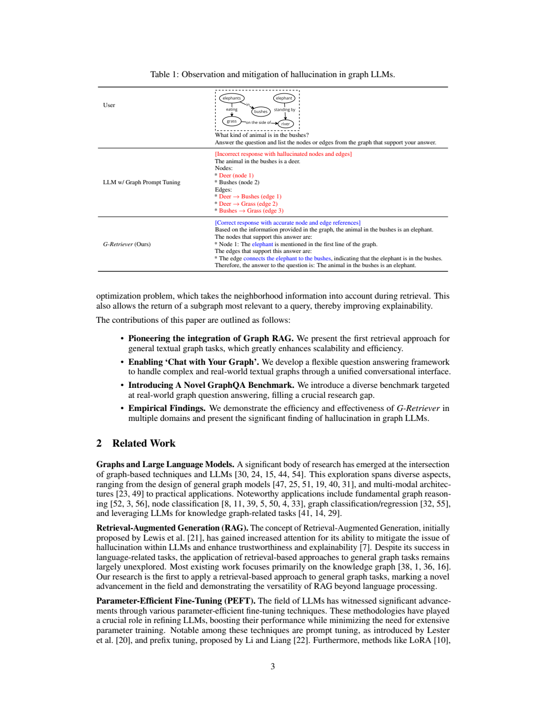

<!-- source-page: 4 -->
## 原文第4页

PEFT 的进展为复杂多模态模型奠定基础，代表包括 MiniGPT-4[57]、LLaVA[26]、NExT-Chat[46]。也有将 PEFT 用于图 LLM 的新探索，如针对基础图推理的 GraphLLM[3]和 GraphToken[31]，以及针对知识图谱多选问答的 GNP[41]。

### 3 形式化

本节建立符号，形式化文本属性图、用于文本编码的语言模型，以及大语言模型和提示微调。

**文本属性图。** 节点和边具有文本属性的图定义为 $G=(V,E,\{x_n\}_{n\in V},\{x_e\}_{e\in E})$。$V,E$ 分别为节点集和边集。$x_n\in D^{L_n}$ 与 $x_e\in D^{L_e}$ 分别是节点和边关联的序列文本；$D$ 为词表，$L_n,L_e$ 为对应文本长度。

**用于文本编码的语言模型。** LM 编码节点与边的文本属性，学习其语义表示。对带属性 $x_n$ 的节点 $n$，

$$z_n=\mathrm{LM}(x_n)\in\mathbb R^d.\tag{1}$$

$z_n$ 为输出，$d$ 为向量维度。

**大语言模型与提示微调。** LLM 引入“预训练—提示—预测”任务适配范式，替代传统“预训练—微调”。LLM 先在大规模文本上预训练，学习通用语言表示；之后不在任务标注数据上微调，而以文本提示指定任务和上下文，再据此直接生成输出。权重为 $\theta$ 的 LLM 接受 token 序列 $X$ 和提示 $P$，输出 $Y=\{y_1,\ldots,y_r\}$。给定拼接输入 $[P;X]$，

$$p_\theta(Y\mid[P;X])=\prod_{i=1}^{r}p_\theta(y_i\mid y_{<i},[P;X]).\tag{2}$$

$y_{<i}$ 表示到位置 $i-1$ 的前缀，右侧表示在此前缀和输入条件下生成 $y_i$ 的概率。

软提示微调免去人工设计提示。$p$ 个 token 组成的 $X=\{x_1,\ldots,x_p\}$ 经文本嵌入器得到 $X_e\in\mathbb R^{p\times d_l}$，$d_l$ 是嵌入维度。软提示是参数 $P_e\in\mathbb R^{q\times d_l}$，$q$ 为提示长度。拼接后得到 $[P_e;X_e]\in\mathbb R^{(q+p)\times d_l}$，照常由 LLM 自注意力层处理。训练通过反向传播最大化 $Y$ 的似然，只更新 $P_e$，保持 $\theta$ 固定。

### 4 所提出的 GraphQA 基准

GraphQA 是综合、多样的图问答基准，用来评估模型回答不同领域广泛图问题的能力。

#### 4.1 数据格式

每条数据包括文本属性图、相关问题，以及一个或多个对应答案，如图2。

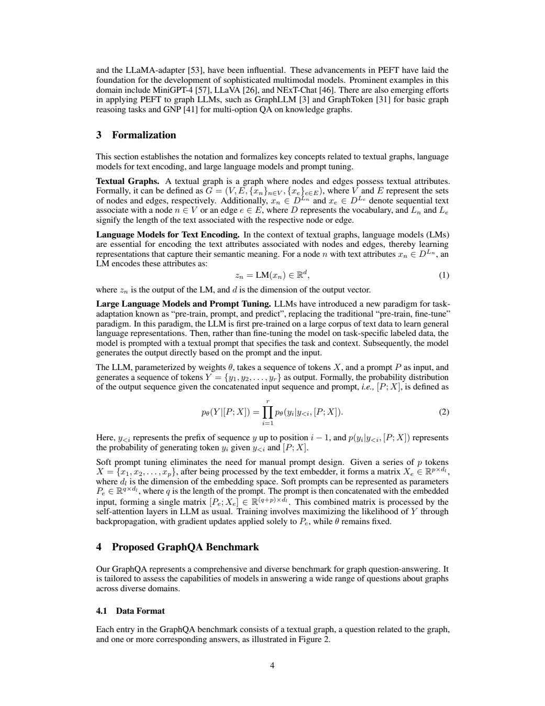

<!-- source-page: 5 -->
## 原文第5页

**表2 GraphQA 数据集概况。**

|数据集|ExplaGraphs|SceneGraphs|WebQSP|
|---|---:|---:|---:|
|图数|2,766|100,000|4,737|
|平均节点数|5.17|19.13|1370.89|
|平均边数|4.25|68.44|4252.37|
|节点属性|常识概念|物体属性，如颜色、形状|Freebase 实体|
|边属性|常识关系|关系，如动作、空间关系|Freebase 关系|
|任务|常识推理|场景图问答|知识问答|
|评价指标|准确率|准确率|Hit@1|

**图2 GraphQA 数据集实例。** 解释图把“男女—是—公民—导致—拥有相同权利—导致—女性—能够—帮助国家—希望—参加战斗”展开为节点与边的 CSV。问题是：“论点1：女性不应参加战斗。论点2：男女拥有相同权利。两者相互支持还是反驳？以 support 或 counter 一个词回答。”答案：counter。场景图有电脑、坐着的人、女性及“在右边”“在前面”关系；问“电脑后的人右边是否有女性？”答“是”。知识图谱包含 Justin Bieber、Jeremy Bieber、Jaxon Bieber 和中间实体 m.0gxnnwp 及父母、子女、兄弟姐妹关系；问“Justin Bieber 的弟弟叫什么？”答“Jaxon Bieber”。图中的 node_id、node_attr、src、edge_attr、dst 分别表示节点编号、节点属性、源节点、边属性、目标节点；原始编号和空间坐标见原图。

**文本属性图。** 将图转为自然语言格式，得到类似 CSV 文件的节点列表和边列表。虽然图文本化有多种方法，本文并不寻找最优方案，而优先使用简单且实证有效的自然语言表示方式，方便在多种 GraphQA 场景中使用。

**问题与答案。** 问题探索图内特定元素或关系；答案位于节点或边的属性中，通常需多跳推理才能准确确定。

#### 4.2 数据集说明

GraphQA 整合 ExplaGraphs、SceneGraphs 和 WebQSP 三个已有数据集，统计见表2。这些数据并非为本文新建；贡献在于将多样数据标准化、处理为适合 GraphQA 的统一格式，把原本用于不同场景的数据以图问答为重点重新引入。与原数据的详细比较见附录C。

ExplaGraphs 是生成式常识推理数据集，通过解释图进行辩论立场预测。它提供详尽、明确、带常识增强的图，以评价论点对某信念的支持或反驳。主要任务判断论点支持还是矛盾，指标为准确率。我们将 Saha 等[35]提供的三元组形式转为标准图格式。

SceneGraphs 是视觉问答数据集，含100,000个场景图，描述图像内物体、属性、关系，任务需空间理解和多步推断。本文根据场景图文字描述回答开放问题，以准确率评估；从 GQA[13]采样，利用 JSON 构建标准图。

WebQSP 是大型多跳知识图谱问答数据集，有4,737个问题，由 Yih 等[48]提出。遵循 Luo 等[28]，使用 Freebase 子集，包含问题实体两跳内的事实。任务要求多跳推理。

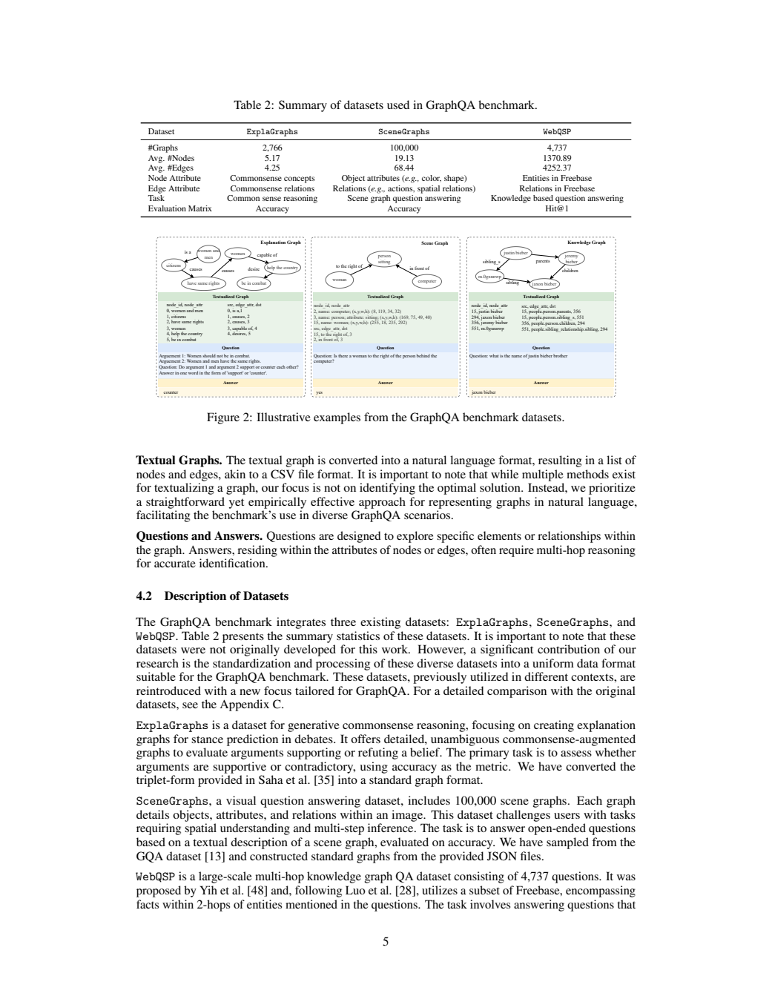

<!-- source-page: 6 -->
## 原文第6页

同一问题可能有多个答案，因此以 Hit@1 衡量首个返回答案的精确性。

**图3 G-Retriever 概览。** 第1步索引：建立图索引以高效处理查询。第2步检索：以查询为条件，检索语义最相关的节点和边。第3步子图构建：提取连通子图，尽可能覆盖相关节点和边，同时保持可管理的图规模。第4步生成：利用图提示、文本化图与查询生成答案。图中 LM 为语言模型；Storage 为存储；Graph Encoder 为图编码器；Projection 为投影层；Text Embedder 为文本嵌入器；Self Attention Layers 为自注意力层；frozen/trainable 分别表示冻结/可训练。示例问题为 Justin Bieber 的弟弟姓名，答案为 Jaxon Bieber。

### 5 G-Retriever

本节介绍为 GraphQA 设计的新架构，结合 GNN、LLM 和 RAG。为高效微调并保留预训练语言能力，冻结 LLM，对 GNN 输出使用软提示。通过直接检索图缓解幻觉，并支持超过 LLM 上下文窗口的图。将子图检索建模为 PCST 问题使 RAG 适用于图，还可通过返回子图提升可解释性。框架包含索引、检索、子图构建和生成四步，如图3。

#### 5.1 索引

首先使用预训练 LM 生成节点和图嵌入，并存储在最近邻数据结构中。具体地，对节点文本 $x_n\in D^{L_n}$，用 SentenceBert[34]等预训练 LM：

$$z_n=\mathrm{LM}(x_n)\in\mathbb R^d.\tag{3}$$

$d$ 为输出维度；对边进行类似预处理，见图3第1步。

#### 5.2 检索

对查询 $x_q$ 使用相同编码策略以统一处理文本：

$$z_q=\mathrm{LM}(x_q)\in\mathbb R^d.\tag{4}$$

采用 k 近邻检索，依据查询与每个节点或边的相似性得到相关节点/边：

$$V_k=\operatorname{argtopk}_{n\in V}\cos(z_q,z_n),\quad E_k=\operatorname{argtopk}_{e\in E}\cos(z_q,z_e).\tag{5}$$

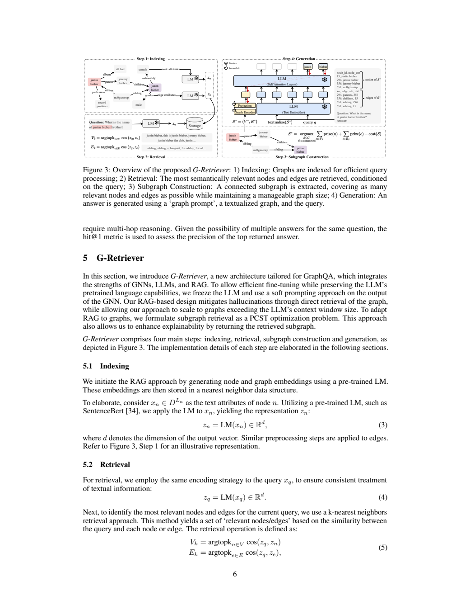

<!-- source-page: 7 -->
## 原文第7页

$z_n,z_e$ 是节点和边嵌入，$\cos(\cdot,\cdot)$ 是余弦相似度，argtopk 返回相似度最高的 k 个元素，构成最相关的 $V_k,E_k$，见图3第2步。

#### 5.3 子图构建

目标是在保持图规模可管理的同时，尽可能包含相关节点和边。这样首先能过滤无关元素，避免无关信息遮蔽有用数据、使后续 LLM 偏离目标；其次能提高效率，使图能转为自然语言并输入 LLM。PCST[2]是确定规模适当且相关子图的主要方法，见图3第3步。

**奖赏收集斯坦纳树。** PCST 寻找连通子图，最大化节点总奖赏并最小化边总成本。根据余弦相似度，为更相关的节点和边分配更高奖赏。前 k 个节点/边依次获 k 到1的递减奖赏，其余为零。节点奖赏为：

$$\operatorname{prize}(n)=\begin{cases}k-i,&n\in V_k\text{且}n\text{为排名第}i\text{的节点},\\0,&\text{其他情况}.\end{cases}\tag{6}$$

译注：公式按原文保留；其文字“k 到1”对应从0开始的排名解释。边奖赏同样分配。优化子图 $S^*=(V^*,E^*)$：

$$S^*=\mathop{\operatorname{argmax}}_{S\subseteq G,\ S\text{连通}}\left[\sum_{n\in V_S}\operatorname{prize}(n)+\sum_{e\in E_S}\operatorname{prize}(e)-\operatorname{cost}(S)\right],\tag{7}$$

$$\operatorname{cost}(S)=|E_S|\times C_e.\tag{8}$$

$C_e$ 是可调整的预定义单位边成本，用来控制子图规模。原始 PCST 只支持节点奖赏；考虑边语义的重要性，我们进行以下适配：边 e 的成本、奖赏分别为 $C_e,P_e$。若 $C_e>P_e$，将边成本降为 $C_e-P_e$；若 $P_e>C_e$，原算法不允许负成本，故用虚拟节点 $v_e$ 替换该边，与原边两端连接。虚拟节点奖赏为 $P_e-C_e$，两条新边成本均为零。该修改对应原问题：选入原图中的边等价于选入修改图中的虚拟节点。最后以近线性时间方法[9]优化 PCST。

#### 5.4 答案生成

**图编码器。** 设检索子图为 $S^*=(V^*,E^*)$，用标准图注意力网络 GAT[43]对其结构编码：

$$h_g=\operatorname{POOL}(\operatorname{GNN}_{\phi_1}(S^*))\in\mathbb R^{d_g}.\tag{9}$$

POOL 是均值池化，$d_g$ 为图编码器维度。

**投影层。** 引入多层感知机对齐图 token 与 LLM 向量空间：

$$\hat h_g=\operatorname{MLP}_{\phi_2}(h_g)\in\mathbb R^{d_l}.\tag{10}$$

$d_l$ 为 LLM 隐藏嵌入维度。

**文本嵌入器。** 为利用 LLM 的文本推理能力，将子图 $S^*$ 的节点和边文本属性展开为文本格式，如图2绿色框所示，称为 textualize 操作。

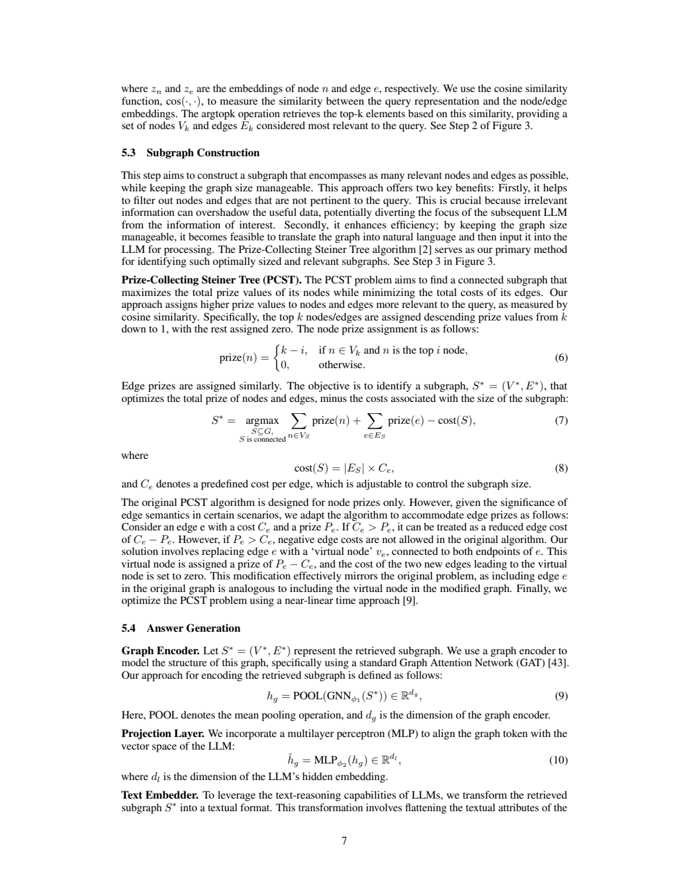

<!-- source-page: 8 -->
## 原文第8页

将文本化图与查询拼接，再用预训练且冻结 LLM 的第一层即文本嵌入器映射：

$$h_t=\operatorname{TextEmbedder}([\operatorname{textualize}(S^*);x_q])\in\mathbb R^{L\times d_l}.\tag{11}$$

$[;]$ 为拼接，$L$ 为 token 数。

**利用图提示微调进行 LLM 生成。** 最后将作为软提示的图 token $\hat h_g$ 与文本嵌入器输出 $h_t$ 输入参数 $\theta$ 冻结的预训练 LLM 自注意力层，生成答案 $Y$：

$$p_{\theta,\phi_1,\phi_2}(Y\mid S^*,x_q)=\prod_{i=1}^{r}p_{\theta,\phi_1,\phi_2}(y_i\mid y_{<i},[\hat h_g;h_t]).\tag{12}$$

虽然 $\theta$ 冻结，图 token 仍接收梯度，使图编码器 $\phi_1$ 和投影层 $\phi_2$ 通过标准反向传播优化。

### 6 实验

#### 6.1 实验设置

索引阶段使用 SentenceBert[34]编码所有节点和边属性；生成阶段使用开源 Llama2-7b[42]，图编码器使用 GraphTransformer[37]。更多细节见附录B.1。

#### 6.2 主要结果

比较三种配置：仅推理，冻结 LLM 直接问答；冻结 LLM 并提示微调（PT），只适配提示；调优 LLM，以 LoRA[10]微调，详见附录B.2。

**表3 不同配置在三个数据集上的性能，均值±标准差。** 每项最佳和次佳在原表以粗体和下划线标示。

|设置|方法|ExplaGraphs|SceneGraphs|WebQSP|
|---|---|---:|---:|---:|
|仅推理|Zero-shot|0.5650|0.3974|41.06|
|仅推理|Zero-CoT[18]|0.5704|0.5260|51.30|
|仅推理|CoT-BAG[44]|0.5794|0.5680|39.60|
|仅推理|KAPING[1]|0.6227|0.4375|52.64|
|冻结LLM加PT|Prompt tuning|0.5763±0.0243|0.6341±0.0024|48.34±0.64|
|冻结LLM加PT|GraphToken[31]|0.8508±0.0551|0.4903±0.0105|57.05±0.74|
|冻结LLM加PT|G-Retriever|0.8516±0.0092|0.8131±0.0162|70.49±1.21|
|相对Prompt tuning提升|Δ|47.77%|28.23%|45.81%|
|调优LLM|LoRA|0.8538±0.0353|0.7862±0.0031|66.03±0.47|
|调优LLM|G-Retriever加LoRA|0.8705±0.0329|0.8683±0.0072|73.79±0.70|
|相对LoRA提升|Δ|1.95%|11.74%|10.44%|

表3显示本方法在不同配置和三个数据集上的有效性。原文称在仅推理设置下 G-Retriever 超过所有基线。值得注意的是，不提供图知识、只给问题时 LLM 可能更好，可能由于知识的复杂性和噪声。对于冻结 LLM 的提示微调，G-Retriever 超过传统提示微调和图提示微调方法 GraphToken[31]，平均提升分别为40.6%和30.8%。使用 LoRA 时，G-Retriever 获得最佳性能。

译注：原段“仅推理设置下 G-Retriever”与表3列出的配置对应不够明确，本文忠实保留陈述，不据此增补未报告的数值。

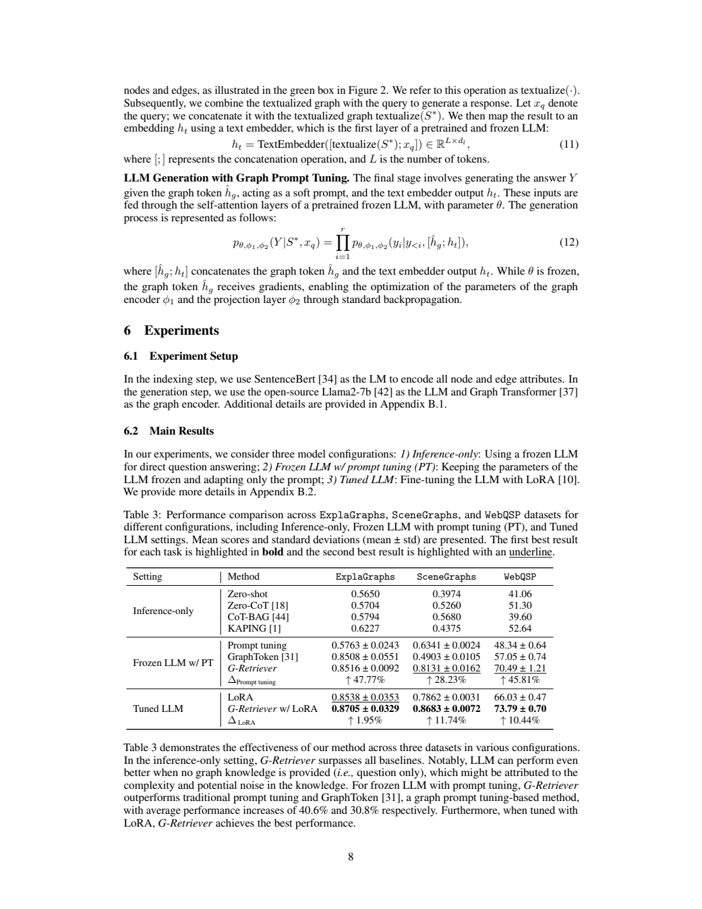

<!-- source-page: 9 -->
## 原文第9页

**表4 图上检索显著提高效率。**

|数据集|检索前平均token|检索前平均节点|检索前分钟/轮|检索后平均token|检索后平均节点|检索后分钟/轮|
|---|---:|---:|---:|---:|---:|---:|
|SceneGraphs|1,396|19|123.1|235（下降83%）|5（下降74%）|86.8（下降29%）|
|WebQSP|100,627|1,371|18.7|610（下降99%）|18（下降99%）|6.2（下降67%）|

#### 6.3 效率评价

表4展示效率：图检索显著减少描述图所需的 token、图节点数并加速训练。SceneGraphs 的 token、节点、训练时间分别下降83%、74%、29%；WebQSP 分别下降99%、99%、67%。这些大幅减少显示了处理大型图数据的效率与潜力。

#### 6.4 缓解幻觉

要求模型回答图问题并确定支持答案的节点或边。以三个指标衡量忠实性：有效节点比例、有效边比例，以及引用的全部节点和边均有效的比例（完全有效图）。人工审查本方法和基线即图提示微调 LLM 各100个回答。表5显示 G-Retriever 相对基线使幻觉减少54%，因为检索确保数据直接来自真实图，从而减少幻觉。细节见附录G。

#### 6.5 消融研究

本消融研究评价流程中各关键组件的独立影响。如表6所示，移除任意这些组件后性能均下降；移除图编码器和文本化图分别下降22.51%和19.19%，说明嵌入格式和文本格式的图表示相互补充。图检索对整体性能也重要。详见B.3。框架对图编码器选择稳健（B.4），并受益于更大 LLM（B.5）。

**表5 SceneGraphs 的幻觉减少，有效节点、有效边、完全有效图比例。**

|指标|基线|G-Retriever|
|---|---:|---:|
|有效节点|31%|77%|
|有效边|12%|76%|
|完全有效图|8%|62%|

**表6 WebQSP 消融，移除组件后的 Hit@1。**

|方法|Hit@1|
|---|---:|
|G-Retriever|70.49|
|无图编码器|54.62（下降22.51%）|
|无投影层|69.70（下降1.11%）|
|无文本化图|56.96（下降19.19%）|
|无检索|63.84（下降9.43%）|

另有现有检索方法比较（附录D）、复杂度讨论（附录E）、使用 G-Retriever“与图对话”的演示（附录H）。译注：表5中8%到62%为54个百分点；正文“54%”是原文表述。

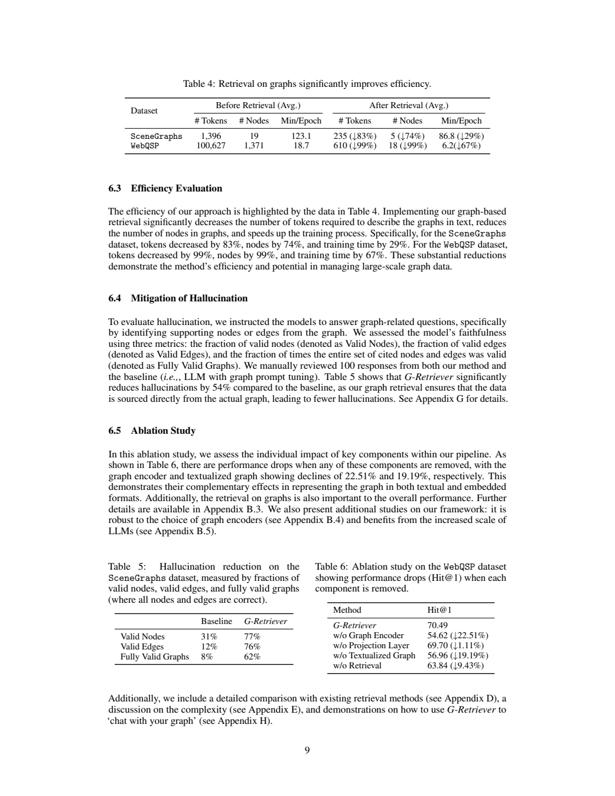

<!-- source-page: 10 -->
## 原文第10页

### 7 结论

本文为真实图问答引入新的 GraphQA 基准，并提出擅长复杂和创造性查询的 G-Retriever 架构。实验表明，它在多个领域的文本属性图任务中优于基线，能够有效扩展到更大图，并抵御幻觉。

**局限和未来工作。** 当前 G-Retriever 使用静态检索组件，未来可以探索检索可训练的更复杂 RAG。

### 致谢

BH 获新加坡教育部学术研究基金一级（2023财年）资助，项目号 A-8001996-00-00。XB 获新加坡国立大学 R-252-000-B97-133 项目资助。作者感谢审稿人反馈，帮助提升了论文清晰度和贡献。

<!-- source-page: 11 -->
## 原文第11页 参考文献

参考文献按要求保留英文原文。

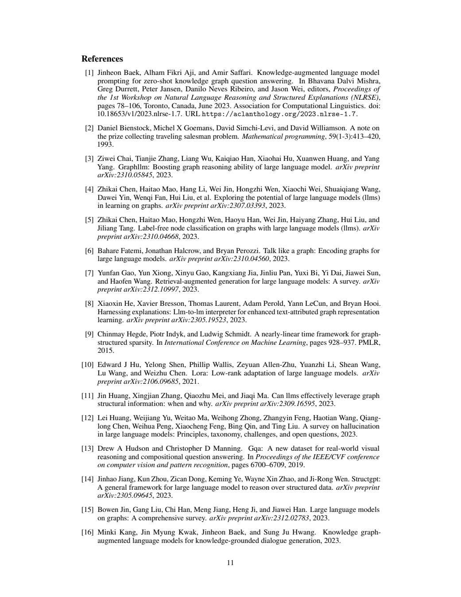

<!-- source-page: 12 -->
## 原文第12页 参考文献续

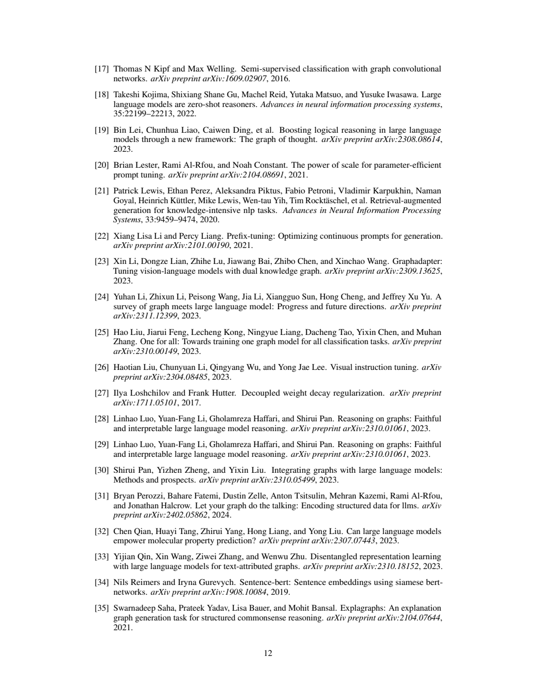

<!-- source-page: 13 -->
## 原文第13页 参考文献续

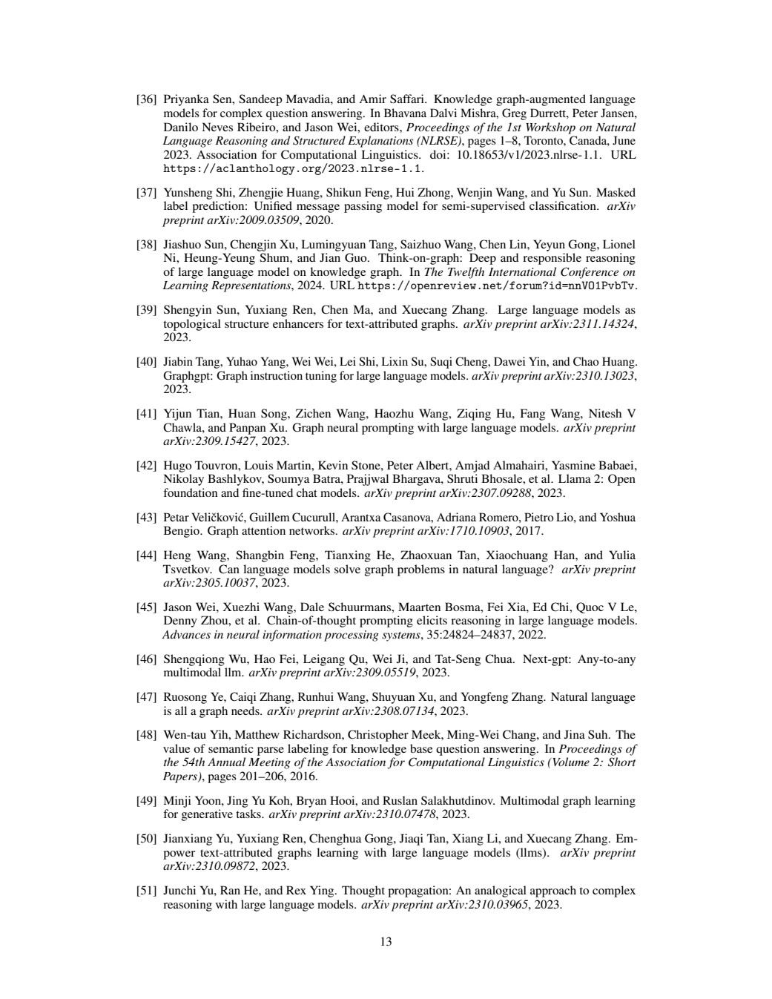

<!-- source-page: 14 -->
## 原文第14页 参考文献续

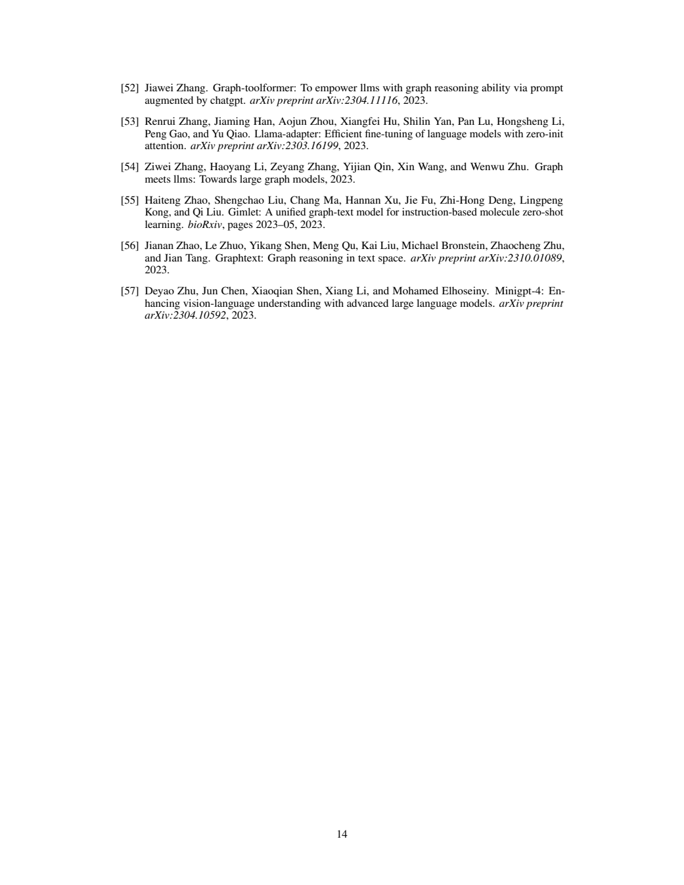

<!-- source-page: 15 -->
## 原文第15页

### 附录A 影响声明

随着 LLM 用于日益多样的任务，处理复杂结构化数据的能力将愈发重要。本文旨在增强 LLM 与图结构数据交互的能力，同时抵御幻觉、提高可靠性。返回检索子图、以对话界面“与图交谈”，也增强了可解释性，改善人机交互，使模型行为更符合人的期待。

### 附录B 实验

#### B.1 实现设置

使用两张 NVIDIA A100-80G GPU。每个实验使用不同随机种子重复四次，以保证稳健性和可复现性。

**图编码器。** 使用 GraphTransformer[37]作为 GNN 骨干，4层，每层4个注意力头，隐藏维度1024。

**LLM。** 使用开源 Llama2-7b[42]骨干。LoRA[10]微调时，更新矩阵维度 lora_r=8，缩放系数 lora_alpha=16，dropout=0.05。提示微调使用10个虚拟 token。最大文本长度512，最多生成32个新 token。

**PCST。** SceneGraphs 检索取前 k 个节点和边，k=3，边成本 $C_e=1$。WebQSP 节点 k=3，边 k=5，边成本0.5。ExplaGraphs 平均仅5.17节点、4.25边（表2），完整图能放入 LLM 上下文，故设 k=0，返回未经改变的原图。

**优化。** AdamW[27]优化器，初始学习率1e-5，权重衰减0.05；预热后按半周期余弦衰减。批量大小4，训练10轮；早停耐心为2轮，以防过拟合、保证训练效率。

#### B.2 模型配置细节

比较三种配置。

**1 仅推理。** 冻结 LLM，使用文本化图和问题直接回答，见图4。

**图4 模型配置1 仅推理。** 图中文字：frozen 冻结；LLM Self Attention Layers 大语言模型自注意力层；LLM Text Embedder 大语言模型文本嵌入器；node_id、node_attr 节点编号、节点属性；src、edge_attr、dst 源节点、边属性、目标节点。示例节点包含 p!nk（Pink，艺名，按原值保留）、gender（性别）、1club.fm: power（电台名称，按原值保留）；示例关系 is_reviewed 表示被评论、artist 表示艺术家、contributions 表示贡献。问题：“Justin Bieber 的弟弟叫什么？”Answer 表示等待生成答案的位置。

**Zero-shot。** 给模型文本化图描述和任务描述，直接要求目标输出，不提供其他示例或演示。

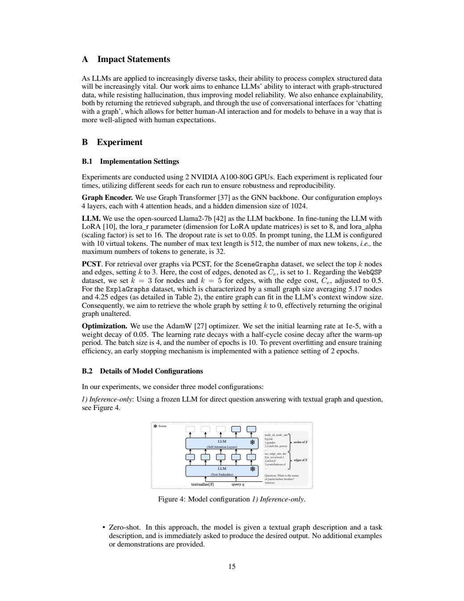

<!-- source-page: 16 -->
## 原文第16页

**Zero-CoT。** 零样本思维链提示[18]延续 CoT[45]，在问题后添加极简单的零样本提示“让我们一步一步思考”。

**CoT-BAG。** Build-a-Graph Prompting[44]在明确给出图的文字描述后，添加“让我们先根据节点和边构建一张图”。

**KAPING。** KAPING[1]是知识图谱问答的零样本知识增强提示方法。先从图中检索与问题相关三元组，再以提示形式放在问题之前，输入 LLM 生成答案。

**2 冻结 LLM 加提示微调。** 保持 LLM 参数固定，只适配提示，包括软提示微调（图5a）、图提示微调方法 GraphToken[31]，以及 G-Retriever（图5b）。

**图5 模型配置2 冻结 LLM 加提示微调。** (a) 提示微调；(b) G-Retriever。prompt 为提示，Projection 为投影，Graph Encoder 为图编码器；frozen/trainable 为冻结/可训练；其余模块和字段含义同图4。两图问题均为“Justin Bieber 的弟弟叫什么？”，模型输出为 Jaxon Bieber（贾克森·比伯）。(a) 中输入节点和关系样例同图4；(b) 中节点 15 Justin Bieber、294 Jaxon Bieber、356 Jeremy Bieber（杰里米·比伯）、551 m.0gxnnwp（未命名中间实体）；parents、children、sibling 分别为父母、子女、兄弟姐妹，节点与边编号、方向按原图保留。

**3 调优 LLM。** 使用 LoRA 微调，包含用于下游任务的标准 LLM LoRA 微调（图6a）和 G-Retriever 加 LoRA（图6b）。

**图6 模型配置3 调优 LLM。** (a) LoRA；(b) G-Retriever 加 LoRA。图中 trainable 表示可训练。两图问题、答案和机器数据分别复用图5(a)(b) 的输入：问题为“Justin Bieber 的弟弟叫什么？”，答案为 Jaxon Bieber。模块、字段、人物及关系中文含义与图4、图5相同。

#### B.3 消融研究细节

本节说明消融研究中对原始架构作出的修改，见图7。

**无图编码器。** 在此设置中，我们将图编码器替换为可训练软 token，并将这类虚拟 token 的数量设为10。

**无投影层。** 删除图编码器之后的投影层，把图编码器输出维度设为4096，与 Llama2-7b 隐藏维度一致，从而使输出图 token（图7b黄色）直接与 LLM token（蓝色）拼接。

**无文本化图。** 改变 LLM 的文本输入，不再同时使用问题和文本化图，仅使用问题。

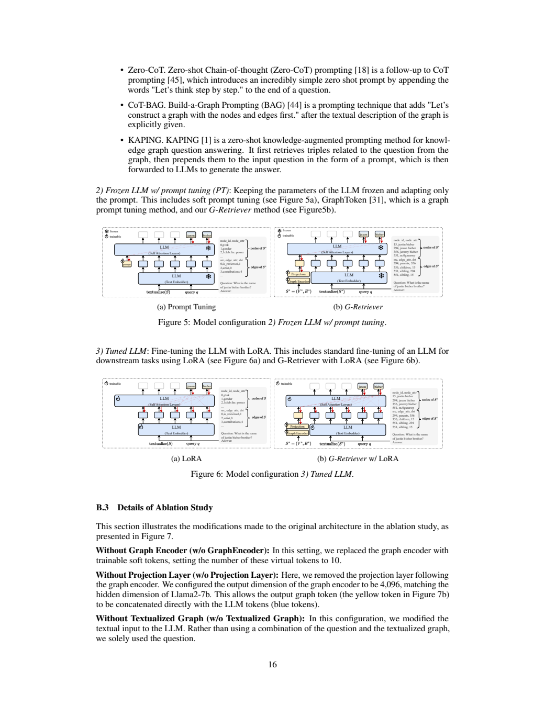

<!-- source-page: 17 -->
## 原文第17页

**图7 消融配置。** (a) 无图编码器；(b) 无投影层；(c) 无文本化图。prompt、Projection、Graph Encoder 分别为提示、投影层、图编码器；frozen/trainable 为冻结/可训练，组件以颜色区分。各图问题均为“Justin Bieber 的弟弟叫什么？”，答案均为 Jaxon Bieber；(a)(b) 的节点属性和关系含义与图5(b) 相同；(c) 不输入文本化图，只输入问题，因而其文字区没有节点边列表。

#### B.4 图编码器选择

除 GraphTransformer[37]外，探索 GCN[17]和 GAT[43]作为编码器，WebQSP 和 ExplaGraphs 比较见表7。

**表7 不同图编码器的性能。**

|图编码器|WebQSP|ExplaGraphs|
|---|---:|---:|
|GCN[17]|70.70|0.8394|
|GAT[43]|70.27|0.8430|
|GraphTransformer[37]|70.49|0.8516|

结果显示不同编码器下本方法保持稳健。三者在 WebQSP 上性能接近且具有竞争力，Hit@1 分别为70.70、70.27、70.49。在 ExplaGraphs 上差异更明显，GraphTransformer 为0.8516，优于 GAT 的0.8430和 GCN 的0.8394。这表明需依据数据集特性与要求选择编码器。译注：原文在本段将 ExplaGraphs 结果亦称 Hit@1，但表2定义其指标为准确率。

#### B.5 LLM 选择

在 LLM 选择方面，我们同时考虑了 Llama2-7b 和 Llama2-13b。表8的实验表明，更强的 LLM 能增强本方法的效果，说明本方法受益于 LLM 规模的增长。

**表8 WebQSP 上不同 LLM 的性能。**

|LLM|Llama2-7b|Llama2-13b|
|---|---:|---:|
|Hit@1|70.49|75.58|

### 附录C GraphQA 基准

详细说明 GraphQA 与原数据集的差别及处理步骤；原始文本和 GraphQA 文本的具体比较见表9。

**ExplaGraphs。** 原数据集[35]（https://explagraphs.github.io/）用三元组表示关系。我们将每个三元组头、尾转为节点，关系转为边，使格式标准化。因测试集标签不可用，仅使用原训练与验证数据，再按6∶2∶2分为训练、验证、测试集。

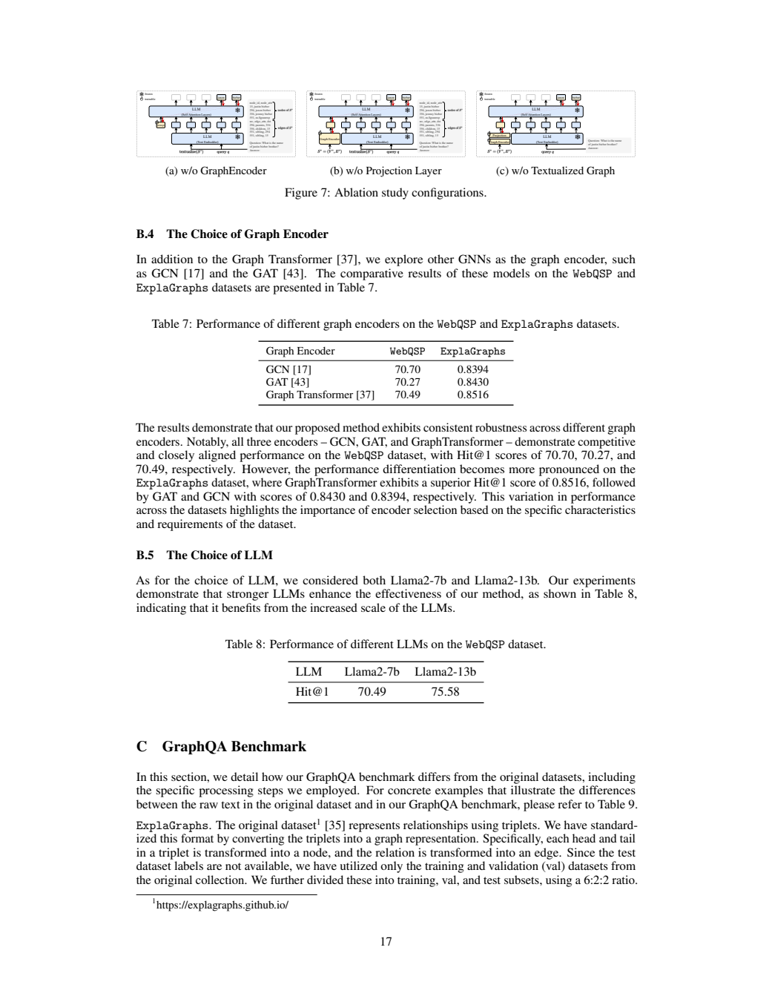

<!-- source-page: 18 -->
## 原文第18页

**表9 原数据集与 GraphQA 的文本格式比较。** 左列为原数据，右列为统一图表示。精确机器可读字段、标识符、节点编号及数值保留在原表；以下给出完整字段中文说明，以保持数据格式可复核。

|原字段|中文含义|
|---|---|
|Dataset / Original dataset / GraphQA Benchmark|数据集 / 原始数据集 / GraphQA 基准|
|width / height|图像宽度 / 图像高度|
|objects / object|物体集合 / 关系所指向的目标物体编号|
|relations / name / attributes|关系列表 / 物体或关系名称 / 物体属性列表|
|x / y / w / h|物体框横坐标 / 纵坐标 / 宽度 / 高度|
|node_id / node_attr|节点编号 / 节点属性|
|src / edge_attr / dst|源节点 / 边属性 / 目标节点|
|name / attribute / (x,y,w,h)|统一节点描述中的名称 / 属性 / 位置与尺寸|
|\n|原数据中的换行分隔符|

WebQSP 路径字段的完整中文对应如下。路径本身属于机器标识符，保留原样，不以中文替换数据：

|关系路径|中文说明|
|---|---|
|sports.sports_award_type.winners|体育奖项类型的获奖记录|
|sports.sports_award_winner.awards|体育奖项得主的获奖记录|
|common.topic.article|主题的文章|
|common.topic.notable_for|主题的显著关联说明|
|freebase.type_profile.published|类型资料的发布状态|
|common.topic.notable_types|主题的显著类型|
|sports.sports_award.award_winner|获奖记录的获奖者|
|type.type.expected_by|引用或预期使用此类型的类型|
|sports.sports_league_season.awards|体育联赛赛季的奖项|
|freebase.type_hints.included_types|类型提示所含的类型|
|type.type.domain|类型所属领域|
|sports.sports_award.award|获奖记录对应的奖项|
|freebase.type_profile.strict_included_types|类型资料严格包含的类型|
|freebase.type_profile.kind|类型资料的类别|
|sports.sports_award.season|获奖记录对应的赛季|
|type.type.properties|类型的属性|

ExplaGraphs 示例原三元组为：“诱捕；能够；遭虐待”“遭虐待；由……造成；警察”“警察；能够；伤害”“伤害；用于；人们”“人们；属于；公民”。统一后节点0—5依次为诱捕、遭虐待、警察、伤害、人们、公民；对应边0→1能够、1→2由……造成、2→3能够、3→4用于、4→5属于。

SceneGraphs 原始 JSON 包含宽500、高375的图像及物体；统一后节点0—15依次为：香蕉（小、黄）、斑点、香蕉（小、黄）、野餐（美味）、吸管（白、塑料）、肉（小、棕、美味）、米饭（堆叠、白）、洋葱（绿）、桌布（白）、碗（满）、大蕉（红）、勺（大、金属、银）、盘（奶油色）、餐食、盘子（白、满）、香蕉（小、黄）。坐标和宽高逐项保留原表。边关系译名：to the left of 在左侧，to the right of 在右侧，on 在上面，inside/in 在内部，next to 在旁边，of 所属，near 附近，with 伴随。全部原始边、节点空间数值见原页，保持数据内容不改写。

WebQSP 示例从三元组列表转为节点列表和边列表。节点含 FedExCup（联邦快递杯）、Brandt Snedeker（布兰特·斯内德克尔）、2012 PGA Tour（2012年PGA巡回赛）、Sports League Award Type（体育联赛奖项类型）、Published（已发布）、Award（奖项）、Topic（主题）、Sports（体育）、Classification（分类）、Winners（获奖者）以及未命名实体标识符。关系包含奖项类型的获奖者、获奖者的奖项、主题文章、显著关联与类型、类型描述的发布状态、体育奖项获奖者与赛季等。为保持数据结构可比，全部 Freebase 路径、实体标识符和节点编号以原文表9为准，不对机器字段做语义替换。

**SceneGraphs。** 原始 GQA[13]旨在真实世界视觉推理和组合问答，解决先前 VQA 数据集的重要不足，包含108k图像及对应场景图。本文关注图问答，因此只用场景图而不使用图像。原始数据以 JSON 描述图像，我们简化物体 ID，随机采样100k条，按6∶2∶2分为训练、验证、测试。

**WebQSP。** 遵循 RoG[28]（https://huggingface.co/datasets/rmanluo/RoG-webqsp）的预处理，将三元组列表转为统一图格式。

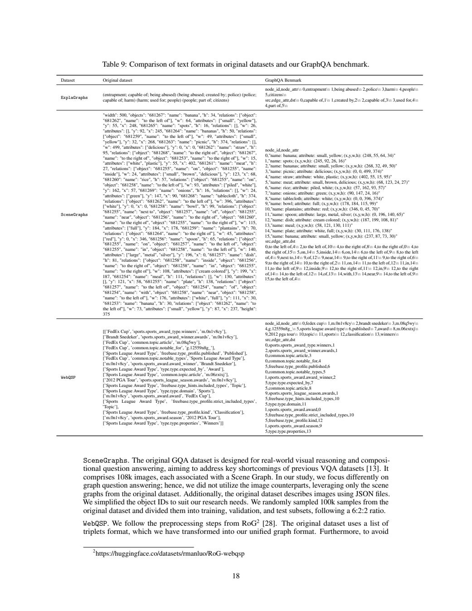

<!-- source-page: 19 -->
## 原文第19页

为避免大小写区别，把所有词转成小写；数据划分与原数据集相同。

**GraphQA 基准的贡献。** 我们承认本基准把三个现有图数据集转为统一格式，但认为标准化在以下方面对研究社区有价值。

- **引入任务。** 现有图问答基准关注小图或合成图，本基准则涵盖真实应用，并将其表述为图问答。
- **标准化。** 将不同背景的数据标准化为 GraphQA 统一格式，是重要工作，确保模型间评估一致、可比。
- **可访问性。** 开源统一格式简化跨数据集模型应用，降低处理不同结构和预处理流程的复杂度，降低新研究者门槛、扩大参与。已有新工作使用 GraphQA，我们预计其会在 LLM 和 GNN 社区快速普及。
- **基线比较。** 提供基线性能，帮助识别新方法相对于既有基线的长处和弱点。

### 附录D 图检索增强生成 GraphRAG

#### D.1 PCST 检索的进一步说明

**建模动机。** 将子图检索表述为 PCST 优化，源于寻找包含大部分相关节点和边的连通子图的需求；这与最大化节点价值、最小化边成本的 PCST 目标一致。尽管并非公认为最优方案，我们通过实验验证了有效性。

**与其他基线相比的效果。** 与三种检索基线比较：(1)Top-k 三元组即 KAPING[1]，检索相关三元组并加入提示；(2)Top-k 节点及其一跳邻居，捕捉局部上下文；(3)最短路径，检索 Top-k 节点并计算其间最短路径。所有方法 k=5，LLM 为 llama2-7b-chat。表10显示 PCST 在 WebQSP 上 Hit@1 为66.17%，优于全部基线。

**表10 WebQSP 检索方法比较。**

|方法|Hit@1|
|---|---:|
|PCST检索|66.17|
|Top-k三元组检索 KAPING|52.64|
|Top-k节点及其邻居|49.82|
|最短路径检索|55.20|

#### D.2 基于子图检索的优势

**上下文相关。** 独立选择节点和边可能忽略邻域；PCST 保证返回连通子图，在检索中捕捉图上下文。

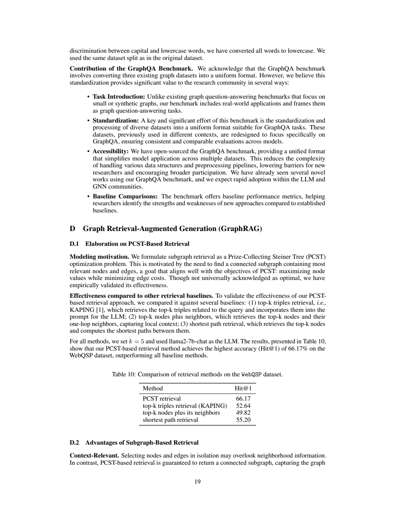

<!-- source-page: 20 -->
## 原文第20页

该方法不仅检索高相关节点或边，还检索将它们与上下文重要节点或边连接的“桥梁”元素，这对生成完整回答至关重要。

**规模管理。** 相比最短路径，PCST 更易控制检索子图大小。调整节点和边的奖赏与成本即可控制子图范围；最短路径无法控制 Top-k 节点间距离，可能产生不连通子图或包含不必要的长路径。

#### D.3 检索中 k 的影响

使用 k 近邻确定最相关节点和边（见公式6）。较小 k 可能漏掉关键知识，较大 k 可能引入过量信息，分散模型对重要细节的注意。我们额外比较 k=3、5、10、20。

**表11 k 对 WebQSP 的影响。**

|k|3|5|10|20|
|---|---:|---:|---:|---:|
|Hit@1|0.6977|0.7063|0.7248|0.7039|

Hit@1 随 k 增大先上升、达到峰值后下降。可通过验证集交叉验证等技术确定最佳 k。

#### D.4 相似度函数选择

本文使用余弦相似度，这是视觉和语言向量模型的常见度量，例如 CLIP 也用它比较文本和图像特征。虽然可能不是最优选择，但我们认为它是通用、有代表性、有效且适合快速检索的选择。

### 附录E 复杂度讨论

#### E.1 GNN LLM 和 GraphRAG 的整合

G-Retriever 结合三者的优势。将 LLM 与其他模态编码器结合，增强多模态能力的 LLM+X 框架已被广泛采用，如 LLaVA、MiniGPT-4、Flamingo；理解和实现并不复杂。GraphRAG 不需训练，可在预处理或即时执行，不会显著增加时间与计算复杂度。相反，可大幅缩小图，例如 WebQSP 去除99%节点，将总运行时间从18.7降至6.2分钟/轮。

#### E.2 计算资源

使用两张显存各80GB的 A100，在 Llama2-7b 和 WebQSP 上测试。训练批量16、评估批量32，结果如下。这些结果说明图 RAG 显著缩小图并加速运行。译注：此处批量16与B.1批量4均按原文保留，不能默认同一批量配置。

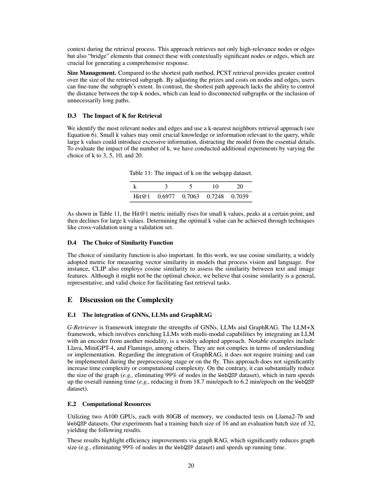

<!-- source-page: 21 -->
## 原文第21页

**表12 WebQSP 各方法性能与效率。**

|设置|方法|Hit@1|时间|
|---|---|---:|---:|
|仅推理|只给问题|61.16|31分钟|
|仅推理|文本化图和问题|41.06|40分钟|
|冻结LLM加PT|Prompt Tuning|48.34|18.7分钟/轮|
|冻结LLM加PT|G-Retriever|70.49|6.2分钟/轮|
|调优LLM|LoRA|66.03|19分钟/轮|
|调优LLM|G-Retriever加LoRA|73.79|6.9分钟/轮|

### 附录F 可解释性讨论

我们认为 G-Retriever 从以下方面增强可解释性。

**检索子图。** 返回与查询最相关的子图，让用户看到图中哪些部分对答案重要，从而理解回答依据。例如，要理解某信息为什么出现在或没有出现在回答中，可检查检索子图是否包含该信息。

**对话接口。** 用户可继续提问并获得详细自然语言解释。例如质疑回答时可问“为什么你认为[xxx]？请解释你的答案。”交互使用户探索模型推理过程，更深入了解其图数据解释方式。

### 附录G 图 LLM 的幻觉

本节给出 SceneGraphs 上幻觉的定量结果。

**基线。** 将 MiniGPT-4[57]适配到图场景：冻结 LLM 与可训练 GNN 交互，GNN 将图编码为软提示，称 LLM+Graph Prompt Tuning。选择图提示微调而非图转文本作为基线，因为文本图表示较长、持续超过 LLM 输入限制。

**实验设计。** 要求 LLM 回答图问题，并列出解释图中支持答案的节点或边。问题没有标准答案，可灵活回答，因此评价困难。我们人工检查本方法和基线各100个回答，核验输出引用的节点和边是否真实存在。

**评价指标。** 有效节点比例（Valid Nodes）、有效边比例（Valid Edges）、所有引用节点和边均有效的回答比例（Fully Valid Graphs）。

**结果。** 表5说明 G-Retriever 相比基线有效减少幻觉。基线节点仅31%有效，边仅12%有效，完整节点边集合仅8%有效；G-Retriever 分别达77%、76%、62%。这表明在图场景同时准确引用节点和边的困难任务上，幻觉显著减少。

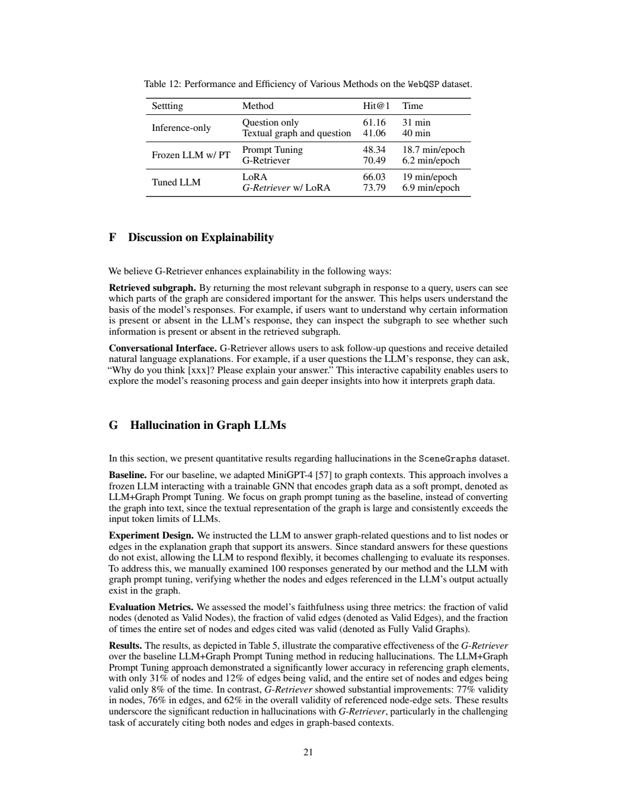

<!-- source-page: 22 -->
## 原文第22页

### 附录H 演示

我们以 ExplaGraphs、SceneGraphs、WebQSP 上的创造性问题展示 G-Retriever 的交互能力，例子分别见表13、14、15，并在图1可视化。

<!-- source-page: 23 -->
## 原文第23页

**表13 ExplaGraphs 创造性对话示例。** 图节点0—7依次为人类、整容手术、女性、改变外貌、成瘾、追求完美、停止、积极。边为：0接受行动1；2属于0；1用于3；3能够4；4由5产生；4不能6；4不是7。

**用户：** 根据解释图提供的信息，写一篇500词的议论文。

**模型：** 解释图详细分析女性接受整容手术的原因。根据图，主要原因包括改变外貌的愿望、社会审美标准的影响，以及对追求完美的成瘾。图中各种节点和边进一步支持这些原因，提供对整容动机与后果的更多认识。

首先，“人类”节点凸显人希望外貌有吸引力并感到自信的基本愿望。这种愿望深植于我们的文化：美常与幸福、成功及社会接纳相关。因此，许多女性感到必须符合社会审美标准的压力，可能导致不安全感和低自尊。一些女性因而把整容当作改善外貌、提升自信的办法。

其次，“女性”节点凸显整容的性别特点。男性也整容，但大多数患者是女性，可能因为女性更常接触并内化社会审美标准，从而更易对外貌不安、以整容改善容貌。

第三，“成瘾”节点凸显潜在负面后果。一些女性在术后最初可能提升自信与自尊，但图表明这种提升未必持久。部分女性可能沉迷于不断追求完美，陷入手术与不满意的循环，造成严重心理情绪后果，包括抑郁、焦虑、自尊丧失。

第四，“追求完美”节点凸显许多女性对整容结果的不现实期待。图表明，她们可能过度期待整容改善外貌、增强自尊的能力，因而对结果失望、不满，并通过更多手术继续追求完美。

最后，“停止”节点凸显面对整容时批判思考和自我反省的重要。图表明，女性应了解整容潜在的负面后果，并认真考虑自己接受手术的原因。她们还应意识到自己对结果可能抱有不现实期待，并准备好处理可能出现的任何负面情绪或不满。

总之，解释图详析女性整容原因，强调人希望有吸引力和自信的基本愿望、整容的性别特点、潜在负面后果，以及批判思考和自我反省的重要。理解原因和后果，女性便能对是否整容作知情决定，并处理可能出现的负面情绪或不满。

译注：以上为原论文模型输出的翻译，保留其概括与推断，不表示译者将其全部视为已获图证据支持的事实。

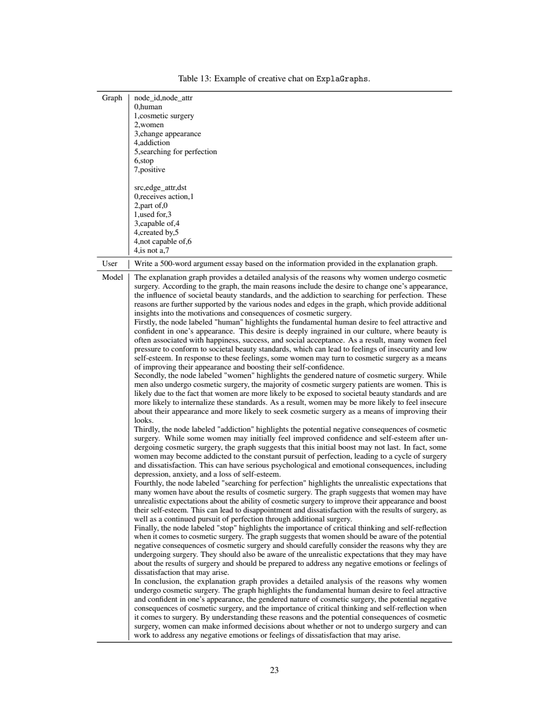

<!-- source-page: 24 -->
## 原文第24页

**表14 SceneGraphs 创造性对话示例。** 作者用 GPT-4 根据图生成图像，帮助读者可视化。

图节点0—14：头（黑），游泳池（小、有水），岸，围栏（铁丝），山（被覆盖），水（蓝），羊（行走、吃草），天空（蓝、晴朗、有云），羊（白、毛茸茸），田野（大、绿、草地），草，11羊（白、毛茸茸），12羊（白、毛茸茸），13羊（白、毛茸茸），14岸（沙质）。每个节点的空间坐标和尺寸见保留原表。边：0在11左侧、13右侧；3在6左侧；6在3右侧、在10上吃草、位于9和10内；7在5上方；8吃10、位于11和12右侧；11在8左侧、在0、13、12右侧、吃10；12吃10、在8左侧、13右侧、11左侧；13在0、11、12左侧、吃10。

**用户：** 为场景图中的地点写一篇500词广告，吸引人们前来游览。

**模型：** 当然！以下是基于场景图为这个地方写的一篇500词广告示例：

“体验这里令人屏息的美景，连绵山丘与游泳池闪耀的水面相接。漫步郁郁葱葱的绿野，眺望如画风景，让微风轻拂脸庞。羊群在远方安静吃草，白色羊毛在阳光下闪烁。天空湛蓝，蓬松白云悠然漂浮。来沐浴这里宁静的氛围，自然之美会让你赞叹不已。”

译注：原文模型虽称“500词”，实际输出明显较短，此处按实际文本翻译，未补写。

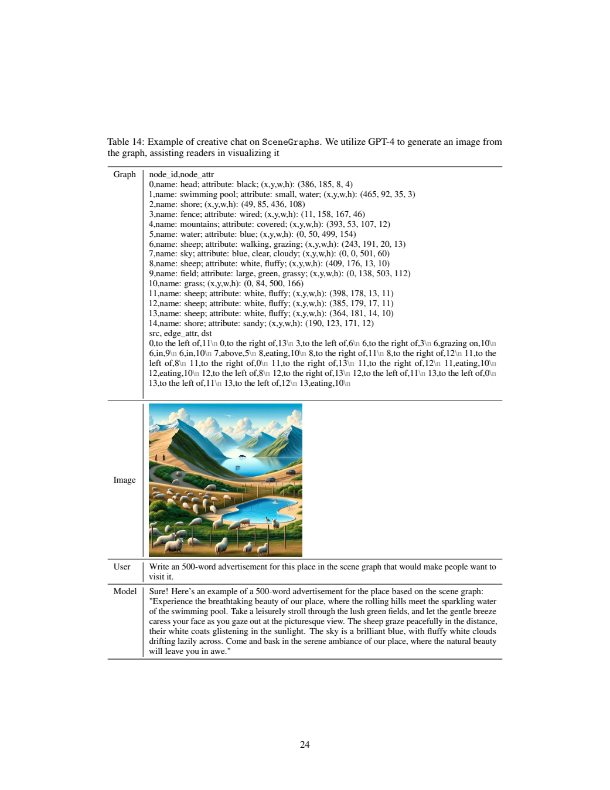

<!-- source-page: 25 -->
## 原文第25页

**表15 WebQSP 创造性对话示例。** 节点：8 Benjamin Franklin（本杰明·富兰克林）；63玻璃琴；98避雷针；99《窃取上帝的雷电：本杰明·富兰克林的避雷针与美国的发明》；227富兰克林与托马斯·杰斐逊共事；442富兰克林炉；525双焦点眼镜；706《富兰克林从天空引来电流》；1044 Prokop Diviš（普罗科普·迪维什）。原始 Freebase 关系路径及方向保留原表：艺术作品主题、知识主题关联、书籍主题作品、发明的发明者、发明家的发明、创新者的原创想法等。

**用户：** 问题：本·富兰克林还发明了什么？围绕这一问题设计一次知识图谱教育导览，以引人入胜的方式突出有趣事实和联系。

**模型：** 很好！根据知识图谱，下面的教育导览介绍富兰克林发明及其他成就的有趣事实与联系。

1. **富兰克林的避雷针。** 首先探索富兰克林最著名的发明——避雷针。了解他的发明如何保护建筑免遭雷击，以及它怎样改变人们对电的理解。联系：富兰克林与托马斯·杰斐逊一起研究避雷针，他们的合作促成了正电荷和负电荷概念的发展。
2. **双焦点眼镜。** 接着了解富兰克林发明的双焦点眼镜。看看他的视力问题如何启发他创造一种新型眼镜，使人们既能看清近处物体，也能看清远处物体。联系：富兰克林的双焦点眼镜是一项开创性发明，改善了世界各地数百万人的生活。
3. **富兰克林炉。** 探索富兰克林设计的富兰克林炉——一种以更少燃料提供更多热量的铸铁炉。了解这种炉子如何革新供暖系统，以及它怎样帮助家庭和企业降低燃料成本。联系：富兰克林炉是能源效率和可持续性的早期范例，为现代供暖系统铺平了道路。
4. **普罗科普·迪维什。** 了解富兰克林与捷克发明家普罗科普·迪维什的联系。迪维什在富兰克林的工作基础上继续发展，研制出了第一台发电机。看看迪维什的发明如何帮助推动工业革命，以及它怎样改变人们的生活和工作方式。联系：富兰克林对避雷针的研究启发迪维什探索电的性质，而他们的合作努力推动了电气工程领域的发展。
5. **创新者与原创思想。** 探索富兰克林作为创新者的声誉，以及他提出原创思想的能力。了解他的创造力和好奇心如何促成许多发明，以及他怎样看出表面上互不相关的事物之间的联系。联系：富兰克林的创新精神和跳出思维定式的能力启发了许多其他发明家与科学家，包括托马斯·爱迪生和尼古拉·特斯拉。
6. **合作与人脉。** 突出富兰克林以合作方式开展发明，以及他同其他发明家和科学家建立联系的能力。了解他与其他创新者的联系如何帮助推进科学技术。联系：富兰克林同托马斯·杰斐逊、普罗科普·迪维什等其他发明家和科学家的合作，帮助加快了创新步伐，并为未来的突破铺平了道路。
7. **遗产与影响。** 反思富兰克林经久不衰的遗产，以及他的发明对现代社会的影响。了解这些发明如何继续启发新一代发明家与科学家，以及它们如何帮助塑造我们今天生活的世界。联系：富兰克林的发明和思想对许多领域产生了持久影响，包括科学、技术乃至整个社会。他的遗产继续启发并激励着世界各地的人们。

沿着这次知识图谱教育导览前进，学生将更深入地理解本杰明·富兰克林的发明及其对现代社会的影响。他们还将了解富兰克林以合作方式开展发明的方法、他的创新精神，以及他跳出思维定式的能力。

译注：本表是模型实际输出示例，内有未经图支持、可能错误的历史联系，不能当作已核实的历史陈述，也不能据此声称幻觉已消除。

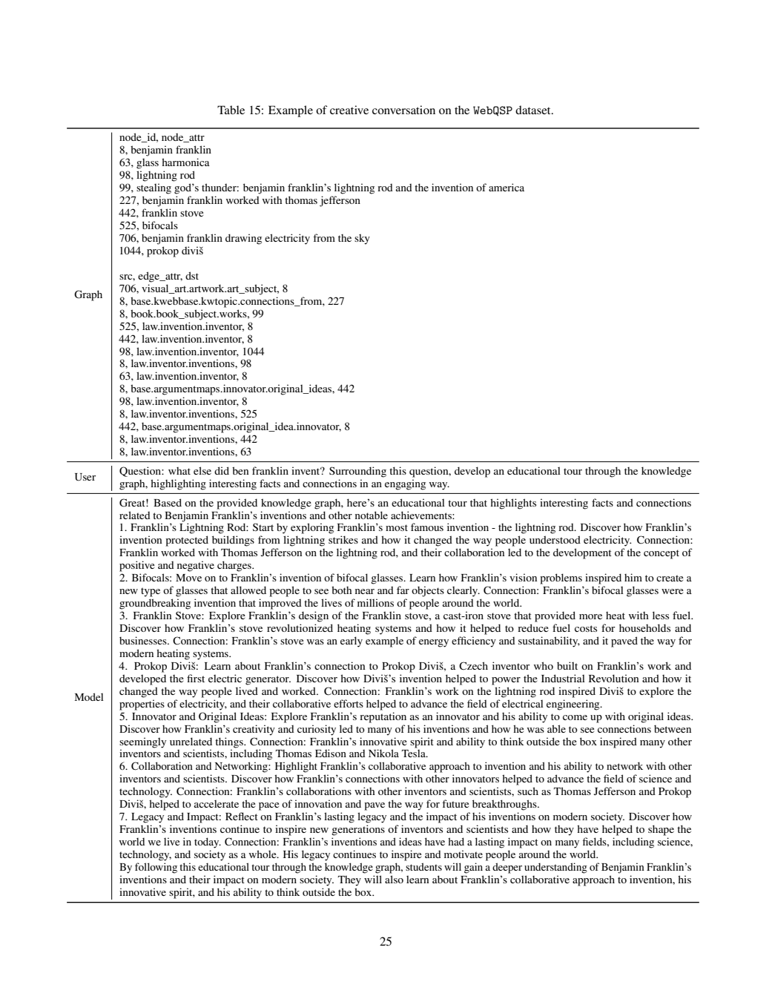

<!-- source-page: 26 -->
## 原文第26页

### NeurIPS 论文检查表

#### 1 研究主张

**问题：** 摘要和引言中的主要主张是否准确反映论文的贡献与范围？

**回答：是。**

**理由：** 如摘要和引言所示。

**指导原则：**

- 回答“不适用”（NA），表示摘要和引言没有包含论文所作的主张。
- 摘要和/或引言应明确陈述论文主张，包括论文贡献，以及重要假设和局限。对此回答“否”或“不适用”，不会获得审稿人的良好评价。
- 所作主张应与理论结果和实验结果相符，并反映这些结果预期能推广到其他设置的程度。
- 可以将愿景性目标作为研究动机，但必须明确说明本文尚未实现这些目标。

#### 2 局限性

**问题：** 论文是否讨论作者已完成工作的局限？

**回答：是。**

**理由：** 我们在第7节讨论了本工作的局限。

**指导原则：**

- 回答“不适用”，表示论文没有局限；回答“否”，表示论文有局限，但文中没有讨论。
- 鼓励作者在论文中单独设立“局限性”一节。
- 论文应指出所有强假设，并说明违反这些假设时结果有多稳健，例如独立性假设、无噪声设置、模型设定正确，以及仅在局部成立的渐近近似。作者应思考这些假设在实践中可能如何被违反，以及后果是什么。
- 作者应反思所作主张的范围，例如方法是否仅在少数数据集或少量运行中测试。一般而言，经验结果往往依赖隐含假设，应把这些假设明确表达出来。
- 作者应反思影响方法性能的因素。例如，人脸识别算法可能在图像分辨率低或弱光拍摄时表现不佳；语音转文字系统也可能因无法处理专业术语，而不能可靠地为在线讲座提供字幕。
- 作者应讨论所提算法的计算效率，以及它们如何随数据集大小扩展。
- 如适用，作者应讨论方法在处理隐私和公平问题时可能存在的局限。
- 作者可能担心，如实披露局限会被审稿人作为拒稿理由；但更糟的结果可能是审稿人发现论文未承认的局限。作者应运用最佳判断，并认识到个人促进透明的行动，对形成维护研究社区诚信的规范很重要。审稿人将被明确要求，不因作者诚实披露局限而惩罚作者。

#### 3 理论假设与证明

**问题：** 对每项理论结果，论文是否提供全部假设，以及完整、正确的证明？

**回答：不适用。**

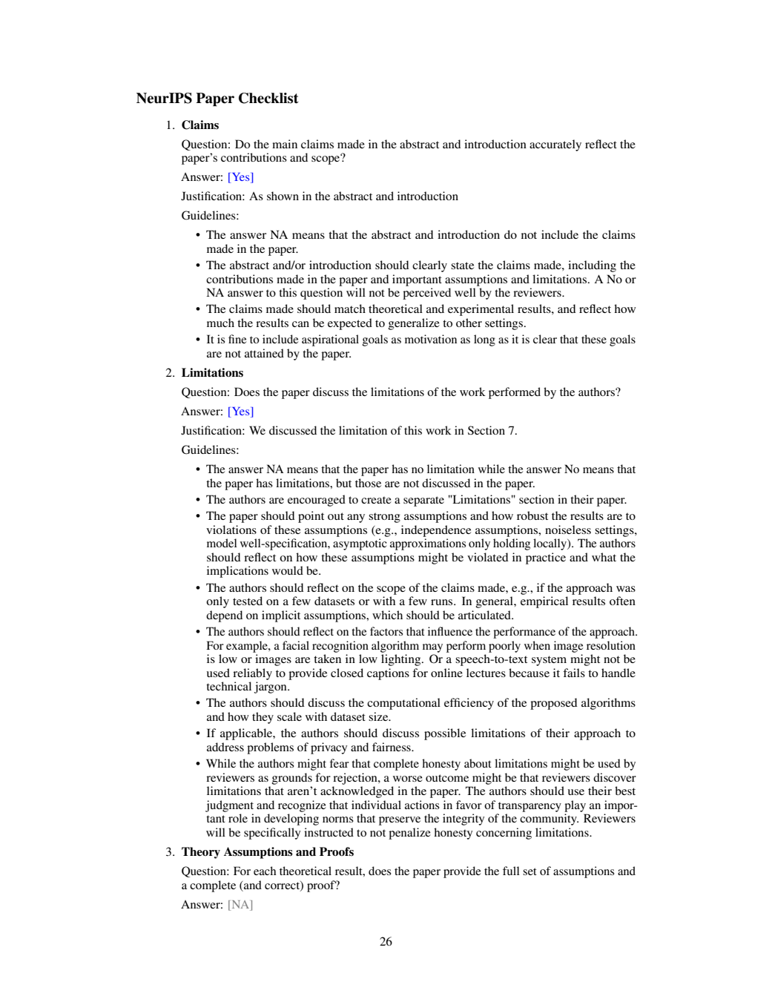

<!-- source-page: 27 -->
## 原文第27页

**第3项理由：** 本文不包含理论结果。

**指导原则：**

- 回答“不适用”，表示论文不包含理论结果。
- 论文中的所有定理、公式和证明都应编号，并进行交叉引用。
- 所有假设都应在定理陈述中清楚写出，或在其中提供引用。
- 证明可以出现在正文或补充材料中；若放在补充材料，鼓励作者在正文提供简短证明思路，以帮助理解其直觉。
- 反过来，正文中的非形式化证明，应由附录或补充材料中的形式化证明补充。
- 证明所依赖的定理和引理应得到正确引用。

#### 4 实验结果可复现性

**问题：** 对影响论文主要主张和/或结论的主要实验结果，论文是否充分披露复现所需的全部信息，无论是否提供代码和数据？

**回答：是。**

**理由：** 第6节和附录B提供了全面实验设置细节，以支持复现。

**指导原则：**

- 回答“不适用”，表示论文没有实验。
- 若论文包含实验，回答“否”不会获得审稿人的良好评价。无论是否提供代码和数据，让论文可复现都很重要。
- 如果贡献是数据集和/或模型，作者应说明为使结果可复现或可验证而采取的步骤。
- 可复现性可因贡献类型而通过不同方式实现。例如，贡献为新架构时，完整描述架构可能就足够；若贡献为特定模型及其实证评估，则可能需要让他人能够用同一数据集复制模型，或允许访问模型。一般而言，发布代码和数据通常是实现复现的好方法，但也可提供详细结果复制指引、托管模型的访问权限（例如大语言模型）、模型检查点，或与该项研究相适应的其他方式。
- NeurIPS 虽不要求发布代码，但要求所有投稿提供某种合理的复现途径；具体途径可取决于贡献性质。例如：

(a) 若主要贡献是新算法，论文应明确说明如何复现该算法。

(b) 若主要贡献是新模型架构，论文应清楚、完整地描述该架构。

(c) 若贡献是新模型，例如大语言模型，应提供访问模型以复现实验结果的方式，或者提供复现模型的方式，例如开源数据集或数据集构建指引。

(d) 我们承认，某些情形下复现可能困难；欢迎作者说明其提供的具体复现方式。闭源模型的访问可能受某些限制，例如只向注册用户开放，但其他研究者仍应有复现或验证结果的途径。

#### 5 数据与代码的开放访问

**问题：** 论文是否开放数据和代码，并提供充分指引，使人们能够按照补充材料忠实复现主要实验结果？

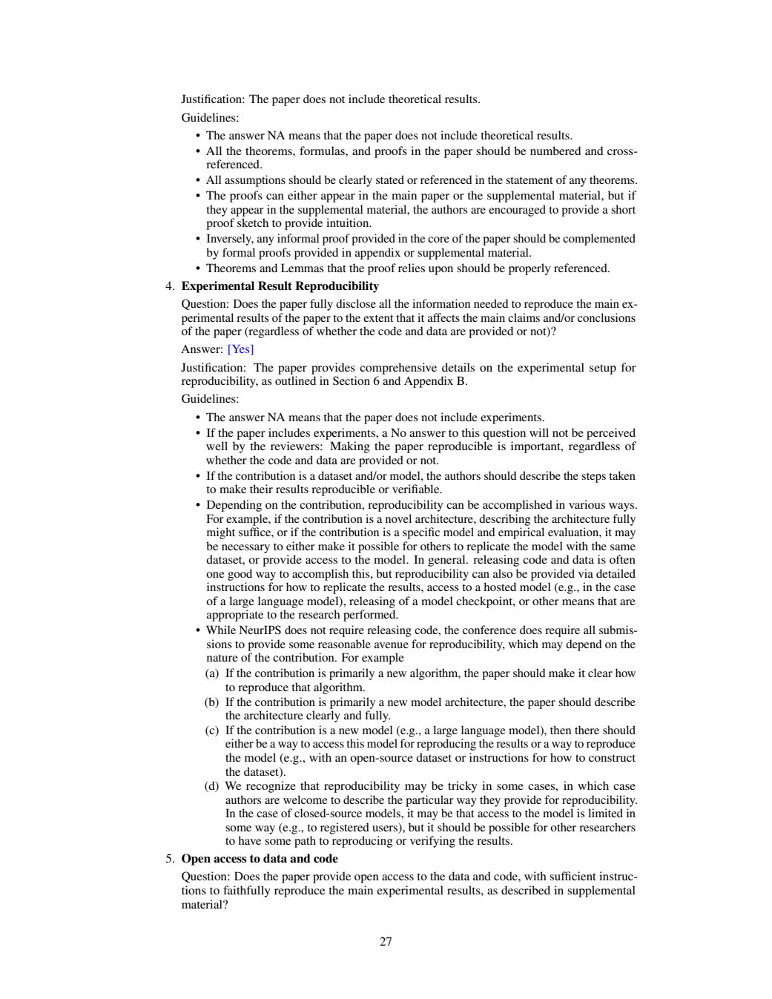

<!-- source-page: 28 -->
## 原文第28页

**第5项回答：是。**

**理由：** 代码与数据集位于 https://anonymous.4open.science/r/G-Retriever 。

译注：此处保留检查表中的匿名地址，论文首页列出正式 GitHub 地址。

**指导原则：**

- 回答“不适用”，表示论文没有需要代码的实验。
- 详情请参阅 NeurIPS 代码和数据提交指南：https://nips.cc/public/guides/CodeSubmissionPolicy 。
- 我们鼓励发布代码和数据，但也理解这可能做不到，因此回答“否”是可以接受的。不能仅因论文不包含代码而拒稿，除非代码是贡献的核心，例如新的开源基准。
- 指引应包含复现结果需要运行的精确命令和环境。更多细节见上述 NeurIPS 代码和数据提交指南。
- 作者应提供数据访问和准备指引，包括如何取得原始数据、预处理数据、中间数据、生成数据等。
- 作者应提供脚本，复现新方法和基线的所有实验结果。若仅能复现一部分实验，应说明脚本省略了哪些实验及原因。
- 投稿时，为保持匿名，作者应发布匿名版本，如适用。
- 建议在附于论文的补充材料中提供尽可能多的信息；也允许提供数据与代码的 URL。

#### 6 实验设置与细节

**问题：** 论文是否说明理解结果所需的全部训练、测试细节，例如数据划分、超参数及其选择方式、优化器类型等？

**回答：是。**

**理由：** 附录B说明了所有训练与测试细节。

**指导原则：**

- 回答“不适用”，表示论文没有实验。
- 正文应提供足够详细的实验设置，使读者能评价结果、理解结果的意义。
- 完整细节可以随代码提供，也可以放在附录或补充材料中。

#### 7 实验统计显著性

**问题：** 论文是否报告了定义恰当、正确的误差条，或关于实验统计显著性的其他适当信息？

**回答：是。**

**理由：** 如表3所示，我们报告了均值和标准差。

**指导原则：**

- 回答“不适用”，表示论文没有实验。
- 至少在支持主要主张的实验中，如果结果附有误差条、置信区间或统计显著性检验，作者应回答“是”。
- 应明确说明误差条捕捉的变异来源，例如训练/测试划分、初始化、某参数的随机抽取，或给定实验条件下完整运行的变异。
- 应解释误差条的计算方法，例如闭式公式、库函数调用、bootstrap 等。
- 应给出所作假设，例如误差服从正态分布。

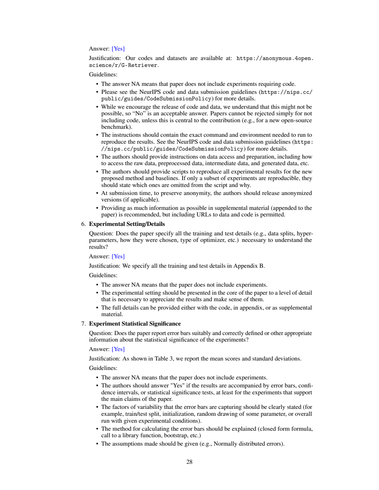

<!-- source-page: 29 -->
## 原文第29页

**第7项指导原则续：**

- 应清楚说明误差条是标准差，还是均值的标准误。
- 可以报告 1-sigma 误差条，但应明确说明。如果没有验证误差的正态性假设，最好报告 2-sigma 误差条，而不是声称这是 96% 置信区间。
- 对不对称分布，应小心避免在表或图中展示对称误差条，以免产生超出范围的结果，例如负的错误率。
- 若表或图报告误差条，作者应在正文中解释计算方式，并在正文引用相应图表。

#### 8 实验计算资源

**问题：** 对每项实验，论文是否提供复现所需计算资源的充分信息，例如计算设备类型、内存和运行时间？

**回答：是。**

**理由：** 附录E报告了所需计算资源。

**指导原则：**

- 回答“不适用”，表示论文没有实验。
- 论文应注明计算设备类型，是 CPU 还是 GPU、内部集群还是云提供商，并包括相关内存与存储信息。
- 论文应给出每次实验运行所需计算量，并估算总计算量。
- 论文应披露整个研究项目是否比文中报告的实验需要更多计算，例如未写入论文的预实验或失败实验。

#### 9 道德准则

**问题：** 论文所开展研究是否在各方面均符合 NeurIPS 道德准则 https://neurips.cc/public/EthicsGuidelines ？

**回答：是。**

**理由：** 本文研究在各方面均符合 NeurIPS 道德准则。

**指导原则：**

- 回答“不适用”，表示作者没有审阅 NeurIPS 道德准则。
- 若作者回答“否”，应解释需要偏离道德准则的特殊情况。
- 作者应确保匿名，例如所在司法辖区法律或法规引起特殊考虑时。

#### 10 更广泛的影响

**问题：** 论文是否同时讨论了所完成工作潜在的正面和负面社会影响？

**回答：是。**

**理由：** 附录A讨论了更广泛的影响。

**指导原则：**

- 回答“不适用”，表示已完成工作没有社会影响。
- 如果作者回答“不适用”或“否”，应解释其工作为什么没有社会影响，或论文为什么没有讨论社会影响。
- 负面社会影响例子包括潜在恶意或非预期用途，如虚假信息、生成虚假个人档案、监控；公平性考虑，如部署的技术可能作出不公平影响特定群体的决策；以及隐私和安全考虑。

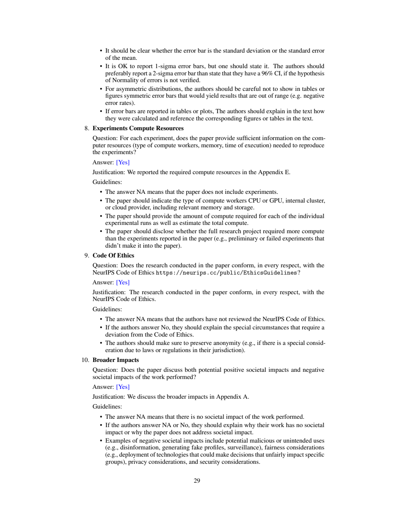

<!-- source-page: 30 -->
## 原文第30页

**第10项指导原则续：**

- 会议预期很多论文属于基础研究，不与具体应用绑定，更谈不上部署。但如果存在通往负面应用的直接路径，作者应指出。例如，生成模型质量提升可能被用来制作传播虚假信息的深度伪造，这样讨论是合理的；另一方面，不必指出通用神经网络优化算法可能让人更快训练深度伪造模型。
- 作者应考虑：技术按预期使用且正常工作时可能产生的伤害；技术按预期使用但给出错误结果时可能产生的伤害；以及有意或无意滥用技术造成的伤害。
- 若存在负面社会影响，作者还可以讨论潜在缓解策略，例如限制模型发布、在提供攻击方法时同时提供防御措施、监测滥用的机制、监测系统如何随时间从反馈中学习的机制，以及提高机器学习效率和可获取性。

#### 11 保障措施

**问题：** 对具有较高滥用风险的数据或模型，例如预训练语言模型、图像生成器、爬取的数据集，论文是否说明为负责任发布所采取的保障措施？

**回答：不适用。**

**理由：** 本文没有此类风险。

**指导原则：**

- 回答“不适用”，表示论文没有此类风险。
- 具有高滥用风险或双重用途的模型，发布时应设置必要保障，允许受控使用，例如要求用户遵守使用指引、限制模型访问，或实施安全过滤。
- 互联网爬取数据集可能有安全风险。作者应说明如何避免发布不安全图像。
- 我们承认有效保障措施很难提供，很多论文也不需要此项，但鼓励作者认真考虑并作出善意努力。

#### 12 既有资产的许可

**问题：** 对论文使用的代码、数据、模型等资产，是否适当认可创建者或原所有者，并明确提及、妥善遵守许可证和使用条款？

**回答：是。**

**理由：** 本文所使用代码、数据和模型等资产的创建者或原所有者均得到适当认可，其许可证和使用条款被明确提及并妥善遵守。

**指导原则：**

- 回答“不适用”，表示论文未使用既有资产。
- 作者应引用产生该代码包或数据集的原始论文。
- 作者应说明所用资产版本，并尽可能提供 URL。
- 每项资产都应给出许可证名称，例如 CC-BY 4.0。
- 对从特定来源如网站爬取的数据，应提供该来源的版权和服务条款。
- 若发布资产，应提供包内的许可、版权信息和使用条款。对于常见数据集，paperswithcode.com/datasets 汇集了部分数据集许可，其许可指南可帮助确定某个数据集的许可。

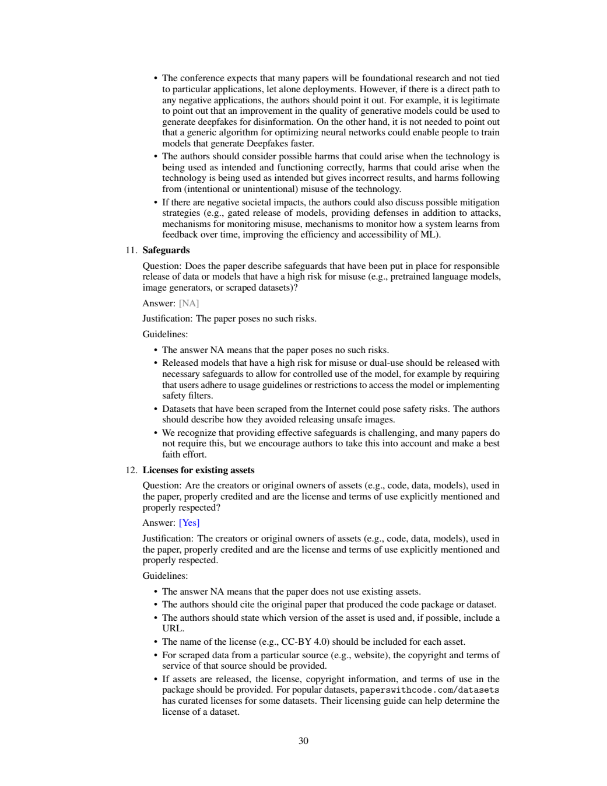

<!-- source-page: 31 -->
## 原文第31页

**第12项指导原则续：**

- 对重新打包的既有数据集，应同时提供原始许可，以及派生资产的许可（若已改变）。
- 若这些信息在线上找不到，鼓励作者联系资产创建者。

#### 13 新资产

**问题：** 论文新引入的资产是否有完善文档，而且文档是否随资产一起提供？

**回答：是。**

**理由：** 本文新引入数据集有详细文档，包括数据收集方法、预处理步骤和使用说明，见附录C。

**指导原则：**

- 回答“不适用”，表示论文不发布新资产。
- 研究者应通过结构化模板，在投稿中交流数据集、代码、模型的细节，包括训练、许可、局限等。
- 论文应讨论是否、如何取得其资产被使用的相关人员的同意。
- 投稿时，记得对资产进行匿名化，如适用；可以创建匿名 URL，也可以提供匿名 zip 文件。

#### 14 众包与人类受试者研究

**问题：** 对众包实验和人类受试者研究，论文是否提供了给参与者的完整指引，以及适用时的截图，并说明报酬（若有）细节？

**回答：不适用。**

**理由：** 本文不涉及众包或人类受试者研究。

**指导原则：**

- 回答“不适用”，表示论文不涉及众包或人类受试者研究。
- 可在补充材料提供这些信息；但如果主要贡献涉及人类受试者，则正文应尽可能给出详细信息。
- 根据 NeurIPS 道德准则，从事数据收集、整理或其他劳动的工作人员，应至少获得数据收集者所在国家的最低工资。

#### 15 人类受试者研究的机构审查委员会审批或等效审批

**问题：** 论文是否说明研究参与者可能面临的风险、是否向参与者披露风险，以及是否取得机构审查委员会（IRB）批准，或按所在国家、机构要求取得等效批准或审查？

**回答：不适用。**

**理由：** 本文不涉及众包或人类受试者研究。

**指导原则：**

- 回答“不适用”，表示论文不涉及众包或人类受试者研究。
- 依据研究所在国家的规定，任何人类受试者研究都可能需要 IRB 或等效审批。如果取得 IRB 批准，应在论文中明确说明。
- 我们承认不同机构、地点的流程可能差异很大，但预期作者遵守 NeurIPS 道德准则和所在机构指引。

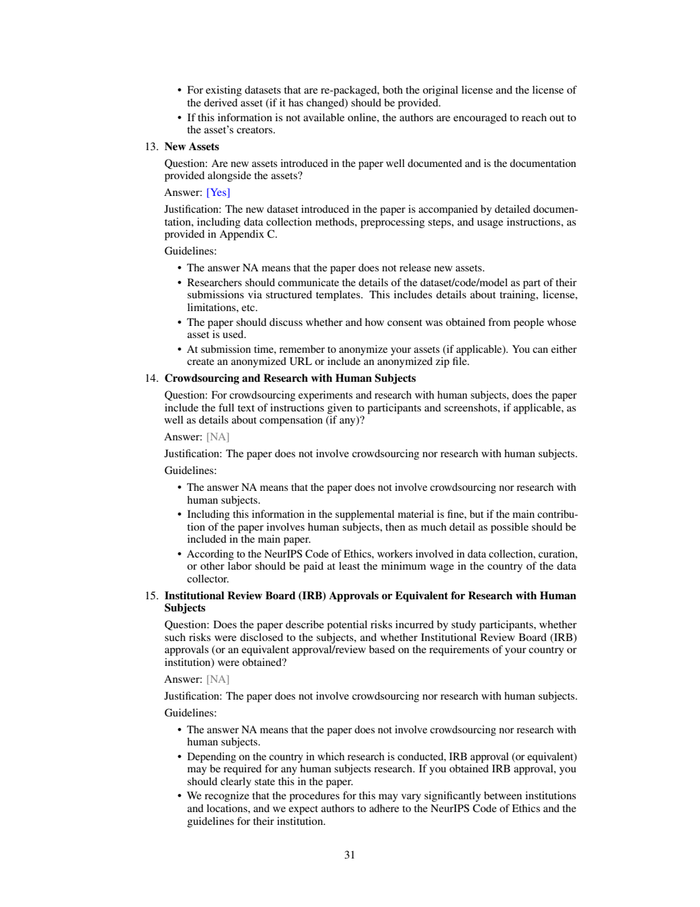

<!-- source-page: 32 -->
## 原文第32页

**第15项指导原则续：**

- 首次投稿时，不要包含会破坏匿名的信息，如适用，例如执行审查的机构。

## 术语对照

|英文|中文|
|---|---|
|textual graph|文本属性图|
|retrieval-augmented generation|检索增强生成|
|graph question answering|图问答|
|Prize-Collecting Steiner Tree|奖赏收集斯坦纳树|
|graph prompt tuning|图提示微调|
|soft prompt|软提示|
|textualize|文本化|
|prize / cost|奖赏／成本|
|virtual node|虚拟节点|
|faithfulness|忠实性|
|hallucination|幻觉|
