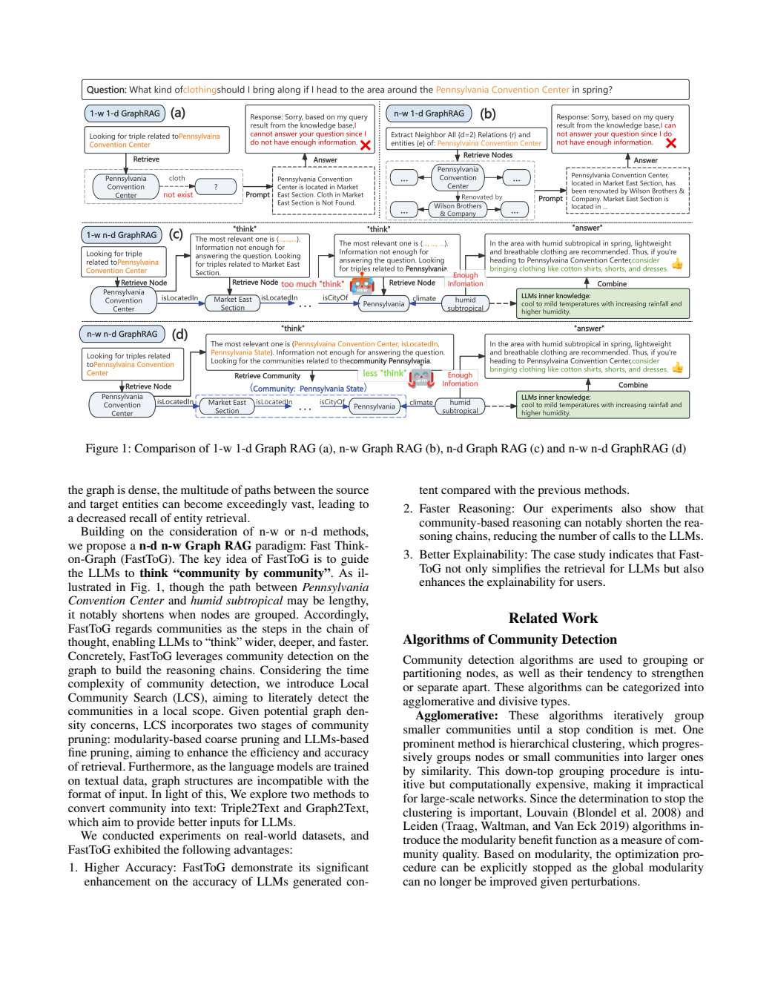
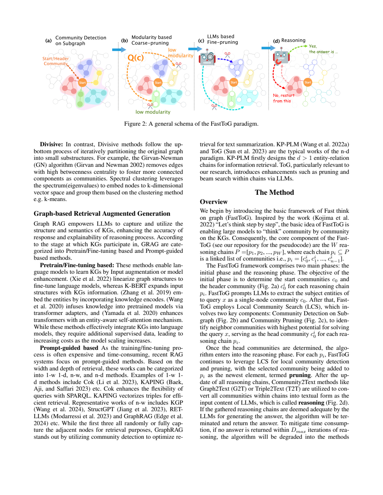
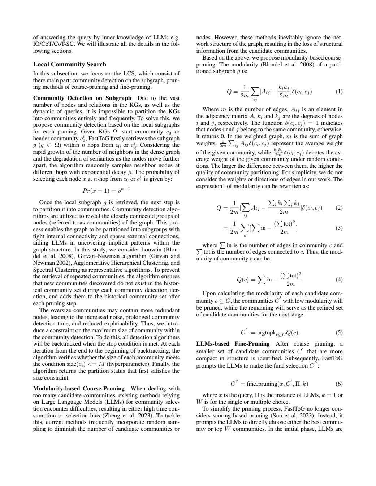
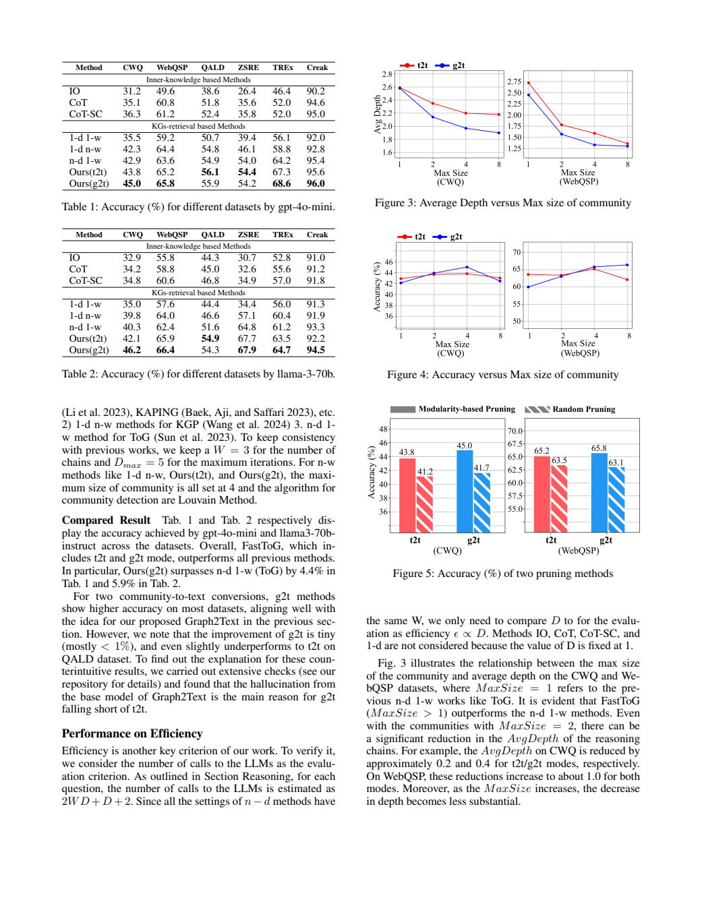
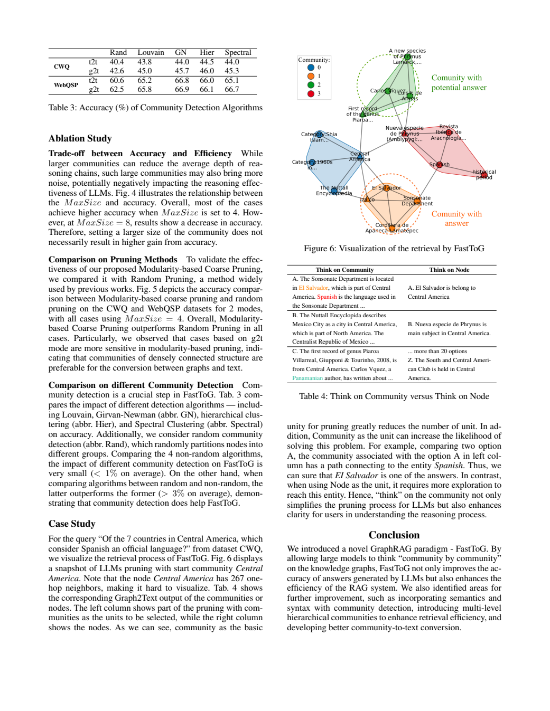
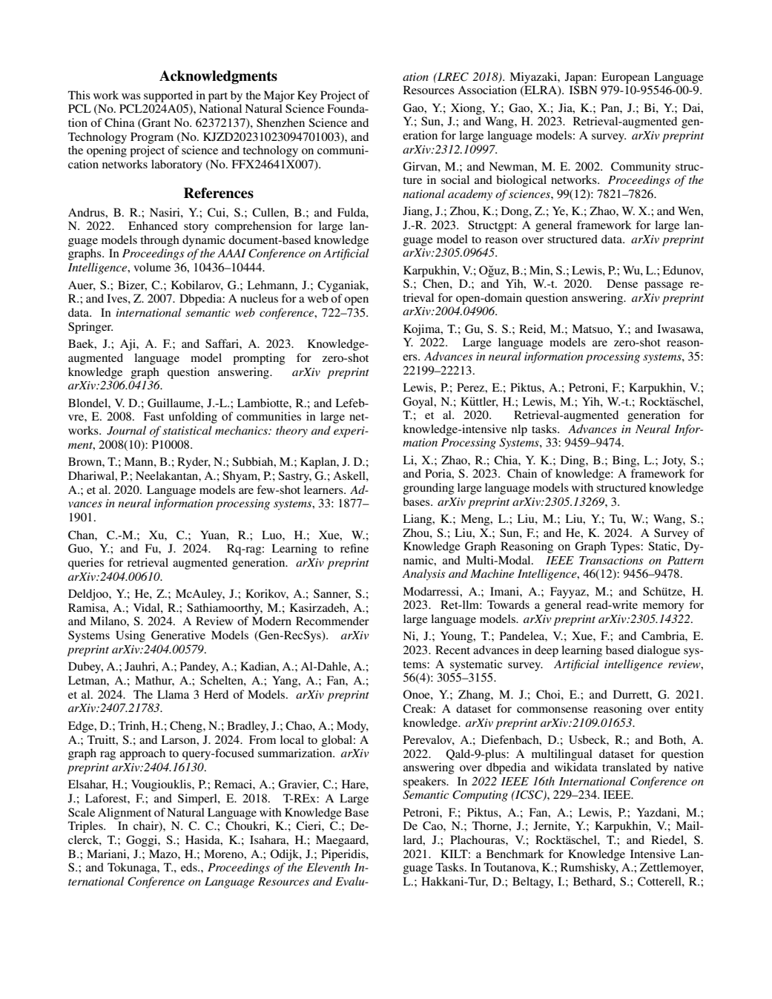
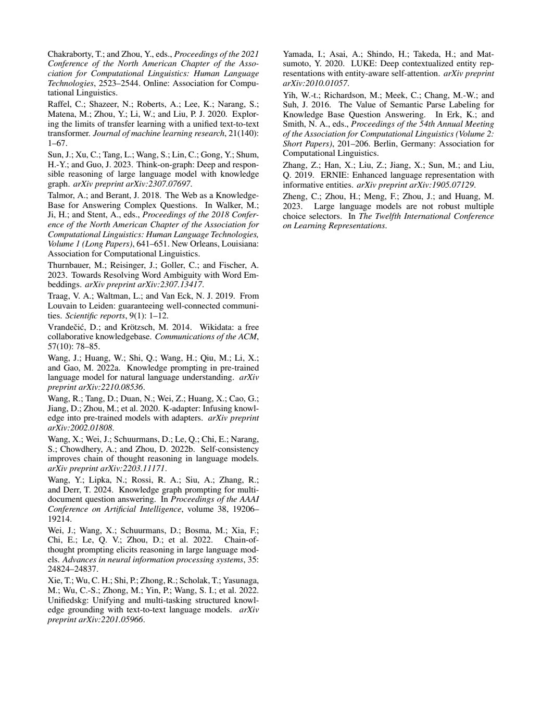
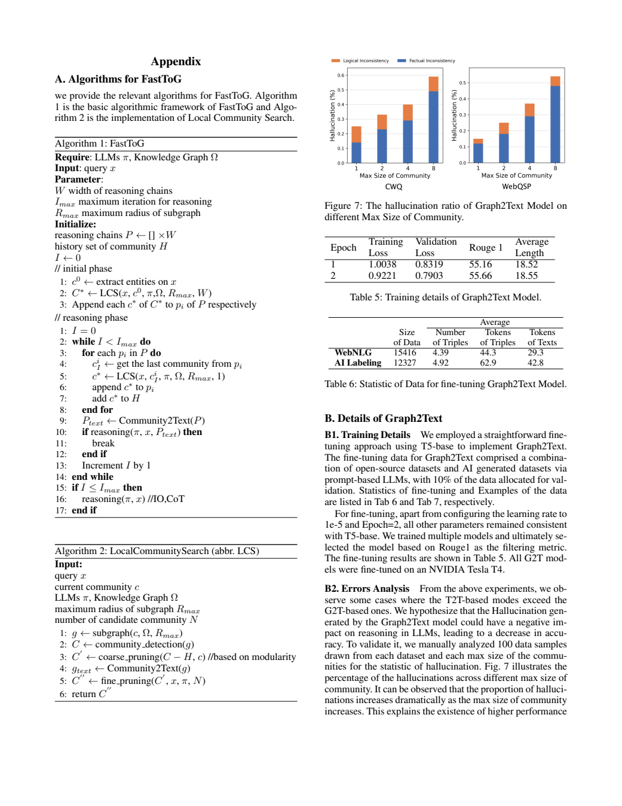
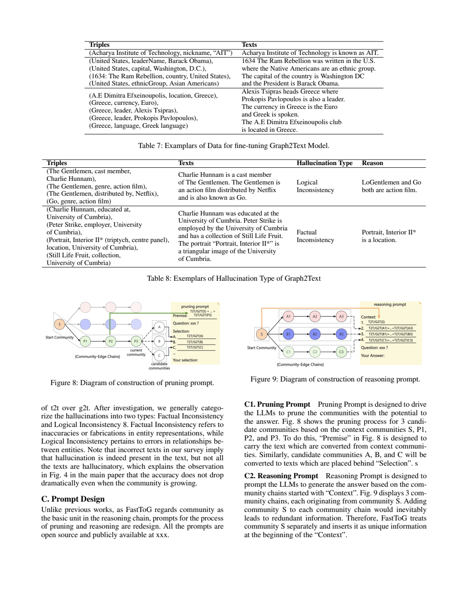

# Fast Think-on-Graph: Wider, Deeper and Faster Reasoning of Large Language Model on Knowledge Graph
# FastToG 在知识图谱上实现更广更深更快的大语言模型推理

作者：Xujian Liang，Zhaoquan Gu（通信作者）。北京邮电大学网络空间安全学院；鹏城实验室新型网络研究部；哈尔滨工业大学（深圳）计算机科学与技术学院。邮箱 xjliang@bupt.edu.cn，guzhaoquan@hit.edu.cn。

译本依据：仓库作者版，11页。原图、图中英文、公式与数据以各页原始影印件为准；译文中的解释不改动原始数值。

<!-- source-page: 1 -->
## 摘要

图检索增强生成（GRAG）是一种新范式，通过将知识图谱等图信息引入大语言模型，在朴素RAG基础上进一步减轻幻觉。然而，现有GRAG仍存在局限：简单范式从知识图谱捕获的关联范围狭窄、深度较浅，通常无法处理复杂问题；与知识图谱紧密耦合的方法，在稠密图上往往计算开销高、耗时长。本文提出快速图上思考（Fast Think-on-Graph，FastToG），使LLM能够在知识图谱上“逐社区思考”。FastToG使用社区检测捕获更深的关联，并通过粗剪枝和精剪枝两个阶段加速检索。我们还开发了两种社区到文本的方法，把社区图结构转化为LLM更容易理解的文本。实验表明，与先前工作相比，FastToG准确率更高、推理更快、可解释性更好。代码：https://github.com/dosonleung/FastToG。

## 引言

检索增强生成（RAG；Lewis等，2020）使大语言模型能够生成准确、合理且可解释的回答。早期的朴素RAG（Gao等，2023）通常将文档索引为可管理的文本块，根据与用户查询的向量相似度（Karpukhin等，2020）检索相关上下文，将其加入提示，再由LLM生成回答。该范式简单，对基础任务效率很高，广泛用于问答（Chan等，2024）、推荐系统（Deldjoo等，2024）和对话系统（Ni等，2023）。不过，嵌入模型中的歧义或偏差（Thurnbauer等，2023）会降低精确率；复杂查询的召回率较低；查询和文档表示为高维向量也使可解释性不足。

图RAG将知识图谱作为外部来源，通常被视为更先进的RAG。通过图数据库中的不同算法，GRAG支持复杂操作（Liang等，2024），例如广度优先搜索、深度优先搜索、路径探索乃至社区检测，使LLM更广、更深地理解数据关系，完成复杂推理并生成更准确的回答。本文根据检索广度和深度，将GRAG分为n-w和n-d类别（图1）。仍有不少工作（Andrus等，2022；Baek、Aji和Saffari，2023；Li等，2023）采用1-w 1-d图RAG，其方式类似朴素RAG的“检索一次、读取一次”，侧重单实体或一跳关系查询，因而继承了朴素RAG的缺点。

n-w GRAG研究（Jiang等，2023；Modarressi等，2023；Edge等，2024；Wang等，2024）旨在扩大检索上下文窗口。其中值得注意的工作把紧密连接的节点群作为检索和推理单元，通过社区检测划分图。与单节点或随机聚类相比，这些群能向LLM提供更多上下文。例如，查询“宾夕法尼亚会议中心所在地区的气候”时，若干三元组从该中心经Market East Section连接到宾夕法尼亚的湿润亚热带气候，在相关实体距离不远时足以作答；距离过远时检索仍可能失败（图1a、b）。n-d GRAG（Sun等，2023；Wang等，2022a）通过增加上下文深度处理这一问题。类似“让我们逐步思考”（Kojima等，2022），这些方法把实体和关系作为思维链中间步骤，引导生成。紧密结合知识图谱能提高召回率，但每一步都要调用LLM思考，链越长计算开销越大（图1c）。

<!-- source-page: 2 -->

图1图内文字补译。问题：“如果春天前往宾夕法尼亚会议中心附近地区，我应该带什么衣服？”a：寻找与Pennsylvania Convention Center相关三元组；Retrieve=检索，Answer=回答，Prompt=提示；cloth衣物关系“不存在”；提示“宾夕法尼亚会议中心位于Market East Section；未找到Market East Section的衣物信息”；回复“抱歉，根据知识库查询结果，我无法回答，因为信息不足。”b：提取该中心所有深度d=2的邻居关系r与实体e；Retrieve Nodes=检索节点；图节点Wilson Brothers & Company、Renovated by=改建方；提示“中心位于Market East Section，由Wilson Brothers & Company改建；中心位于……”，回复同样表示信息不足。c：寻找中心相关三元组，检索节点，思考“最相关的是（……）；信息不足，寻找与Market East Section相关三元组”；再次思考“最相关的是（……）；信息不足，寻找与Pennsylvania相关三元组”；过多思考后获得Enough Information=足够信息。链为中心—isLocatedIn位于→Market East Section—isLocatedIn位于→…—isCityOf所属城市→Pennsylvania—climate气候→humid subtropical湿润亚热带。d：检索社区，将宾夕法尼亚州社区整体作为证据，思考“最相关的是（Pennsylvania Convention Center,isLocatedIn,Pennsylvania State）；信息不足，寻找与宾夕法尼亚州社区相关的社区”，以更少思考获得足够信息。两种成功回答均为“春季湿润亚热带地区建议穿轻便透气衣物。因此，若前往宾夕法尼亚会议中心，可考虑棉衬衫、短裤和连衣裙。”Combine=结合；LLMs inner knowledge=LLM内部知识，其内容为“气温从凉爽到温和，降雨增加，湿度较高”。Think=思考，answer=回答；Community: Pennsylvania State=宾夕法尼亚州社区。

若图很稠密，源实体与目标实体之间的路径数量可能极大，降低实体检索召回率。基于上述考虑，我们提出n-d n-w图RAG范式FastToG。核心思想是引导LLM“逐社区思考”。如图1所示，宾夕法尼亚会议中心到湿润亚热带气候的路径虽可能很长，将节点分组后路径明显缩短。因此，FastToG以社区为思维链步骤，使LLM思考得更广、更深、更快。

具体而言，FastToG利用社区检测构建推理链。考虑社区检测的时间复杂度，我们提出局部社区搜索（LCS），在局部范围迭代检测社区。考虑图密度，LCS引入两阶段社区剪枝：基于模块度的粗剪枝和基于LLM的精剪枝，以提高检索效率与准确率。由于语言模型在文本数据上训练，图结构不能直接适配输入格式，我们探索Triple2Text和Graph2Text两种社区转文本方法，为LLM提供更好的输入。

真实数据集实验显示：第一，FastToG显著提高LLM生成内容的准确率；第二，社区推理明显缩短推理链并减少LLM调用；第三，案例研究说明它既简化LLM检索，也提升用户理解推理过程的能力。

## 相关工作
### 社区检测算法

社区检测将节点分组或划分，依据其趋于相连或分离的结构特征，可分为凝聚式和分裂式。凝聚式算法迭代合并小社区，直至满足停止条件。层次聚类根据相似度逐渐将节点或小社区合并为大社区。这种自底向上的过程直观，但计算昂贵，难以用于大规模网络。由于停止条件很重要，Louvain（Blondel等，2008）和Leiden（Traag、Waltman和Van Eck，2019）使用模块度收益函数衡量社区质量；当扰动已无法提高全局模块度时，优化即可停止。

<!-- source-page: 3 -->

图2图内标签：Community Detection on Subgraph=子图社区检测；Start/Header Community=起始／首社区；Start=起点；Modularity based Coarse-pruning=基于模块度的粗剪枝；low modularity=低模块度；LLMs based Fine-pruning=基于LLM的精剪枝；Reasoning=推理；Yes,the answer is…=是，答案为……；No,restart from this=否，从此处重新开始。Q(c)保留原符号。

分裂式方法相反，采用自顶向下的过程，迭代把原图分为小结构。例如Girvan–Newman（GN）算法（Girvan和Newman，2002）移除介数中心性高的边，形成更多连通分量作为社区。谱聚类利用特征值谱，将节点嵌入k维向量空间，再通过k-means等方法分组。

### 基于图的检索增强生成

图RAG使LLM捕获和利用知识图谱的结构与语义，提高回答准确率和推理可解释性。根据知识图谱参与阶段，可分为预训练／微调方法和提示引导方法。前者通过输入增强或模型增强学习图谱。Xie等（2022）将图线性化后微调语言模型，K-BERT利用图谱信息扩展输入结构；Zhang等（2019）借助知识编码器嵌入实体；Wang等（2020）的K-Adapter通过Transformer适配器注入知识；Yamada等（2020）的LUKE增强实体感知自注意力。这些方法有效，但需要额外监督数据，且模型规模增大时成本随之增加。

训练微调昂贵耗时，因此近期RAG更关注提示引导。按检索宽度和深度，分为1-w 1-d、n-w和n-d。1-w 1-d包括CoK（Li等，2023）和KAPING（Baek、Aji和Saffari，2023）：CoK通过SPARQL提高查询灵活性，KAPING把三元组向量化以高效检索。n-w代表包括KGP（Wang等，2024）、StructGPT（Jiang等，2023）、RET-LLMs（Modarressi等，2023）和GraphRAG（Edge等，2024）。前三者随机或完整获取相邻节点；GraphRAG通过社区检测优化面向摘要的检索。n-d代表包括KP-PLM（Wang等，2022a）和ToG（Sun等，2023）：前者设计深度大于1的实体关系链，后者与本文密切相关，在链内引入LLM剪枝和束搜索。

## 方法
### 概述

受“让我们逐步思考”（Kojima等，2022）启发，FastToG使大模型在知识图谱上逐社区思考。核心为W条推理链 P=[p₁,p₂,…,pW]，其中每条链为社区链表 pᵢ=[c₀ⁱ,c₁ⁱ,…,cₙ₋₁ⁱ]。框架分为初始阶段与推理阶段。初始阶段确定起始社区c₀和每条链的首社区c₀ⁱ（图2a）。LLM从查询x提取主题实体作为单节点社区c₀；随后局部社区搜索通过子图社区检测（图2b）和社区剪枝（图2c），找到最有可能回答x的相邻社区，作为各链首社区。

进入推理阶段后，对每条链继续用LCS做局部检测和剪枝，将选中社区追加到链尾。全部链更新后，使用Graph2Text或Triple2Text将链内社区转为文本，供LLM推理（图2d）。若LLM判断证据足够作答，则终止并返回答案；若在最大Dmax轮内未返回答案，为控制耗时，退化为利用LLM内部知识的IO、CoT或CoT-SC方式。

<!-- source-page: 4 -->
### 局部社区搜索

LCS由子图社区检测、粗剪枝和精剪枝三个部分组成。知识图谱节点关系数量庞大、查询动态变化，不能频繁对全图划分社区。给定图谱Ω及起始社区c₀或首社区c₀ⁱ，FastToG首先检索距离其n跳以内的局部子图g⊂Ω。考虑稠密图邻居急剧增长、语义随距离增加而减弱，对各跳邻居使用指数衰减ρ随机采样：距当前社区n跳的节点x被选择的概率为 Pr(x=1)=ρ^(n−1)。

得到子图后，采用社区检测识别内部连接紧密、外部连接稀疏的节点群，使LLM发现图中的隐含模式。本文考虑Louvain（Blondel等，2008）、GN（Girvan和Newman，2002）、凝聚层次聚类和谱聚类。为避免重复检索，每轮检测确保新社区不在历史集合中，并在剪枝后将其加入历史集合。

过大社区包含更多冗余节点，会增加噪声、延长检测时间、降低可解释性，因此设最大社区大小M。检测算法达到停止条件后回溯，从最终状态向前逐次检查每个社区是否满足 size(cᵢ)≤M，返回首个满足约束的划分状态。

候选社区过多时，依赖LLM选择可能耗时长或产生选择偏差（Zheng等，2023）。现有方法常用随机采样减少候选节点或社区，却忽略网络结构，丢失结构信息。因此提出基于模块度的粗剪枝。分区子图的模块度（Blondel等，2008）为：

Q=(1/2m) Σᵢⱼ [Aᵢⱼ−kᵢkⱼ/(2m)]δ(cᵢ,cⱼ)。 （1）

m为边数，Aᵢⱼ为邻接矩阵元素，kᵢ与kⱼ为节点度；同社区时δ=1，否则为0。在加权图中m为权重和；实际社区内部的平均权重与随机情况下期望权重之差越大，划分质量越高。为简化，本文不考虑边权与方向。等价式与社区贡献保留如下（符号依原文）：

Q=(1/2m) [Σᵢⱼ Aᵢⱼ−(Σᵢkᵢ Σⱼkⱼ)/(2m)]δ(cᵢ,cⱼ)； （2）
Q=(1/2m) Σc [Σin−(Σtot)²/(2m)]； （3）
Q(c)=Σin−(Σtot)²/(2m)。 （4）

译注：式（2）的求和与δ位置照录底本，未将其改写成另一个推导式。

Σin为社区内部边数，Σtot为连接到社区的边数。计算各候选社区c∈C的模块度后，剪去低模块度社区，保留精化候选集：C′:=argtopk(c⊆C) Q(c)。（5）原文此处对C′的文字表述存在歧义，以式（5）保留高分社区为准。

粗剪枝获得结构更紧凑的小候选集C′后，LLM作最终选择：C″=fine_pruning(x,C′,Π,k)。（6）其中x为查询，Π为LLM实例，k=1或W表示单选或多选。为简化流程，不再采用基于评分的剪枝（Sun等，2023），不再让LLM打分，而直接选择最佳一个或前W个社区。

<!-- source-page: 5 -->

初始阶段多选W个社区，分别作为W条链的首社区；推理阶段对每条链单选一个最佳社区，追加到该链。若LLM认为所有候选均不相关，就停止探索该链，因此链长可能不同。

### 推理

所有链更新后，提示LLM整合各链生成答案。链足够时返回明确答案，否则返回“Unknown”。未知则进入下一轮，直至达到最大深度Dmax或得到明确回答。轮次耗尽仍不能回答，就退化为LLM内部知识作答。与ToG（Sun等，2023）一致，初始阶段包括一轮剪枝和推理；第二阶段最多2WDmax次剪枝及Dmax次推理。因此，最坏需要2WDmax+Dmax+2次LLM调用。

### 社区到文本

知识图谱以RDF三元组存储，社区也由三元组组成。例如[(Philadelphia,isCityOf,Pennsylvania),(Pennsylvania,climate,Humid Subtropical)]。为输入LLM，提出T2T和G2T两种转换。T2T通过规则脚本直接转成“Philadelphia isCityOf Pennsylvania, Pennsylvania climate Humid Subtropical”。G2T则生成自然语言：“费城位于宾夕法尼亚州，具有湿润亚热带气候。”

T2T可能冗余。例如Allentown、New Castle和Philadelphia各自属于Pennsylvania的三元组，会重复输出三句，实际上可概括成“三座城市都是宾夕法尼亚州的城市”。所以G2T同时承担摘要作用。我们以T2T输出微调较小的语言模型（如220M参数的T5-base）。与现有LLM相比，该模型参数很少，如Llama-3-8B约为T5-base的36倍，因此时间影响很小。除了社区内部关系，还需将社区间路径c₁−E₁,₂−c₂中的E₁,₂转为文本。本文排除距当前社区超过一跳的候选，因此社区间连接不存在中间节点。

## 实验
### 设置

在六个真实数据集评估：多跳知识库问答CWQ（Talmor和Berant，2018）、WebQSP（Yih等，2016）、QALD（Perevalov等，2022）；槽填充ZSRE（Petroni等，2021）和TREx（Elsahar等，2018）；常识推理Creak（Onoe等，2021）。为与先前工作（Li等，2023；Sun等，2023；Edge等，2024）一致，采用精确匹配hit@1。考虑成本和时间，对超过1000条的数据集随机抽样1000条，起始社区采用Sun等（2023）提供的初始实体。

使用gpt-4o-mini和无量化Llama-3-70B-Instruct（Dubey等，2024）。剪枝温度0.4，推理温度0.1；因社区描述较长，最大输出长度提高为1024。G2T通过WebNLG（Auer等，2007）和GPT-4生成的合成数据微调T5-base（Raffel等，2020）实现；合成数据是实验中产生的社区描述。知识图谱采用2024-01-01版Wikidata（Vrandečić和Krötzsch，2014），只使用英文三元组；抽取后8460万实体、3.036亿关系存入Neo4j。

脚注1：GPT-4o mini介绍页：https://openai.com/index/gpt-4o-mini-advancing-cost-efficient-intelligence 。脚注2：Neo4j官网：https://neo4j.com/ 。

### 准确率

比较内部知识方法与图谱检索方法。内部方法包括直接输出IO（Brown等，2020）、逐步思考CoT（Wei等，2022）以及集成多个思维链得到一致预测的CoT-SC（Wang等，2022b）。图谱方法包括代表CoK（Li等，2023）、KAPING（Baek、Aji和Saffari，2023）的1-d 1-w，代表KGP（Wang等，2024）的1-d n-w，以及代表ToG（Sun等，2023）的n-d 1-w。统一W=3、Dmax=5；n-w方法与两种FastToG模式均设社区最大大小4，检测算法为Louvain。

<!-- source-page: 6 -->

表1为gpt-4o-mini在各数据集的准确率（%）。

|方法|CWQ|WebQSP|QALD|ZSRE|TREx|Creak|
|---|---:|---:|---:|---:|---:|---:|
|IO|31.2|49.6|38.6|26.4|46.4|90.2|
|CoT|35.1|60.8|51.8|35.6|52.0|94.6|
|CoT-SC|36.3|61.2|52.4|35.8|52.0|95.0|
|1-d 1-w|35.5|59.2|50.7|39.4|56.1|92.0|
|1-d n-w|42.3|64.4|54.8|46.1|58.8|92.8|
|n-d 1-w|42.9|63.6|54.9|54.0|64.2|95.4|
|本方法T2T|43.8|65.2|56.1|54.4|67.3|95.6|
|本方法G2T|45.0|65.8|55.9|54.2|68.6|96.0|

表2为Llama-3-70B准确率（%）。

|方法|CWQ|WebQSP|QALD|ZSRE|TREx|Creak|
|---|---:|---:|---:|---:|---:|---:|
|IO|32.9|55.8|44.3|30.7|52.8|91.0|
|CoT|34.2|58.8|45.0|32.6|55.6|91.2|
|CoT-SC|34.8|60.6|46.8|34.9|57.0|91.8|
|1-d 1-w|35.0|57.6|44.4|34.4|56.0|91.3|
|1-d n-w|39.8|64.0|46.6|57.1|60.4|91.9|
|n-d 1-w|40.3|62.4|51.6|64.8|61.2|93.3|
|本方法T2T|42.1|65.9|54.9|67.7|63.5|92.2|
|本方法G2T|46.2|66.4|54.3|67.9|64.7|94.5|

总体上两种FastToG模式优于先前方法。原文称G2T相比ToG在两表分别提高4.4%与5.9%。G2T在多数数据集更好，但增益很小（大多小于1%），在QALD甚至略弱于T2T。我们作了详细检查，发现G2T基础模型幻觉是主要原因。

### 效率

以LLM调用次数评估效率，每题估计调用2WD+D+2次。所有n-d设置W相同，因此只需比较D（原文记效率ϵ∝D）。IO、CoT、CoT-SC和1-d方法因D固定为1不参与比较。图3展示CWQ和WebQSP的最大社区大小与平均深度关系，MaxSize=1对应ToG等既有方法。MaxSize>1表现更好，即使大小2，CWQ上T2T/G2T平均深度已分别降低约0.2/0.4；WebQSP两者均约降低1.0。继续增大社区，深度下降幅度逐渐变小。

图3至图5图内标签：Avg Depth=平均深度，Max Size=最大大小，Accuracy (%)=准确率（%），t2t/g2t为两种社区文本模式；Modularity-based Pruning=模块度剪枝，Random Pruning=随机剪枝。图3：平均深度与社区最大大小。图4：准确率与社区最大大小。图5：两种剪枝方法的准确率。

<!-- source-page: 7 -->
### 消融研究

更大社区虽能降低平均推理深度，也会带来更多噪声，损害LLM推理。图4显示大多数情况MaxSize=4准确率较高，增至8反而下降，社区越大不意味着准确率收益越高。

为验证模块度粗剪枝，与先前广泛使用的随机剪枝比较。图5在CWQ与WebQSP、两种模式、MaxSize=4下比较，模块度方法在所有情况均更好。G2T对模块度剪枝尤其敏感，表明紧密连接的社区更适合图文转换。

表3比较社区检测算法的准确率（%）。Rand随机将节点划分为组；GN为Girvan–Newman，Hier为层次聚类。

|数据及模式|Rand|Louvain|GN|Hier|Spectral|
|---|---:|---:|---:|---:|---:|
|CWQ T2T|40.4|43.8|44.0|44.5|44.0|
|CWQ G2T|42.6|45.0|45.7|46.0|45.3|
|WebQSP T2T|60.6|65.2|66.8|66.0|65.1|
|WebQSP G2T|62.5|65.8|66.9|66.1|66.7|

四种非随机算法差别很小，平均小于1%；非随机算法相比随机平均超过3%，说明社区检测确有帮助。

### 案例研究

对CWQ问题“中美洲七国中，哪些把西班牙语作为官方语言？”可视化FastToG检索。图6为以Central America作起始社区时的剪枝快照；该节点有267个一跳邻居，难以直接可视化。表4左列给出社区候选，右列给出节点候选：社区A描述“Sonsonate省位于萨尔瓦多，后者属于中美洲，西班牙语用于Sonsonate省……”；社区B描述“Nuttall百科把墨西哥城描述为中美洲城市，中美洲属于北美洲；墨西哥中央集权共和国……”；社区C描述“Piaroa Villarreal, Giupponi & Tourinho, 2008属的首次记录来自中美洲；Carlos Vásquez是一位巴拿马作者，他曾写过……”；节点候选A仅有“萨尔瓦多属于中美洲”，B为“新Phrynus物种的主题在中美洲”，还有20多个选项，Z为“南美和中美洲俱乐部在中美洲举办”。

社区作为剪枝单元显著减少候选数量，且更可能解决问题。左侧A的社区已有通向Spanish的路径，因而能确认萨尔瓦多为答案之一；节点方式还需继续探索。逐社区思考既简化LLM剪枝，也使用户更清晰理解推理过程。

## 结论

本文提出图RAG新范式FastToG，通过在知识图谱上逐社区思考，同时提高LLM回答准确率和RAG效率。未来可将语义和句法结合到社区检测，引入多级层次社区提高检索效率，并开发更好的社区文本转换。

图6图内标签：Community=社区（编号0—3）；Community with potential answer=含潜在答案的社区；Community with answer=含答案的社区；Central America=中美洲；El Salvador=萨尔瓦多；Sonsonate Department=松索纳特省；Izalco=伊萨尔科；Cordillera de Apaneca-Lamatepec=阿帕内卡—拉马特佩克山脉；Spanish=西班牙语；historical period=历史时期；The Nuttall Encyclopædia=Nuttall百科全书；Category:1960s=分类：1960年代；Category:Shia Islam…=分类：什叶派伊斯兰教……；A new species of Phrynus Lamarck,…=Phrynus Lamarck的一种新物种……；Carlos Víquez=原图人名；Las de Abajo=原图作品名；First record of the genus Piarpa…=Piarpa属首次记录……（按图中字样）；Nueva especie de Phrynus (Amblypygi:…)=Phrynus新物种（无尾鞭蝎目：……）；Revista Ibérica de Aracnología…=伊比利亚蛛形学期刊……。原图部分节点标签带省略号，译文同样保留省略边界。

<!-- source-page: 8 -->
## 致谢与参考文献

本研究部分得到鹏城实验室重大重点项目PCL2024A05、国家自然科学基金62372137、深圳科技计划KJZD20231023094701003及通信网络科学与技术实验室开放项目FFX24641X007支持。

参考文献按要求保留英文原文，见下列原页。

<!-- source-page: 9 -->

<!-- source-page: 10 -->
## 附录A FastToG算法

算法1为总体框架；算法2实现局部社区搜索。

算法1 FastToG。需要LLM π和知识图谱Ω；输入查询x；参数W为推理链宽度，Imax为最大推理轮数，Rmax为子图最大半径。初始化P为空链列表共W条、历史社区集合H、I=0。

初始阶段：

1. c₀ ← 从x提取实体。
2. C* ← LCS(x,c₀,π,Ω,Rmax,W)。
3. 将C*中每个c*分别追加到P中对应pᵢ。

推理阶段（行号按原文重起）：

1. I ← 0。
2. 当I<Imax时循环。
3. 对P中的每条pᵢ。
4. cᵢᴵ ← 获取pᵢ的最后一个社区。
5. c* ← LCS(x,cᵢᴵ,π,Ω,Rmax,1)。
6. 将c*追加到pᵢ。
7. 将c*加入H。
8. 结束逐链循环。
9. Ptext ← Community2Text(P)。
10. 若reasoning(π,x,Ptext)为真。
11. 跳出。
12. 结束条件分支。
13. I加1。
14. 结束循环。
15. 若I≤Imax。
16. reasoning(π,x)，使用IO、CoT。
17. 结束条件分支。

译注：第15行条件照录原文，与正文“耗尽后回退”可能不一致，不擅自修正。

算法2 局部社区搜索LCS。输入查询x、当前社区c、LLM π、图谱Ω、子图最大半径Rmax、候选社区数N。

1. g ← subgraph(c,Ω,Rmax)。
2. C ← community_detection(g)。
3. C′ ← coarse_pruning(C−H,c)，基于模块度。
4. gtext ← Community2Text(g)。
5. C″ ← fine_pruning(C′,x,π,N)。
6. 返回C″。

## 附录B Graph2Text细节

B1 训练：用T5-base做直接微调。训练数据混合开源数据集与提示LLM生成的AI数据，10%作验证。表6列统计、表7列样例。除学习率1e−5、2个epoch外，其余参数与T5-base一致。训练多个模型，以Rouge1选择，全部在NVIDIA Tesla T4上训练。

表5 Graph2Text模型训练细节。

|轮次|训练损失|验证损失|Rouge 1|平均长度|
|---|---:|---:|---:|---:|
|1|1.0038|0.8319|55.16|18.52|
|2|0.9221|0.7903|55.66|18.55|

表6 Graph2Text微调数据统计。三元组数与token数均为对应数据集平均值。

|数据来源|样本数|平均三元组数|三元组token数|文本token数|
|---|---:|---:|---:|---:|
|WebNLG|15416|4.39|44.3|29.3|
|AI标注|12327|4.92|62.9|42.8|

B2 错误分析：有些T2T模式优于G2T，我们推测G2T幻觉妨碍LLM推理。对每个数据集、每种社区最大大小各人工分析100例统计幻觉。图7显示社区最大大小增加时幻觉比例急剧增加，这解释了T2T可能更强。

图7：Graph2Text在不同社区最大大小下的幻觉率。图中Max Size为社区最大大小，Hallucination Ratio为幻觉比例；CWQ和WebQSP为数据集名。

<!-- source-page: 11 -->

表7 Graph2Text微调数据样例。输入与生成文本逐项如下。

样例1输入：(Acharya Institute of Technology，昵称，“AIT”)。生成文本：“Acharya Institute of Technology称为AIT。”

样例2输入：(United States，领导人姓名，Barack Obama)；(United States，首都，Washington, D.C.)；(1634: The Ram Rebellion，国家，United States)；(United States，族群，Asian Americans)。生成文本：“《1634 The Ram Rebellion》在美国写成，Native Americans是美国的一个族群。该国首都为Washington DC，总统为Barack Obama。”译注：输入Asian Americans与输出Native Americans不一致，保留原例。

样例3输入：(A.E Dimitra Efxeinoupolis，位置，Greece)；(Greece，货币，Euro)；(Greece，领导人，Alexis Tsipras)；(Greece，领导人，Prokopis Pavlopoulos)；(Greece，语言，Greek language)。生成文本：“Alexis Tsipras领导希腊，Prokopis Pavlopoulos也是该国领导人。希腊的货币为欧元，使用希腊语。A.E Dimitra Efxeinoupolis俱乐部位于希腊。”

表8 Graph2Text幻觉类型样例，逐栏翻译如下。

样例1输入三元组：(The Gentlemen，演员，Charlie Hunnam)；(The Gentlemen，类型，action film动作片)；(The Gentlemen，发行方，Netflix)；(Go，类型，action film动作片)。生成文本：“Charlie Hunnam是The Gentlemen的演员。The Gentlemen是Netflix发行的动作片，也称为Go。”幻觉类型：逻辑不一致。原因栏：“LoGentlemen和Go都是动作片。”译注：LoGentlemen为原表字样，不能从两个作品同类型推出二者同名。

样例2输入三元组：(Charlie Hunnam，就读于，University of Cumbria)；(Peter Strike，雇主，University of Cumbria)；(Portrait, Interior II* (triptych, centre panel)，位置，University of Cumbria)；(Still Life Fruit，收藏机构，University of Cumbria)。生成文本：“Charlie Hunnam曾就读于University of Cumbria。Peter Strike受雇于University of Cumbria，并拥有Still Life Fruit藏品。肖像Portrait, Interior II*是University of Cumbria的一幅三角形图像。”幻觉类型：事实不一致。原因栏：“Portrait, Interior II*是一个地点。”译注：作品名、三联画中间幅描述及原表原因存在可疑之处，逐项保留，不将该理由视为另行核实的事实。

调查后，我们将幻觉概括为事实不一致和逻辑不一致两类。前者为实体表示中的不准确或捏造，后者为实体关系错误。调查中标为错误的文本，意味着该文本确含幻觉，但并非所有语句都有幻觉。这解释了正文图4中社区增大时准确率并未急剧下降。

## 附录C 提示设计

FastToG以社区为推理链基本单元，因此重新设计剪枝和推理提示。原文称提示开源公开于“xxx”，此占位符照录。C1 剪枝提示驱动LLM选择可能含答案的社区。图8以S、P1、P2、P3为上下文，展示三个候选社区的剪枝。“Premise”承载上下文社区转成的文本；A、B、C候选也转为文本，放在“Selection”后。

C2 推理提示引导LLM根据以“Context”开头的社区链回答。图9有三条都从S出发的链；每条都加入S会冗余，因此将S单独处理，仅在Context开始处放一次。

图8：剪枝提示的构造示意。图9：推理提示的构造示意。图内标签对应：Premise前提，Selection选项，Context上下文，Question问题，Answer回答；结构与连线保留原图。

图8图内文字逐项译注：Start Community=起始社区；Community-Edge Chains=社区—边链；current community=当前社区；candidate communities=候选社区；pruning prompt=剪枝提示；Premise=前提；Question: xxx ?=问题：xxx？；Selection=选项；Your selection=你的选择。其提示结构为“前提：T2T/G2T(S)+…+T2T/G2T(P3)；问题：xxx？；选项：A. T2T/G2T(A)，B. T2T/G2T(B)，C. T2T/G2T(C)，…；你的选择：”。S、P1、P2、P3、A、B、C为节点或社区标识，不翻译。

图9图内文字逐项译注：Start Community=起始社区；Community-Edge Chains=社区—边链；reasoning prompt=推理提示；Context=上下文；Question: xxx ?=问题：xxx？；Your Answer=你的回答。提示结构为“上下文：1. T2T/G2T(S)；2. T2T/G2T(A1)+…+T2T/G2T(A3)；3. T2T/G2T(B1)+…+T2T/G2T(B3)；4. T2T/G2T(C1)+…+T2T/G2T(C3)；问题：xxx？；你的回答：”。S与A1—C3为原图标识。
