# From RAG to Memory: Non-Parametric Continual Learning for Large Language Models
# 从RAG到记忆 大语言模型的非参数持续学习

作者：Bernal Jiménez Gutiérrez、Yiheng Shu（共同第一作者）、Weijian Qi、Sizhe Zhou、Yu Su。单位：美国俄亥俄州立大学；美国伊利诺伊大学厄巴纳香槟分校。通信：jimenezgutierrez.1@osu.edu，shu.251@osu.edu，su.809@osu.edu。发表于第42届国际机器学习大会，加拿大温哥华；PMLR 267，2025；版权归作者所有。

译本底本为仓库19页PMLR正式版。数据表和原图以影印件完整保留，中文表题、表头及图注在正文给出；参考文献保留英文。原文异常不擅改。

<!-- source-page: 1 -->
## 摘要

持续获取、组织和利用知识的能力是人类智能的关键特征，AI系统必须接近这一能力才能充分发挥潜力。由于大语言模型持续学习面临挑战，检索增强生成（RAG）已成为引入新信息的主要方式。然而，它依赖向量检索，难以模拟人类长期记忆动态且相互关联的特征。近期RAG在向量嵌入之外引入知识图谱等结构，以弥补意义建构和关联能力等不足；但这些方法在更基础的事实记忆任务中，表现显著低于标准RAG。

本文针对这种非预期退化，提出HippoRAG 2，使系统在事实、意义建构和关联记忆任务中全面优于标准RAG。HippoRAG 2基于HippoRAG采用的个性化PageRank算法，通过更深入整合文段及更有效地在线使用LLM改进系统。这使RAG更接近人类长期记忆的有效性：关联记忆任务比最先进嵌入模型提高7%，同时具有更好的事实知识和意义建构记忆能力。本文为LLM非参数持续学习开辟道路。代码和数据：https://github.com/OSU-NLP-Group/HippoRAG。

## 1 引言

在不断变化的世界中，持续吸收、整合和利用知识是人类智能最重要的特征之一。从应对法律变化的律师到追踪多方面科学进展的研究者，我们的大量生产力都依赖这种持续学习能力。AI若要成为真正有用、达到人类水平的助手，就必须接近这一能力。

近年LLM在人类智能的许多方面取得显著进展，但赋予其持续演化的长期记忆能力仍面临困难：参数知识具有复杂分布，既难以完整吸收新知识（Zhong等，2023；Hoelscher-Obermaier等，2023），也难避免灾难性遗忘（Cohen等，2024；Gu等，2024）。RAG绕过这些障碍，在不改变参数表示的情况下，以非参数方式访问新信息。凭借简单、稳健的特点（Zhong等，2023；Xie等，2024），RAG已迅速成为生产LLM系统事实上的持续学习方案。然而，简单向量检索无法捕获互联长期记忆的两个关键方面：意义建构（Klein等，2006），即解释更大、更复杂或不确定上下文的能力；关联性（Suzuki，2005），即在分散知识之间建立多跳联系的能力。

近期若干RAG框架让LLM显式组织检索语料。为增强意义建构，结构增强方法让LLM生成摘要（Edge等，2024；Sarthi等，2024；Chen等，2023）或知识图谱（Guo等，2024），关联分散但相关的文段，从而理解长故事等复杂话语。为弥补关联性，HippoRAG（Gutiérrez等，2024）使用个性化PageRank（Haveliwala，2002）和LLM自动构图能力，使检索具有多跳推理能力。

<!-- source-page: 2 -->

图1：在三个关键维度评估持续学习：事实记忆（NaturalQuestions、PopQA）、意义建构（NarrativeQA）和关联性（MuSiQue、2Wiki、HotpotQA、LV-Eval）。HippoRAG 2在这些基准类别总体超越其他方法，更接近真正的长期记忆系统。

图1图内逐项翻译：Factual Memory=事实记忆，问题“George Rankin的职业是什么？”；错误候选“Oliver Badman是政治家”“Thomas Marwick是政治家”，正确候选“George Rankin是政治家”。Sense-making=意义建构，问题“灰姑娘如何获得幸福结局？”；顺序为“灰姑娘参加皇家舞会”“王子用遗失的玻璃鞋搜寻整个王国”“鞋子完全合脚时，灰姑娘与王子重聚”。Associativity=关联性，问题“Erik Hort的出生地属于哪个县？”；正确事实“其出生地为Montebello”“Montebello属于Rockland County”，干扰事实“Marina出生在Minsk”；Associated=已关联。下方各柱依次为RAPTOR、GraphRAG、HippoRAG、NV-Embed-v2、HippoRAG 2，均为方法名。事实记忆值53.45、47.50、55.60、58.80、59.75；意义建构21.40、23.00、16.30、25.70、25.90；关联性48.37、53.49、54.88、58.81、62.96。

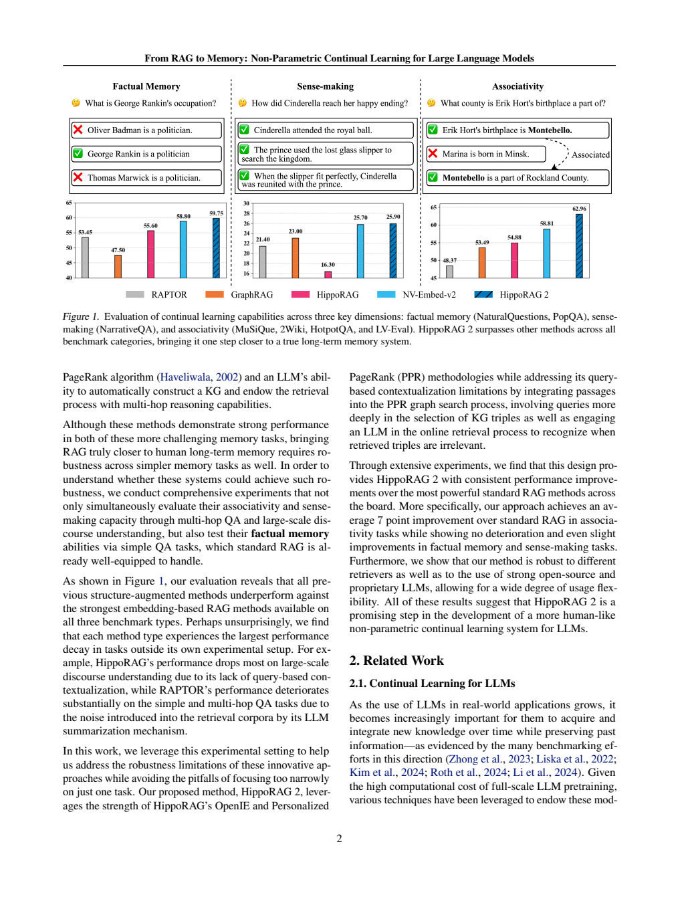

尽管这些方法在更具挑战的两类记忆任务中表现强，要使RAG真正接近人类长期记忆，也必须在简单任务上稳健。我们设计全面实验，同时用多跳问答、长篇话语理解评估关联与意义建构，也用标准RAG擅长的简单问答评估事实记忆。

如图1，所有既有结构增强方法在三个类别上总体均弱于最强嵌入式RAG。各方法在其原有实验设置以外的任务退化最大：HippoRAG缺少基于查询的上下文化，长篇话语理解下降最多；RAPTOR的LLM摘要向语料引入噪声，在简单和多跳问答上明显退化。

本文利用这一实验设置，解决创新方法的稳健性局限，同时避免只关注单任务。HippoRAG 2保留HippoRAG的OpenIE和PPR优势，通过把文段纳入图搜索、更深入地让查询参与三元组选择、在线使用LLM识别无关三元组，改善基于查询的上下文化。

广泛实验表明，该设计使HippoRAG 2在各方面稳定优于最强标准RAG。关联任务平均提高7点，而事实记忆和意义建构没有退化，甚至略有提升。系统对不同检索器、强开源和闭源LLM均稳健，使用灵活。结果说明它是朝向更像人类的非参数持续学习系统的一步。

译注：摘要原文使用“7% improvement”，引言使用“an average 7 point improvement”。两处分别保留为“提高7%”和“平均提高7点”，不将其擅自统一为某一相对增幅或百分点计算。

## 2 相关工作
### 2.1 LLM持续学习

LLM在真实应用中不断普及，保留旧信息并随时间获取整合新知识越来越重要，多个基准工作（Zhong等，2023；Liska等，2022；Kim等，2024；Roth等，2024；Li等，2024）已体现这一需求。完整预训练代价高，因此研究者采用多种技术赋予持续学习能力，通常分为持续微调、模型编辑和RAG（Shi等，2024）。

<!-- source-page: 3 -->

持续微调定期使用新数据训练LLM，可采用持续预训练（Jin等，2022）、指令微调（Zhang等，2023）和对齐微调（Zhang等，2024）。它能引入新语言模式及推理技能，但存在灾难性遗忘（Huang等，2024），即新数据引入时旧知识丢失；计算代价也使频繁更新不现实。模型编辑（Yao等，2023）通过直接修改特定参数更新知识，是较轻量的替代，但更新往往高度局部，难以同步修改应当随之变化的相关信息。RAG则在推理时检索相关外部信息，无需改动模型本身，因而是可扩展、实用的持续学习替代。下节讨论这一非参数方案。

### 2.2 LLM非参数持续学习

编码器尤其LLM骨干的改进，通过更高质量、能捕获语义关系的嵌入，增强RAG检索和生成。近期模型（Li等，2023；Muennighoff等，2025；Lee等，2025）借助LLM、大语料、架构改进和指令微调取得显著提升。本文以NV-Embed-v2（Lee等，2025）为主要比较对象。

意义建构是理解大规模或复杂事件、经历、数据的能力（Koli等，2024）。标准RAG需整合不同文段，对此能力有限。RAPTOR（Sarthi等，2024）和GraphRAG（Edge等，2024）均生成整合语料的摘要，但决定摘要对象和粒度的过程不同：RAPTOR用高斯混合模型发现文档簇；GraphRAG用社区检测，可总结文档、有关联的实体簇或二者组合。LightRAG（Guo等，2024）结合图结构和向量检索，以双层机制获取低层与高层知识。虽然GraphRAG和LightRAG也用KG，我们的KG用于辅助检索，而非扩充检索语料本身，因此引入较少LLM生成噪声，避免其在单跳和多跳任务中的性能损害。

关联性是在分散事实间建立多跳联系以有效检索的能力，是持续学习的重要部分。标准RAG独立向量检索无法模拟。HippoRAG（Gutiérrez等，2024）通过显式开放KG上的PPR处理这一性质。HippoRAG 2深受其启发，在多跳任务表现良好；进一步整合文段、查询和三元组，也改善意义建构和事实记忆。

## 3 HippoRAG 2
### 3.1 概述

HippoRAG（Gutiérrez等，2024）为受神经生物学启发的LLM长期记忆框架。LLM作为人工新皮层；KG和PPR模拟海马体自联想特性；检索编码器连接二者，对应海马旁区域的一项功能。这些组件协同模拟人类长期记忆相互作用。

离线时LLM把文段处理为KG三元组，纳入人工海马索引；编码器发现同义关系，连接信息。在线时LLM从查询提取命名实体，编码器在图中找最相似实体；这些种子节点为PPR分配重置概率，使随机游走概率偏向种子及其邻域，实现上下文检索。然而，实体中心方法在索引和推理阶段丢失上下文，也使语义匹配困难，是关键缺陷。

<!-- source-page: 4 -->

图2：HippoRAG 2方法。离线以LLM从文段抽取开放KG三元组，对短语节点检测同义关系；短语与文段共同形成开放KG。在线以嵌入模型给文段和三元组打分，确定两类PPR种子；识别记忆通过LLM筛选排名靠前三元组。PPR随后在KG上做上下文检索，为最终问答提供相关文段。图中节点颜色深浅表示PPR诱导的概率质量，越深概率越高。图例：Phrase Node短语节点，Passage Node文段节点，Seed Node种子节点；Relation/Synonym/Context Edge分别为关系／同义／上下文边。

图2其他文字：Offline Indexing=离线索引；Passages=文段；Triples=三元组；Knowledge Graph=知识图谱；1 OpenIE by LLM=LLM进行开放信息抽取；2 Synonym detection by embedding=以嵌入检测同义；3 Dense-sparse integration=稠密稀疏整合。Online Retrieval & QA=在线检索和问答；Query=查询；Ranked Passages=已排序文段；Ranked Triples=已排序三元组；Filtered triples=筛选后三元组；Answer=答案；在线步骤1检索文段和三元组，2识别记忆（三元组筛选），3分配种子节点权重，4 PPR图搜索，5以所选文段完成问答阅读。

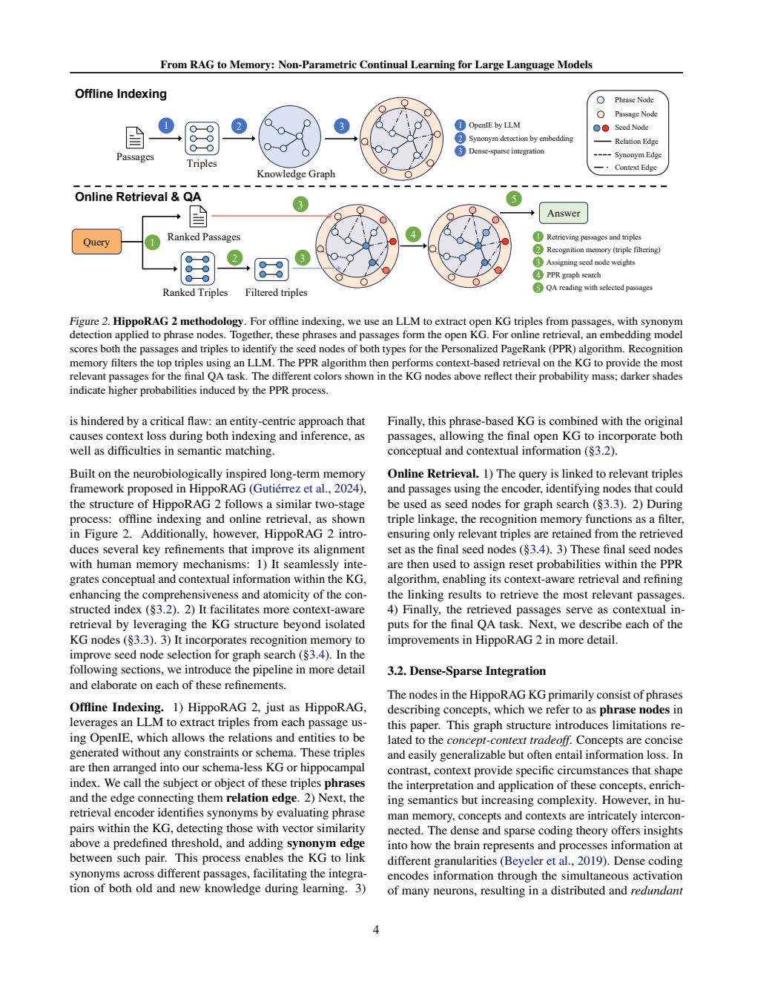

HippoRAG 2基于HippoRAG（Gutiérrez等，2024）的神经生物学记忆框架，沿用离线索引和在线检索两阶段，但有三项改进：在KG中无缝整合概念与上下文，提升索引全面性及原子性；利用超出孤立节点的图结构，实现更充分的上下文检索；加入识别记忆，改善种子选择。

离线索引：第一，以LLM OpenIE从每篇文段抽取无约束、无模式的实体关系三元组，组成无模式KG／海马索引，主语宾语称短语，其连接称关系边。第二，编码器检测短语对，若向量相似度超过阈值，则加入同义边，使不同文段中的同义概念连接，整合新旧知识。第三，将短语图与原始文段结合，使最终开放KG同时含概念与上下文。

在线检索：第一，用编码器把查询连接到相关三元组和文段，识别潜在种子。第二，识别记忆筛选三元组，只保留相关项作为最终种子。第三，种子用于设置PPR重置概率，执行上下文检索并精化匹配，得到最相关文段。第四，将文段输入最终问答。下文详述各项改进。

### 3.2 稠密与稀疏整合

HippoRAG的KG节点主要是描述概念的短语。概念简洁、易泛化，却常丢失信息；上下文提供解释和应用概念的具体条件，丰富语义但增加复杂度。人类记忆中二者紧密相连。稠密和稀疏编码理论（Beyeler等，2019）解释大脑在不同粒度表示处理信息：稠密编码同时激活多个神经元，形成分布、冗余表示；稀疏编码只激活少量神经元，提高效率与存储紧凑性。

<!-- source-page: 5 -->

受此启发，短语节点视为抽取概念的稀疏编码，文段上下文作为稠密编码引入KG。首先以嵌入模型编码文段，再在KG中整合两种编码。HippoRAG的文档集成只聚合图搜索与嵌入匹配分数；本方法则新增文段节点，实现上下文更紧密融合。离线索引基本过程不变，但建图时增加文段相关节点与边：每个语料文段为一个节点，以标记“contains”的上下文边连接该文段抽取出的全部短语。

### 3.3 更深入的上下文化

HippoRAG基于NER解析查询，以概念为中心，忽视与KG的上下文对齐，许多信号未被利用（Gutiérrez等，2024）。为使查询语义与图搜索起点更好对齐，比较三种连接方法。1 NER到节点：原方法，从查询提取实体，再以嵌入匹配图节点。2 查询到节点：不单独提实体，直接以整条查询的嵌入匹配节点。3 查询到三元组：整条查询匹配图内三元组，其包含概念间基本关系，提供更丰富上下文和查询意图。HippoRAG 2默认采用第三种，并在6.1评估全部方法。

### 3.4 识别记忆

回忆与识别是人类检索记忆的互补过程（Uner和Roediger III，2022）。回忆是无外部线索主动提取信息，识别则依靠外部刺激辨认。受此启发，将查询到三元组分两步：先用嵌入模型取前k个三元组T；再让LLM筛选T，生成T′⊆T。详细提示见附录A。

### 3.5 在线检索

在线任务是选种子并分配重置概率。首先从查询到三元组及识别记忆筛选结果中识别短语。若无三元组，直接以嵌入模型检索文段；否则最多选k个短语节点，分数为它出现在所有筛选后三元组中的排名分数均值。全部文段节点也作种子，因广泛激活更利于多跳。短语按排名分数设置重置概率；文段按嵌入相似度，并乘权重因子平衡两类节点。随后执行PPR，以文段节点PageRank排序，选前列用于问答。示例和初始化详见附录B及G.1。

## 4 实验设置
### 4.1 基线

三类基线：简单检索BM25（Robertson和Walker，1994）、Contriever（Izacard等，2022）、GTR（Ni等，2022）；BEIR榜单（Thakur等，2021）表现强的7B大嵌入模型GTE-Qwen2-7B-Instruct（Li等，2023）、GritLM-7B（Muennighoff等，2025）、NV-Embed-v2（Lee等，2025）；四种结构增强方法RAPTOR（Sarthi等，2024；语义层次结构）、GraphRAG（Edge等，2024）和LightRAG（Guo等，2024）（KG及高层摘要）、HippoRAG（Gutiérrez等，2024；KG与PPR整合，而非摘要）。

<!-- source-page: 6 -->
### 4.2 数据集

为考察事实记忆保持以及关联、意义建构能力，选择三类挑战。简单问答评估准确回忆检索事实；多跳问答要求连接多条信息，评估关联；话语理解要求解释和推理复杂长叙事，评估意义建构。

简单问答：这类常见任务主要围绕单一实体提问，因此特别适合嵌入模型直接检索相关上下文。从NaturalQuestions（NQ；Wang等，2024收集）随机取1000条，涉及真实用户的广泛主题；PopQA（Mallen等，2023）取1000条，语料为2021年12月维基百科。两者提供直接问答，适合单跳评估。PopQA尤其以实体为中心，实体比NQ更低频，适于评估实体识别和检索。

多跳问答：遵循HippoRAG（Gutiérrez等，2024），从MuSiQue、2WikiMultihopQA和HotpotQA各随机1000条。另纳入LV-Eval（Yuan等，2024）的hotpotwikiqa-mixup 256k全部124条，其通过关键词和短语替换减少知识泄漏与过拟合，因而比维基百科数据更适合评估跨来源综合知识。把其长上下文切为短文段，维持相同RAG设置。

话语理解：NarrativeQA要求整体理解长篇小说，适合意义建构评估。随机选10篇长文及对应293条问题，按LV-Eval方式组织语料。

表1 数据集统计，列顺序NQ、PopQA、MuSiQue、2Wiki、HotpotQA、LV-Eval、NarrativeQA。查询数为1000、1000、1000、1000、1000、124、293；文段数为9633、8676、11656、6119、9811、22849、4111。

### 4.3 指标

遵循HippoRAG（Gutiérrez等，2024），以文段recall@5评价检索；遵循MuSiQue（Trivedi等，2022）指标计算基于token的F1评价问答。

### 4.4 实现

以开源Llama-3.3-70B-Instruct（AI@Meta，2024）完成NER/OpenIE抽取和三元组筛选，NV-Embed-v2作检索器；结构增强基线也用相同抽取器和检索器复现以公平比较。筛选提示通过DSPy（Khattab等，2024）MIPROv2和Llama优化指令与示例，见附录A。筛选检索器前5个三元组；问答以检索前5篇文段为上下文，由GPT-4o-mini或Llama-3.3-70B-Instruct回答。其余超参数遵循HippoRAG默认，详见附录G。

## 5 结果

下文给出以检索结果为上下文的主要问答和检索实验。更多结果见附录C，图统计见附录D（原文此处写A，按实际附录位置注明）。

<!-- source-page: 7 -->

表2 RAG基准问答F1，阅读器为Llama-3.3-70B-Instruct。无检索测试阅读器参数知识。所有结构增强基线及HippoRAG 2用该LLM建结构、NV-Embed-v2检索。原表标最佳与次佳；自助法显著性检验中，†代表优于NV-Embed-v2，p<0.05。列为简单QA的NQ、PopQA，多跳QA的MuSiQue、2Wiki、HotpotQA、LV-Eval，以及话语理解NarrativeQA与平均值。

|方法|NQ|PopQA|MuSiQue|2Wiki|HotpotQA|LV-Eval|NarrativeQA|平均|
|---|---:|---:|---:|---:|---:|---:|---:|---:|
|无检索|54.9|32.5|26.1|42.8|47.3|6.0|12.9|38.4|
|Contriever（Izacard等，2022）|58.9|53.1|31.3|41.9|62.3|8.1|19.7|46.9|
|BM25（Robertson和Walker，1994）|59.0|49.9|28.8|51.2|63.4|5.9|18.3|47.7|
|GTR（Ni等，2022）|59.9|56.2|34.6|52.8|62.8|7.1|19.9|50.4|
|GTE-Qwen2（Li等，2023）|62.0|56.3|40.9|60.0|71.0|7.1|21.3|54.9|
|GritLM（Muennighoff等，2025）|61.3|55.8|44.8|60.6|73.3|9.8|23.9|56.1|
|NV-Embed-v2（Lee等，2025）|61.9|55.7|45.7|61.5|75.3|9.8|25.7|57.0|
|RAPTOR（Sarthi等，2024）|50.7|56.2|28.9|52.1|69.5|5.0|21.4|48.8|
|GraphRAG（Edge等，2024）|46.9|48.1|38.5|58.6|68.6|11.2|23.0|49.6|
|LightRAG（Guo等，2024）|16.6|2.4|1.6|11.6|2.4|1.0|3.7|6.6|
|HippoRAG（Gutiérrez等，2024）|55.3|55.9|35.1|71.8|63.5|8.4|16.3|53.1|
|HippoRAG 2|63.3†|56.2|48.6†|71.0†|75.5|12.9†|25.9|59.8|

表3 检索文段recall@5；*为原论文报告，其他结构增强方法用对齐LLM和检索器复现；GraphRAG和LightRAG不直接输出文段检索结果，因此不列。表中NQ、PopQA、MuSiQue、2Wiki、HotpotQA与平均分别如下：

|方法|NQ|PopQA|MuSiQue|2Wiki|HotpotQA|平均|
|---|---:|---:|---:|---:|---:|---:|
|BM25（Robertson和Walker，1994）|56.1|35.7|43.5|65.3|74.8|55.1|
|Contriever（Izacard等，2022）|54.6|43.2|46.6|57.5|75.3|55.4|
|GTR（Ni等，2022）|63.4|49.4|49.1|67.9|73.9|60.7|
|GTE-Qwen2（Li等，2023）|74.3|50.6|63.6|74.8|89.1|70.5|
|GritLM（Muennighoff等，2025）|76.6|50.1|65.9|76.0|92.4|72.2|
|NV-Embed-v2（Lee等，2025）|75.4|51.0|69.7|76.5|94.5|73.4|
|RAPTOR（Sarthi等，2024）|68.3|48.7|57.8|66.2|86.9|65.6|
|HippoRAG原报告*（Gutiérrez等，2024）|—|—|51.9|89.1|77.7|—|
|HippoRAG复现|44.4|53.8|53.2|90.4|77.3|63.8|
|HippoRAG 2|78.0|51.7|74.7|90.4|96.3|78.2|

问答方面，表2以Llama-3.3-70B-Instruct为问答阅读器，HippoRAG 2平均F1最高，跨设置稳健。大型嵌入模型优于小模型，例如NV-Embed-v2平均比GTR高6.6%；它们成本更低且超过结构增强基线，但主要擅长简单问答，复杂任务仍有困难。HippoRAG 2在2Wiki比NV-Embed-v2高9.5点、LV-Eval高3.1点；相比HippoRAG改善更大，支持神经心理学启发设计的有效性。这些结果表明，HippoRAG 2是一套先进RAG系统，能够由开源模型有效驱动，同时提高检索与问答性能。附录表8含使用Llama或GPT-4o-mini抽取、筛选及阅读的EM/F1。GPT-4o-mini趋势相同，NV-Embed-v2大多强于结构增强方法，除HippoRAG的多跳情况；HippoRAG 2几乎所有设置稳定领先。

<!-- source-page: 8 -->

各方法token、时间、内存分析见附录F。检索方面，表3只报告拥有支持文段标注的数据集，以及显式检索文段的模型结果。大型7B嵌入模型明显强于Contriever和GTR。原文称“至少高9.8% F1”，但该段对应表3为recall@5，译文保留并指出指标名称不一致。用Llama和NV-Embed-v2复现HippoRAG仅略改善（原文记1.3% F1）；它在实体中心PopQA召回最高，但总体弱于新稠密检索器及HippoRAG 2。后者多数数据集最高，MuSiQue、2Wiki相较NV-Embed-v2的recall@5分别高5.0和13.9点。

## 6 讨论
### 6.1 消融研究

对连接方法、图构建和三元组筛选做消融（表4），每项机制均有帮助。更深上下文化显著提高性能。NER到节点、查询到节点均不筛选；无论筛选与否，查询到三元组都更好，平均recall@5相比NER到节点高12.5点。查询到节点不优于NER到节点，因查询与图节点粒度不同，而NER结果及图节点都属短语粒度。

表4 多跳文段recall@5。

|设计|MuSiQue|2Wiki|HotpotQA|平均|
|---|---:|---:|---:|---:|
|HippoRAG 2|74.7|90.4|96.3|87.1|
|NER到节点|53.8|91.2|78.8|74.6|
|查询到节点|44.9|65.5|68.3|59.6|
|无文段节点|63.7|90.3|88.9|81.0|
|无筛选|73.0|90.7|95.4|86.4|

### 6.2 重置概率控制

运行PPR前，需平衡短语与文段节点重置概率。给全部文段节点分数乘权重因子。表5在各1000查询的MuSiQue、NQ验证集显示该因子很重要。综合不同情景，默认0.05。

|权重|0.01|0.05|0.1|0.3|0.5|
|---|---:|---:|---:|---:|---:|
|MuSiQue|79.9|80.5|79.8|78.4|77.9|
|NQ|75.6|76.9|76.9|76.7|76.4|

### 6.3 语料扩张稳健性

真实RAG须适应语料持续增长。将NQ、MuSiQue各等分四段，每段含约250题金标准和干扰文档。固定一段评估，逐步加入其余三段，模拟持续学习。图3给HippoRAG 2与NV-Embed-v2的F1；横轴总文档百分比，纵轴F1。实线为NQ简单记忆，虚线为MuSiQue关联记忆。

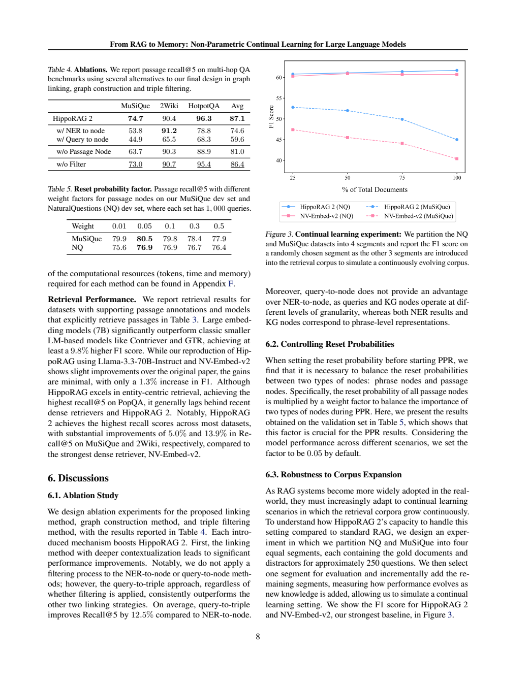

<!-- source-page: 9 -->

图3中，HippoRAG 2对NV-Embed-v2的优势在两种持续学习设置均稳定。随着知识增加，两者在简单任务保持较强性能，复杂关联任务则以相似速度下降。这说明未来持续学习基准应涵盖不同任务复杂度。

### 6.4 稠密检索器灵活性

表7表明不同检索器下本方法均优于直接稠密检索，提升稳健。MuSiQue子集recall@5：GTE-Qwen2为63.6→68.8，GritLM为66.0→71.6，NV-Embed-v2为69.7→74.7。

### 6.5 定性分析

表6给PopQA和MuSiQue示例，粗体原表项为支持文段标题。简单问答“I.P. Paul出生于哪个城市？”中，NV把I.P. Paul排第一，已足够回答；HippoRAG 2在三元组连接时直接发现Thrissur，并在随后图搜索把该实体对应文段排第二，作者称之为“完美的检索结果”。NV前三为I.P. Paul、Yinka Ayefele—Early life（早年生活）、Paul Parker(singer，歌手)；本方法筛选(I.P. Paul，来自，Thrissur)、(I.P. Paul，曾任其市长，Thrissur municipal corporation特里苏尔市政机构)，前三文段为I.P. Paul、Thrissur、Yinka Ayefele。

多跳问题“Erik Hort出生地属于哪个县？”中，NV也找到Erik Hort，但两步推理还需出生地信息。其前三为Erik Hort、Horton Park(Saint Paul,Minnesota)、Hertfordshire；本方法筛选(Erik Hort，出生于，Montebello)、(Erik Hort，出生于，New York)，图搜索前三为Erik Hort、Horton Park、Monstebello,New York（原表6拼写；正文及图5作Montebello）。在查询到三元组阶段检索到的Montebello文段含暗示答案的地理信息，随后图搜索也将其排在前列。更多错误分析见附录E。

## 7 结论

HippoRAG 2旨在弥补现有RAG模拟人类长期记忆动态互联性质的不足，结合PPR、更深文段整合、LLM有效在线使用，在事实、意义建构和关联记忆中全面改善标准RAG，展示既有方法忽视或未能在全面评估中实现的能力。未来可用图检索进一步增强长对话中的情景记忆。

## 影响声明

本文推进LLM长期记忆领域的RAG研究。可能有多种社会影响，但未发现超出LLM与信息检索一般问题之外、需要特别强调的顾虑。

## 致谢

感谢OSU NLP组同事建设性意见。研究部分受ARL W911NF2220144、NSF 2112606及Cisco赠款支持，感谢Ohio Supercomputer Center提供算力。

<!-- source-page: 10 -->

本文观点和结论属于作者，不应视为美国政府明示或暗示的官方政策。无论本文版权声明如何，美国政府有权为政府目的复制和分发重印本。

## 参考文献

以下三页保留英文原文，不翻译。

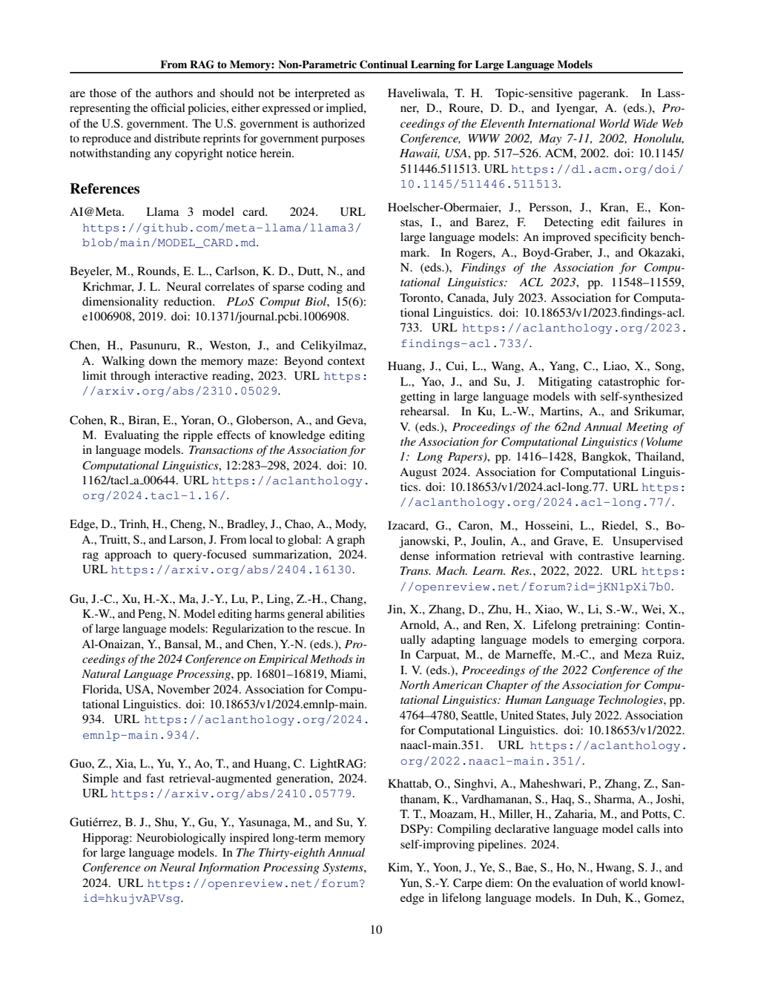

<!-- source-page: 11 -->
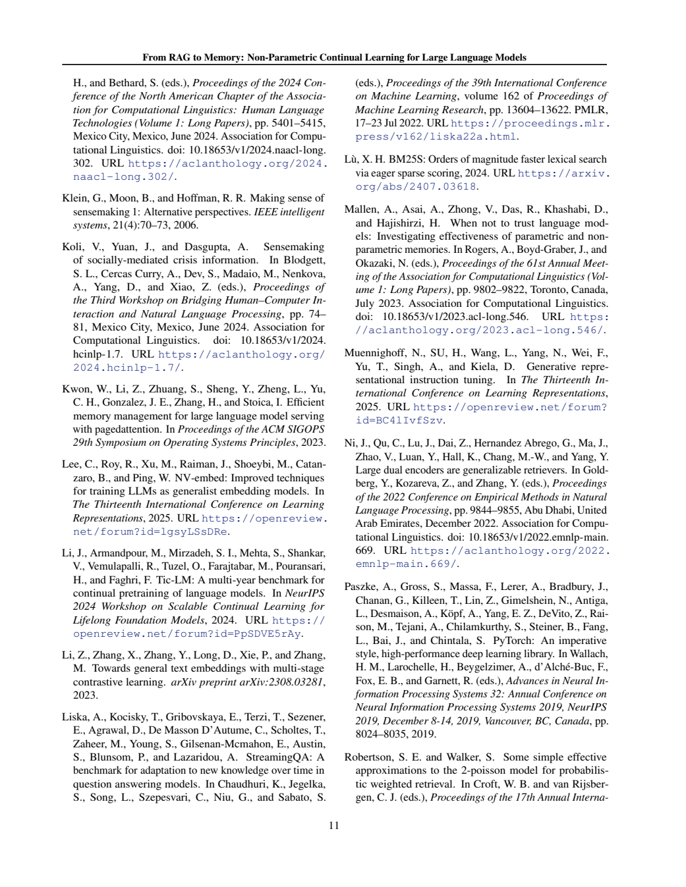

<!-- source-page: 12 -->
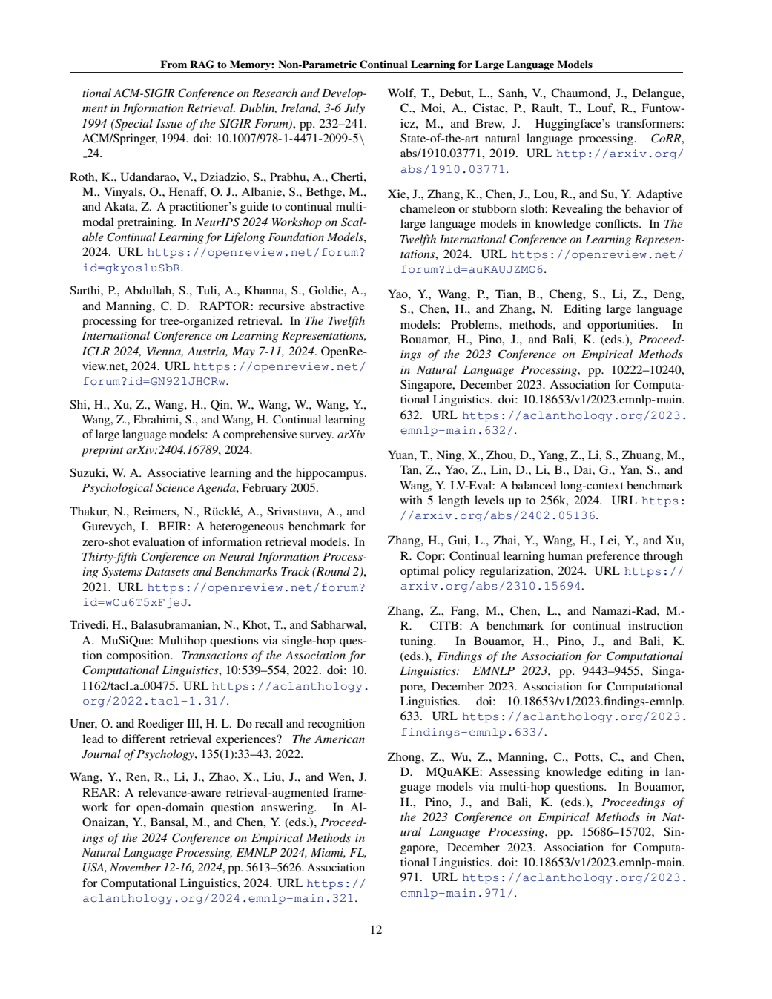

<!-- source-page: 13 -->
## 附录

补充材料包含：A LLM提示；B HippoRAG 2流程示例；C详细实验结果；D图统计；E错误分析；F成本和效率；G实现细节与超参数。

### A LLM提示

图4给出三元组筛选提示，包括指令、少样本示例及输入格式，见下一页完整译文。

### B 流程示例

图5展示在线检索的查询到三元组、三元组筛选，以及种子节点用于PPR的过程。

### C 详细实验结果

表8、表9给闭源GPT-4o-mini结果及更多指标。以GPT-4o-mini索引与阅读时，HippoRAG 2在多数数据上EM和F1均有竞争力，特别在MuSiQue、2Wiki领先，在NarrativeQA、LV-Eval也更好。与强NV-Embed-v2相比，F1相当或更高，尤其在知识泄漏较少的LV-Eval突出。recall@2改善趋势与recall@5相同。

### D 图统计

表10给Llama-3.3-70B-Instruct、GPT-4o-mini用于OpenIE的KG统计。

### E 错误分析

分析HippoRAG 2的100个recall@5<1.0样本，其中二跳、三跳、四跳问题分别26%、41%、33%。三元组筛选和图搜索为主要错误源。

识别记忆：筛选前，7%样本在查询到三元组取得的短语中，没有任何短语与支持文档匹配；筛选后该比例为26%。8%样本筛选后，与支持文段匹配的短语比例下降。表11第一例筛选为空，删除所有相关短语。另外18%样本筛选后零三元组；这未必为筛选错误，却表明三元组连接失败，系统直接回退稠密检索。总体上，识别记忆虽重要，筛选精度仍有提升空间。

<!-- source-page: 14 -->
### 图4 三元组筛选 识别记忆提示

**指令：**

你是全球顶尖研究者和决策者使用的一套高风险问答系统的关键组件。你的任务是根据事实与给定查询的相关性筛选事实，确保向这些利益相关方呈现最关键的信息。查询需要仔细分析，也可能需要通过多跳推理连接不同信息。

你必须从提供的候选列表选择至多4条与查询有强关联的相关事实，以辅助推理并提供准确答案。

输出应为JSON格式，例如 {"fact": [["s1", "p1", "o1"], ["s2", "p2", "o2"]]}。如无相关事实，则返回空列表 {"fact": []}。

你的回答准确性至关重要，将直接影响这些高层利益相关方的决策。只能使用候选列表中的事实，不得生成新事实。关键决策的未来取决于你准确筛选和呈现相关信息的能力。

**示例1**

问题：Imperial River（佛罗里达）和Amaradia（Dolj）是否位于同一国家？

筛选前事实：{"fact": [["imperial river","位于","florida"],["imperial river","是一条河流，所在国为","united states"],["imperial river","可能指","south america"],["amaradia","流经","roiade amaradia"],["imperial river","可能指","united states"]]}

筛选后事实：{"fact": [["imperial river","位于","florida"],["imperial river","是一条河流，所在国为","united states"],["amaradia","流经","roiade amaradia"]]}

**示例2**

问题：电影The Ancestor的导演生日是哪一天？

筛选前事实：{"fact": [["jean jacques annaud","出生于","1943年10月1日"],["tsui hark","出生于","1950年2月15日"],["pablo trapero","出生于","1971年10月4日"],["the ancestor","导演为","guido brignone"],["benh zeitlin","出生于","1982年10月14日"]]}

筛选后事实：{"fact": [["the ancestor","导演为","guido brignone"]]}

**示例3**

问题：Teafuone所在的国家属于哪个地理区域？

筛选前事实：{"fact": [["teafuaniua","位于…侧","东"],["motuloa","位于两者之间，其中之一为","teafuaniua"],["motuloa","位于两者之间，其中之一为","teafuanonu"],["teafuone","是","小岛"],["teafuone","位于","nukufetau"]]}

筛选后事实：{"fact": [["teafuone","是","小岛"],["teafuone","位于","nukufetau"]]}

**示例4**

问题：电影S.O.B.的导演何时去世？

筛选前事实：{"fact": [["allan dwan","逝世于","1981年12月28日"],["s o b","编剧及导演为","blake edwards"],["robert aldrich","逝世于","1983年12月5日"],["robert siodmak","逝世于","1973年3月10日"],["bernardo bertolucci","逝世于","2018年11月26日"]]}

筛选后事实：{"fact": [["s o b","编剧及导演为","blake edwards"]]}

**示例5**

问题：Gloria（1980年电影）和A New Life的导演是否来自同一国家？

筛选前事实：{"fact": [["sebastin lelio watt","因执导而获得赞誉","gloria"],["gloria","是","1980年美国惊悚犯罪剧情片"],["a brand new life","导演为","ounie lecomte"],["gloria","编剧及导演为","john cassavetes"],["a new life","导演为","alan alda"]]}

筛选后事实：{"fact": [["gloria","是","1980年美国惊悚犯罪剧情片"],["gloria","编剧及导演为","john cassavetes"],["a new life","导演为","alan alda"]]}

**示例6**

问题：The Old Guard（1960年电影）的导演逝世日期是哪一天？

筛选前事实：{"fact": [["the old guard","是","1960年法国喜剧片"],["gilles grangier","执导","the old guard"],["the old guard","导演为","gilles grangier"],["the old fritz","导演为","gerhard lamprecht"],["oswald albert mitchell","执导","Old Mother Riley系列电影"]]}

筛选后事实：{"fact": [["the old guard","是","1960年法国喜剧片"],["gilles grangier","执导","the old guard"],["the old guard","导演为","gilles grangier"]]}

**示例7**

问题：电影Aulad（1968年）的作曲家生日是哪一天？

筛选前事实：{"fact": [["aulad","配乐作曲为","chitragupta shrivastava"],["aadmi sadak ka","配乐为","ravi"],["ravi shankar sharma","为以下作品作曲","印地语电影"],["gulzar","出生于","1934年8月18日"],["aulad","是一部","1968年印地语剧情片"]]}

筛选后事实：{"fact": [["aulad","配乐作曲为","chitragupta shrivastava"],["aulad","是一部","1968年印地语剧情片"]]}

输入：问题：{}；筛选前事实：{}；筛选后事实：{}。

译注：为保持提示可复现，原始英文JSON及引号格式见原图；中文示例翻译关系和问题，实体标识与原始文字保留，原例中的类型和方位等自然语言值也已在JSON译为中文，其英文对应为：islet小岛，east东部，1980 american thriller crime drama film为1980年美国惊悚犯罪剧情片，1960 french comedy film为1960年法国喜剧片，hindi films为印地语电影，1968 hindi language drama film为1968年印地语剧情片。

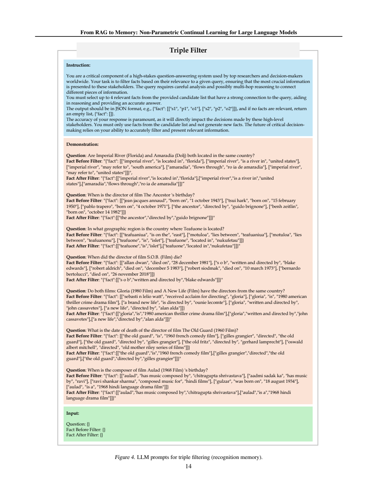

<!-- source-page: 15 -->
### 图5 HippoRAG 2流程示例

查询到三元组：问题为“Erik Hort出生地属于哪个县？”检索三元组为(Erik Hort，出生于，Montebello)、(Erik Hort，出生于，New York)、(Erik Hort，是，American美国人)、(Erik Hort，出生日期，1987年2月16日)、(Erik Hort，是，Soccer player足球运动员)。筛选后保留前两条。

PPR种子短语节点：(Montebello,1.0)、(Erik Hort,0.995)、(New York,0.989)。种子文段节点标题及权重：(Erik Hort,0.05)、(Horton Park (Saint Paul, Minnesota),0.031)、(Hertfordshire,0.028)，等等。

返回前列文段（原图高亮PPR排名最高节点与最终答案）：

1 Erik Hort。Erik Hort于1987年2月16日出生在纽约州Montebello，是美国足球运动员，目前为自由球员。

2 Horton Park（明尼苏达州圣保罗）。Horton Park是美国明尼苏达州圣保罗的一座小型树木园，以树种丰富著称，已成为Saint Paul Midway社区的象征。

3 Montebello, New York。Montebello在意大利语中意为“美丽的山”，是美国纽约州Rockland County（罗克兰县）Ramapo镇内的建制村，位于Suffern以北、Hillburn以东、Wesley Hills以南、Airmont以西。2010年人口普查为4526人。罗克兰县为本题答案。

4 Hertfordshire。赫特福德郡紧邻伦敦以北，属于主要为统计单位的英格兰东部区域。各区相当一部分居民通勤至伦敦城。东邻Essex，西邻Buckinghamshire，北邻Bedfordshire和Cambridgeshire。

5 Hull County, Quebec。加拿大魁北克的历史郡，以英格兰东约克郡同名城镇Hull或Kingston-upon-Hull命名；位于渥太华河北岸，属Outaouais，即魁北克约12个历史区域之一。

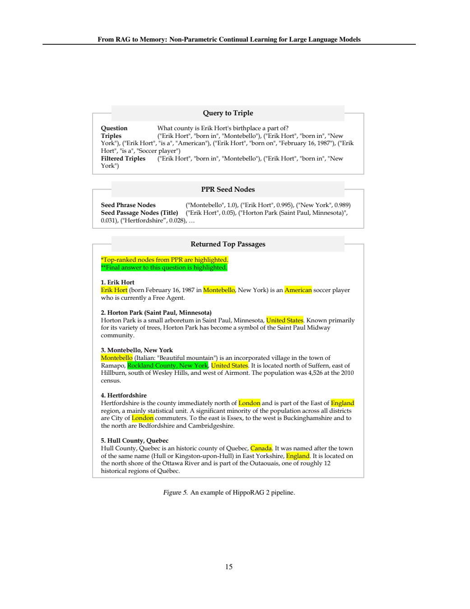

<!-- source-page: 16 -->

### 表8 RAG基准问答EM与F1

无检索表示测量阅读器参数知识。HippoRAG及HippoRAG 2使用对应LLM进行OpenIE、三元组筛选和问答阅读。各数据单元为EM/F1，列为NQ、PopQA、MuSiQue、2Wiki、HotpotQA、LV-Eval、NarrativeQA、平均。上半为Llama-3.3-70B-Instruct，下半为GPT-4o-mini；所有原始数据完整保留于表8影印件。None=无检索，Simple QA=简单问答，Multi-Hop QA=多跳问答，Discourse Understanding=话语理解，Retrieval=检索方法，Avg=平均。

图构建：构图较难评价，但仅2%错误样本在链接节点一跳邻域内不包含任何支持文段的短语。考虑稠密稀疏整合，我们可以假设所构图通常包含大部分可利用信息。

PPR：50%错误样本中，至少一半已连接短语出现在支持文档，却因图搜索未取得满意结果。原文用表11第二例说明：识别记忆找到关键短语“Philippe, Duke of Orléans”，图搜索却未在前5文段返回完整结果。译注：表11实际第二例三元组涉及Bank of America，与此叙述不符，保留该源文问题。

### F 成本与效率

LLM部署使用四张NVIDIA H100，以vLLM（Kwon等，2023）张量并行运行Llama-3.3-70B-Instruct。在MuSiQue约1.1万文档上索引与问答，记录token、索引时间、每查询时间和GPU内存，并比较NV-Embed-v2（Lee等，2025）、RAPTOR（Sarthi等，2024）、LightRAG（Guo等，2024）、HippoRAG（Gutiérrez等，2024）、GraphRAG（Edge等，2024）（表12）。模型权重内存为各系统共用，故不计。

HippoRAG 2不仅问答和检索更强，相比LightRAG、GraphRAG也使用更少token、明显更快；相比RAPTOR、HippoRAG略慢。事实嵌入增加内存，但考虑性能收益，作者认为可接受。全部结构方法时间和内存效率都不如标准RAG，而HippoRAG 2是唯一显著超过这一强基线的方法。

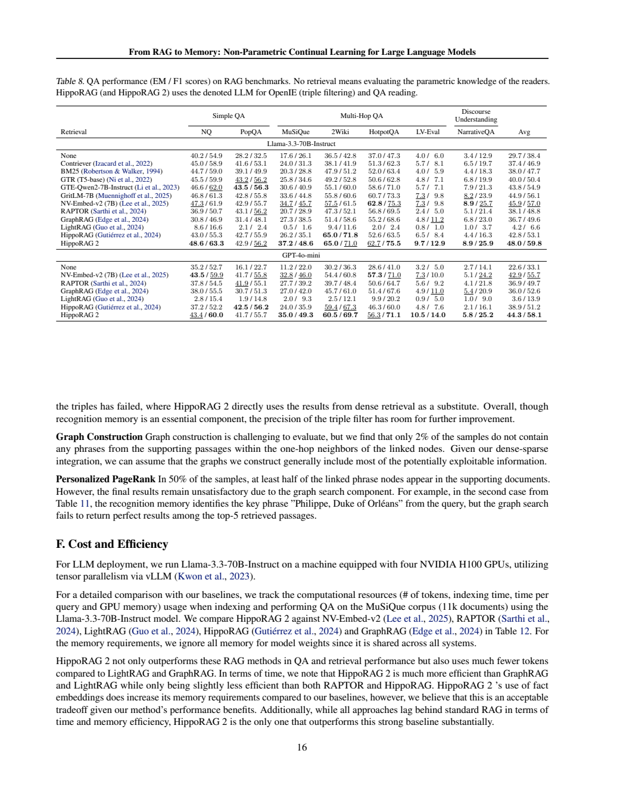

<!-- source-page: 17 -->
### 表9 文段recall@2与recall@5

每个单元为@2/@5；*为原论文报告，复现HippoRAG时对齐LLM和检索器。列为NQ、PopQA、MuSiQue、2Wiki、HotpotQA、平均；行组为简单基线、大嵌入模型、结构增强RAG。数据保留原表影印件；Simple/Multi-hop为简单／多跳。GPT-4o-mini与Llama-3.3-70B-Instruct标出各结构方法使用的LLM。

### G 实现细节和超参数
#### G.1 HippoRAG 2

本节详述PPR初始化，目标是确定种子并赋合适重置概率，保证检索有效。

种子选择分短语与文段两类。以下嵌入分数均通过归一化嵌入计算。短语节点来自识别记忆筛选后三元组；若返回空列表、无短语可用，直接以嵌入模型返回前列文段，不做图搜索。否则最多保留5个短语种子，其排名分数为包含该短语的所有筛选三元组分数平均。文段节点先按嵌入相似度计分，全部作为种子，因为比只激活排名靠前文段更广泛地激活，能更有效发现多跳链上的文段。

重置概率：确定种子后，控制PPR随机游走返回各节点的概率。短语直接用排名分数；文段用与嵌入相似度成比例的分数，并乘6.2讨论的权重因子，平衡两类节点对检索的贡献。

PPR执行与文段排序：初始化后在构图上运行PPR，按文段节点最终PageRank排序，前列文段供下游阅读器。使用python-igraph管理KG和运行PPR：https://python.igraph.org/en/stable/。同时用两类节点初始化，可改善相关文段检索，尤其多跳任务。

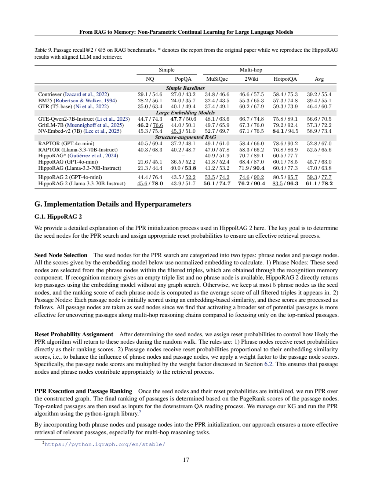

<!-- source-page: 18 -->
### 表10 不同OpenIE模型构建图统计

节点与三元组按唯一值计数。列为NQ、PopQA、MuSiQue、2Wiki、HotpotQA、LV-Eval、NarrativeQA；两组分别Llama-3.3-70B-Instruct与GPT-4o-mini。行依次为短语节点数、文段节点数、总节点数、抽取边数、同义边数、上下文边数、总边数。全部数值保留原表，不因个别加总疑点修改。译注：GPT-4o-mini的PopQA“总边数”原值为494,082，但该列三类边数108,989、901,528、127,568之和为1,138,085；原文未解释这一差异，本译稿保留原值。

### 表11 MuSiQue中recall@5小于1的两个示例

示例1。问题：“那位想改革并处理Bernhard Lichtenberg所属宗教的人，去世前曾在某区讲道谈论圣母敬礼，该区位于何处？”答案：Saxony-Anhalt（萨克森—安哈尔特）。支持文段标题：Mary, mother of Jesus（耶稣之母玛利亚）、Reformation（宗教改革）、Wittenberg(district)（维滕贝格区）、Bernhard Lichtenberg。检索标题：Bernhard Lichtenberg、Mary, mother of Jesus、Ambroise-Marie Carré、Reformation、Henry Scott Holland；recall@5=0.75。查询到三元组前5项为(Bernhard Lichtenberg，是，Roman Catholic Priest罗马天主教神父)、(Bernhard Lichtenberg，由其册封为真福，Catholic Church天主教会)、(Bernhard Lichtenberg，逝世于，1943年11月5日)、(Catholic Church，册封为真福者，Bernhard Lichtenberg)、(Bernhard Lichtenberg，是，Theologian神学家)。以上主宾均出现在支持文段；筛选后为空。

示例2。问题：“奥尔良公爵Philippe的祖母是谁？”答案Marie de’ Medici（玛丽·德·美第奇）。支持文段为Philippe I,Duke of Orléans和Leonora Dori。检索为Philippe I,Duke of Orléans、Louise Élisabeth d’Orléans、Philip III of Spain、Anna of Lorraine、Louis Philippe I；recall@5=0.5。原表的查询到三元组前5项却为(Bank of America，购买，Fleetboston Financial)、(Fleetboston Financial，收购方为，Bank of America)、(Bank of America，收购，Fleetboston Financial)、(Bank of America，宣布购买，Fleetboston Financial)、(Bank of America，合并对象，Fleetboston Financial)。原表称这些主宾均出现在支持文段；筛选后保留前两条，仍声称均出现在支持文段。译注：其与问题明显不符，属原表疑点，不据此推断算法行为。

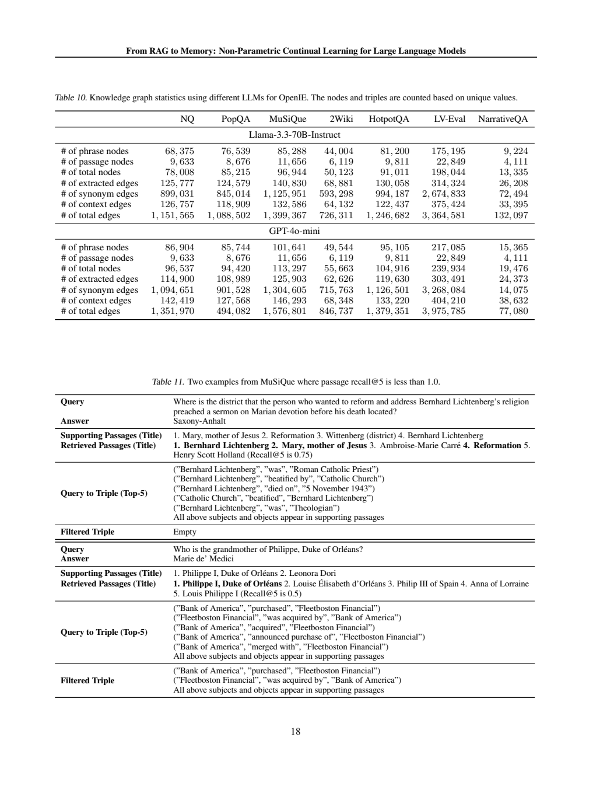

<!-- source-page: 19 -->
### 表12 计算资源

在MuSiQue 11656文段上比较索引token、索引分钟、每查询问答秒数、问答GPU内存GB；括号为相对HippoRAG 2的比例（其为100%）。Input/Output Tokens为输入／输出token，Indexing Time为索引时间，QA Time/Query为每查询问答时间，QA GPU Memory为问答GPU内存。完整原表保留于影印件。译注：LightRAG每查询13.3秒旁原比例为1008.3%，与HippoRAG 2的1.2秒直接相除不一致；其他个别舍入／比例也按原表保留，未重算覆盖。

|资源|NV-Embed-v2（Lee等，2025）|RAPTOR（Sarthi等，2024）|LightRAG（Guo等，2024）|GraphRAG（Edge等，2024）|HippoRAG（Gutiérrez等，2024）|HippoRAG 2|
|---|---:|---:|---:|---:|---:|---:|
|输入token|—|1.7M|68.5M|115.5M|9.2M|9.2M|
|输出token|—|0.2M|18.3M|36.1M|3.0M|3.0M|
|索引分钟|12.1|100.5|235.0|277.0|57.5|99.5|
|每查询秒|0.3|0.6|13.3|10.7|0.9|1.2|
|问答GPU GB|1.7|1.4|4.5|3.7|6.0|9.9|

超参数在MuSiQue训练数据100例上调优。表13为同义阈值0.8，PPR阻尼因子0.5，温度0.0。

#### G.2 比较方法

稠密检索使用PyTorch（Paszke等，2019）和HuggingFace（Wolf等，2019），BM25使用BM25s（Lù，2024）。GraphRAG（Edge等，2024）与LightRAG（Guo等，2024）遵循默认超参数和提示。为保证一致评估，使用HippoRAG 2从HippoRAG（Gutiérrez等，2024）继承的同一QA提示，对这两者原始回答重新表述。索引超参数保留默认；问答在与G.1相同100例上调参。

表14 GraphRAG与LightRAG超参数。两者均为Local（局部）模式，回答类型Short phrase（短语），问答前k短语60，文本块1200 token、重叠100 token。GraphRAG社区报告最大长度2000、最大输入8000、最大簇大小10；LightRAG无这些参数，实体摘要最大500 token，而GraphRAG无该参数。

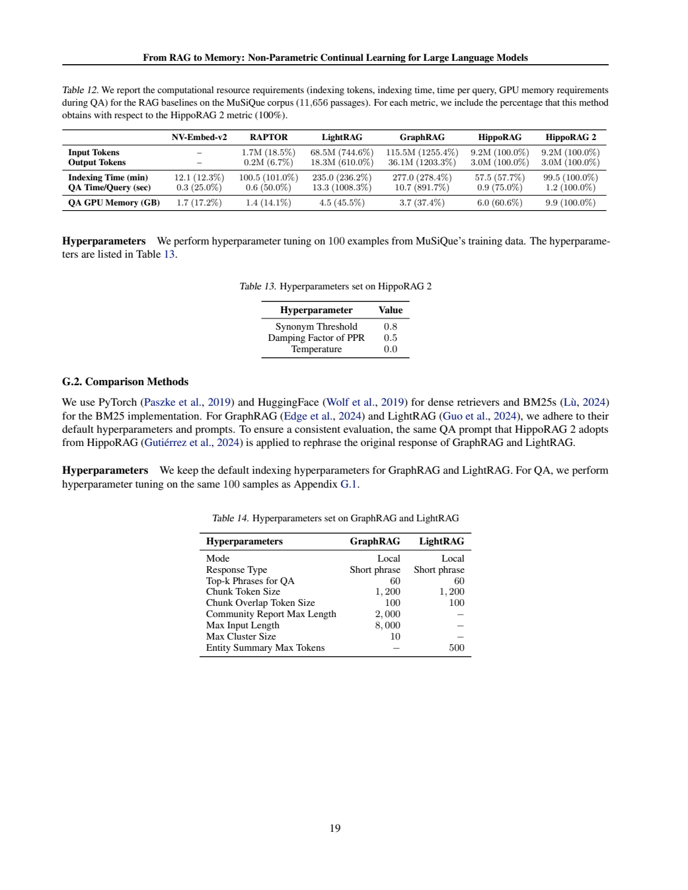
